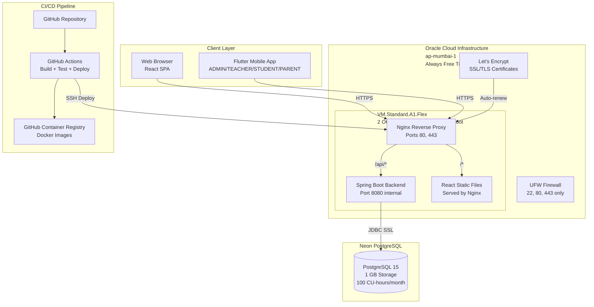

# GMS — Architecture and Decisions (Canonical)

**Date:** 2026-11-03  
**Status:** NO-GO — NOT APPROVED FOR PROVISIONING OR PRODUCTION DEPLOYMENT  
**Author:** Principal Software Architect, Senior DevOps Engineer, Cloud Architect  
**Repository:** GMS (test/playwright-e2e branch)  
**Purpose:** Single authoritative source of truth for production architecture, decisions, and cost model. Supersedes all prior Stage J documents.

---

## Document Status

**OVERALL STATUS: NO-GO — PRODUCTION BLOCKERS REMAIN**

This document describes the **PROPOSED** production architecture. Critical components remain unimplemented and unverified:

- **Flyway migration procedure:** PROPOSED — NOT YET TESTED
- **CI/CD deployment workflow:** PROPOSED — GitHub Action SHAs NOT VERIFIED
- **JWT authentication:** BLOCKED — localStorage must migrate to HttpOnly cookies
- **TLS/HTTPS:** BLOCKED — Requires domain purchase (MANDATORY for production)
- **OCI infrastructure:** UNKNOWN — Requires owner verification of Always Free eligibility
- **Neon database:** UNKNOWN — Requires owner to create project and provide connection string
- **Backup/restore:** PROPOSED — NOT YET TESTED
- **Flutter mobile app:** NOT IMPLEMENTED — Only React web app exists

---

## Executive Summary

This document defines the **production architecture** for GMS, a multi-tenant School Management SaaS platform. The architecture is built on **Oracle Cloud Infrastructure (OCI) Always Free** tier with **Neon PostgreSQL** (owner-controlled, initially free tier), targeting **₹0 initial infrastructure cost**.

**Key Architecture Decisions:**
- **Hosting:** Single OCI ARM instance (VM.Standard.A1.Flex, 2 OCPUs, 12 GB RAM, 100 GB boot)
- **Database:** Neon PostgreSQL (1 GB storage free, 100 CU-hours/month compute)
- **Frontend:** Self-hosted on OCI instance via Nginx (NOT Vercel — Hobby plan prohibits commercial SaaS)
- **Mobile:** Flutter application (native, NOT PWA)
- **Containerization:** Docker + Docker Compose
- **Reverse Proxy:** Nginx with Let's Encrypt SSL/TLS
- **CI/CD:** GitHub Actions with automated deployment

**Target Scale:** 2,000 students (pilot phase)  
**Availability Target:** 99.5% uptime  
**Recovery Point Objective (RPO):** < 24 hours  
**Recovery Time Objective (RTO):** < 4 hours (UNVERIFIED — requires timed restore drill)

---

## 1. Architecture Principles

### 1.1 Design Constraints

1. **₹0 initial budget** — No paid services without explicit owner approval
2. **Oracle Always Free** — Primary hosting platform
3. **No PWA** — Flutter for mobile, web frontend only for SUPERADMIN
4. **Modular monolith** — No microservices, no Kubernetes
5. **Solo operator** — Single developer maintains production
6. **Pilot scale** — 2,000 students, not enterprise scale
7. **HTTPS mandatory** — Production deployment is BLOCKED without a domain and valid TLS certificate

### 1.2 Non-Functional Requirements

| Requirement | Target | Rationale |
|------------|--------|-----------|
| Uptime | 99.5% | Pilot phase, manual recovery acceptable |
| Response time (API) | < 1s | Acceptable for school management workflows |
| Response time (web) | < 3s | Static assets via Nginx, CDN not required at pilot scale |
| Concurrent users | 500 | 2,000 students, ~25% concurrent at peak |
| Data retention | 7 years | Compliance with education record requirements |
| Backup frequency | Daily | RPO < 24 hours |
| Recovery time | < 4 hours | Manual restore from backups acceptable (UNVERIFIED) |

---

## 2. Component Architecture

### 2.1 High-Level Architecture Diagram



### 2.2 Component Responsibilities

---

### 2.3 Nginx Reverse Proxy

**Location:** OCI instance, port 80/443  
**Repository Reference:** `gms_frontend/nginx.conf` (requires production adaptation)

**Responsibilities:**
- Terminate TLS (Let's Encrypt certificates)
- Serve React static files from `/opt/gms/frontend/dist`
- Reverse proxy `/api/*` to Spring Boot backend (port 8080)
- Enforce HTTPS redirect (HTTP 80 → HTTPS 443)
- Add security headers (HSTS, X-Frame-Options, X-Content-Type-Options)
- Gzip compression for static assets
- SPA routing (`try_files $uri $uri/ /index.html`)

**TLS Bootstrap Sequence:**

The configuration below assumes TLS certificates have been obtained. The correct bootstrap sequence is:

1. **Phase 1: HTTP-only bootstrap** — Start with HTTP-only configuration to verify domain ownership and certificate challenge prerequisites
2. **Phase 2: Certificate issuance** — Obtain Let's Encrypt certificate via Certbot
3. **Phase 3: HTTPS enablement** — Enable HTTPS virtual host and certificate references
4. **Phase 4: HTTP redirect** — Enable HTTP-to-HTTPS redirection only after HTTPS is operational

**Phase 1: HTTP-Only Bootstrap Configuration (Initial Setup)**

```nginx
# /etc/nginx/sites-available/gms-bootstrap
# HTTP-only configuration for initial setup and certificate issuance

server {
    listen 80;
    server_name gms.yourdomain.com;
    
    # Let's Encrypt certificate challenge
    location /.well-known/acme-challenge/ {
        root /var/www/certbot;
    }
    
    # Temporary HTTP-only health check for monitoring setup
    location /health {
        return 200 'OK\n';
        add_header Content-Type text/plain;
        access_log off;
    }
    
    # Frontend (React SPA) — HTTP only during bootstrap
    location / {
        root /opt/gms/frontend/dist;
        try_files $uri $uri/ /index.html;
    }
    
    # Backend API — HTTP only during bootstrap
    location /api/ {
        proxy_pass http://127.0.0.1:8080;
        proxy_set_header Host $host;
        proxy_set_header X-Real-IP $remote_addr;
        proxy_set_header X-Forwarded-For $proxy_add_x_forwarded_for;
        proxy_set_header X-Forwarded-Proto $scheme;
    }
}
```

**IMPORTANT:** This HTTP-only configuration is NOT suitable for production. It is only for initial setup and certificate issuance. Production deployment requires HTTPS (Phase 3 configuration below).

**Domain acquisition is REQUIRED for production HTTPS.** Without a domain:
- Let's Encrypt certificates cannot be obtained (requires domain validation)
- HTTPS cannot be established
- HTTP over raw public IP is NOT production-ready (security risk, unprofessional)
- **Production deployment is BLOCKED until domain is purchased**

**Phase 3: HTTPS Production Configuration (After Certificate Issued)**

```nginx
# /etc/nginx/sites-available/gms
# Production HTTPS configuration

# HTTP → HTTPS redirect (only after HTTPS is verified working)
server {
    listen 80;
    server_name gms.yourdomain.com;
    return 301 https://$server_name$request_uri;
}

server {
    listen 443 ssl http2;
    server_name gms.yourdomain.com;

    ssl_certificate /etc/letsencrypt/live/gms.yourdomain.com/fullchain.pem;
    ssl_certificate_key /etc/letsencrypt/live/gms.yourdomain.com/privkey.pem;
    
    # TLS configuration
    ssl_protocols TLSv1.2 TLSv1.3;
    ssl_ciphers ECDHE-ECDSA-AES128-GCM-SHA256:ECDHE-RSA-AES128-GCM-SHA256:ECDHE-ECDSA-AES256-GCM-SHA384:ECDHE-RSA-AES256-GCM-SHA384;
    ssl_prefer_server_ciphers off;
    ssl_session_cache shared:SSL:10m;
    ssl_session_timeout 10m;
    
    # Security headers
    add_header Strict-Transport-Security "max-age=31536000; includeSubDomains" always;
    add_header X-Frame-Options "SAMEORIGIN" always;
    add_header X-Content-Type-Options "nosniff" always;
    add_header Referrer-Policy "strict-origin-when-cross-origin" always;
    
    # Content Security Policy (PROPOSED — requires testing with actual application)
    # This CSP is a starting point and MUST be tested before production deployment
    # Adjust based on actual application requirements (external scripts, styles, images, etc.)
    add_header Content-Security-Policy "default-src 'self'; script-src 'self' 'unsafe-inline' 'unsafe-eval'; style-src 'self' 'unsafe-inline'; img-src 'self' data: https:; font-src 'self' data:; connect-src 'self' https://*.neon.tech; frame-ancestors 'self';" always;
    
    # Frontend (React SPA)
    location / {
        root /opt/gms/frontend/dist;
        try_files $uri $uri/ /index.html;
        
        # Cache static assets
        location ~* \.(js|css|png|jpg|jpeg|gif|ico|svg|woff|woff2|ttf|eot)$ {
            expires 1y;
            add_header Cache-Control "public, immutable";
        }
    }
    
    # Backend API
    # Backend routes are /api/v1/*, not /api/*
    # This location block proxies all /api/ requests to backend
    location /api/ {
        proxy_pass http://127.0.0.1:8080/api/;
        proxy_set_header Host $host;
        proxy_set_header X-Real-IP $remote_addr;
        proxy_set_header X-Forwarded-For $proxy_add_x_forwarded_for;
        proxy_set_header X-Forwarded-Proto $scheme;
        
        # Timeout settings
        proxy_connect_timeout 60s;
        proxy_send_timeout 60s;
        proxy_read_timeout 60s;
    }
    
    # Public monitoring endpoint (minimal, no sensitive data)
    # This is NOT the Spring Boot Actuator /actuator/health endpoint
    # This is a separate lightweight endpoint for external monitoring (UptimeRobot, etc.)
    location /health {
        return 200 'OK\n';
        add_header Content-Type text/plain;
        access_log off;
    }
    
    # Block all Actuator endpoints from public access
    # Spring Boot Actuator /actuator/* endpoints are PRIVATE and must not be exposed
    location /actuator/ {
        # Only allow localhost access (for internal health checks)
        allow 127.0.0.1;
        deny all;
        
        proxy_pass http://127.0.0.1:8080;
        proxy_set_header Host $host;
        proxy_set_header X-Real-IP $remote_addr;
        proxy_set_header X-Forwarded-For $proxy_add_x_forwarded_for;
        proxy_set_header X-Forwarded-Proto $scheme;
        
        access_log off;
    }
    
    # Block access to sensitive paths
    location ~ /\.(git|env|htaccess) {
        deny all;
        access_log off;
        log_not_found off;
    }
}
```

**Actuator Endpoint Security:**

**CRITICAL:** Spring Boot Actuator endpoints (`/actuator/*`) expose sensitive operational information:
- `/actuator/health` — Database status, disk space, internal dependencies
- `/actuator/env` — Environment variables and configuration properties (may contain secrets)
- `/actuator/configprops` — Configuration properties
- `/actuator/metrics` — Application metrics
- `/actuator/threaddump` — Thread dumps
- `/actuator/heapdump` — Heap dumps (may contain sensitive data)

**These endpoints must NEVER be exposed to the public internet.**

**Public Monitoring Endpoint:**

For external monitoring services (UptimeRobot, etc.), use a separate lightweight endpoint:

```nginx
# Public endpoint — returns minimal information only
location /health {
    return 200 'OK\n';
    add_header Content-Type text/plain;
    access_log off;
}
```

**Expected public HTTP response:**
```
HTTP/1.1 200 OK
Content-Type: text/plain
Content-Length: 3

OK
```

**Internal Actuator Access:**

For internal health checks (Docker healthcheck, internal monitoring), access Actuator via localhost:

```bash
# Internal health check (from OCI instance itself)
curl -s http://127.0.0.1:8080/actuator/health | jq .status
# Expected output: "UP" (if database and disk are healthy)
```

**Docker Compose healthcheck configuration:**

```yaml
healthcheck:
  test: ["CMD", "curl", "-f", "http://localhost:8080/actuator/health"]
  interval: 30s
  timeout: 10s
  retries: 3
  start_period: 60s
```

**Security Tests (REQUIRED):**

1. **Positive test:** `curl https://gms.yourdomain.com/health` returns `200 OK`
2. **Negative test:** `curl https://gms.yourdomain.com/actuator/health` returns `403 Forbidden` (from external IP)
3. **Negative test:** `curl https://gms.yourdomain.com/actuator/env` returns `403 Forbidden`
4. **Internal test:** `curl http://127.0.0.1:8080/actuator/health` returns `{"status": "UP"}` (from localhost)
5. **API test:** `curl https://gms.yourdomain.com/api/v1/auth/login` returns `200 OK` (not SPA HTML)
6. **SPA fallback test:** `curl https://gms.yourdomain.com/nonexistent` returns SPA `index.html`
7. **Security headers test:** Verify HSTS, X-Frame-Options, CSP headers present in response

**Dependencies:**
- Let's Encrypt certificates (auto-renewed via Certbot)
- React build artifacts (deployed from CI/CD)

**Cost:** ₹0 (included in OCI instance)

**Security Implications:**
- TLS termination at Nginx, not backend
- Backend only accessible via localhost (127.0.0.1:8080)
- No direct exposure of Spring Boot to internet

---

### 2.4 Spring Boot Backend

**Location:** OCI instance, Docker container, port 8080 (internal only)  
**Repository Reference:** `gms_backend/Dockerfile`, `gms_backend/src/main/resources/application-prod.properties`

**Responsibilities:**
- REST API for all business logic (students, employees, attendance, fees, etc.)
- JWT authentication and authorization
- Tenant isolation (school-scoped data)
- Connection pooling to Neon PostgreSQL (HikariCP)
- Actuator health endpoints for monitoring

**Flyway Migration Strategy (PROPOSED — NOT YET IMPLEMENTED OR TESTED):**

**Current code state:** `application-prod.properties` has `spring.flyway.enabled=true`, meaning Flyway runs on every application boot. This is **unsafe for production** because:
- Multiple backend containers could attempt concurrent migrations
- A failed migration leaves the database in an inconsistent state with no automatic rollback
- Application rollback does NOT reverse database migrations
- No deployment locking prevents race conditions

**REQUIRED CODE CHANGE (NOT YET APPLIED):** `spring.flyway.enabled` must be set to `false` in `application-prod.properties` before production deployment. This is a source-code change that must be made in the repository.

**Canonical Environment Contract:**

All components use ONE authoritative environment contract based on JDBC URL:

```bash
# /etc/gms/.env (permissions 0640, owner gmsdeploy:docker)
# Canonical JDBC URL-based contract — DB_URL is the single source of truth

# Database connection (JDBC URL format for Spring Boot)
DB_URL=jdbc:postgresql://<neon-host>:5432/gms?sslmode=require
DB_USERNAME=<neon-user>
DB_PASSWORD=<neon-password>

# Flyway connection (derived from DB_URL at runtime, PostgreSQL native format)
# Migration script extracts host/port/database from DB_URL
FLYWAY_URL=<derived-from-DB_URL>  # jdbc:postgresql://host:port/db?sslmode=require
FLYWAY_USER=${DB_USERNAME}
FLYWAY_PASSWORD=${DB_PASSWORD}

# JWT and application secrets
JWT_SECRET=<openssl-rand-base64-48>
CORS_ALLOWED_ORIGINS=https://gms.yourdomain.com

# Superadmin credentials (initial setup only)
APP_SUPERADMIN_ENABLED=true
APP_SUPERADMIN_USERNAME=admin
APP_SUPERADMIN_PASSWORD=<strong-password>
APP_SUPERADMIN_EMAIL=admin@yourdomain.com
APP_SUPERADMIN_FULL_NAME=Platform Administrator

# Deployment tracking
DEPLOYMENT_SHA=<git-commit-sha>
DEPLOYMENT_TIMESTAMP=<iso-8601-timestamp>
```

**IMPORTANT:** The `/etc/gms/.env` file contains only `DB_URL`, `DB_USERNAME`, `DB_PASSWORD` as the canonical database contract. All scripts (migrate.sh, backup.sh, restore.sh) derive `PG_HOST`, `PG_PORT`, `PG_DATABASE`, `PG_USER`, `PG_PASSWORD` from `DB_URL` at runtime — the same approach used by migrate.sh. Separate `PG_*` variables are NOT stored in the .env file.

**Chosen strategy: Deployment-step migrations using pinned Flyway CLI Docker container**

The Spring Boot fat JAR does not expose `org.flywaydb.core.Flyway` as a runnable main class. The migration runner uses the official Flyway Docker image instead, with migration files extracted from the same Git commit as the application JAR.

**Flyway Image Pinning (PROPOSED):**

**PROPOSED VALUE — REQUIRES VERIFICATION**

```dockerfile
# Use exact version, not mutable major tag
flyway/flyway:10.15.2  # PROPOSED: Pin to exact minor version
# OR pin to digest for production (requires verification):
flyway/flyway@sha256:<digest>  # UNKNOWN: Digest not yet verified
```

**PostgreSQL Driver Compatibility:** Flyway 10.x requires the `flyway-database-postgresql` module, which is included in the official `flyway/flyway` Docker image. No additional driver installation is needed.

**How migration files are packaged:**
- Migration SQL files live at `gms_backend/src/main/resources/db/migration/V1__*.sql` through `V10__*.sql`
- The CI/CD deployment pipeline checks out the exact Git commit being deployed
- Migration files are copied from that checkout to `/opt/gms/migrations/<git-sha>/` on the OCI instance
- The application Docker image and the migration files on disk always originate from the same commit

**How database credentials are supplied securely:**
- Credentials are stored in `/etc/gms/.env` (permissions 0640, owner `gmsdeploy:docker`)
- The migration script sources this file and extracts the JDBC URL components
- Credentials are passed to the Flyway container via environment variables (`FLYWAY_URL`, `FLYWAY_USER`, `FLYWAY_PASSWORD`)
- Credentials never appear in process listings, logs, or Docker image layers
- Temporary files containing credentials are created with mode 0600 and deleted immediately after use

**Canonical Production Migration Procedure:**

```bash
#!/bin/bash
# /opt/gms/migrate.sh — executed ONCE per deployment, before application start
# Canonical procedure with flock-based atomic locking

set -uo pipefail  # Note: NOT set -e (see error handling below)

# Source environment file
if [ ! -f /etc/gms/.env ]; then
  echo "ERROR: Environment file not found: /etc/gms/.env" >&2
  exit 1
fi
source /etc/gms/.env

# Validate required environment variables
for var in DB_URL DB_USERNAME DB_PASSWORD DEPLOYMENT_SHA; do
  if [ -z "${!var:-}" ]; then
    echo "ERROR: Required environment variable not set: $var" >&2
    exit 1
  fi
done

# Extract PostgreSQL connection parameters from JDBC URL
# JDBC format: jdbc:postgresql://host:port/database?params
PG_HOST=$(echo "$DB_URL" | sed -n 's|jdbc:postgresql://\([^:]*\):.*|\1|p')
PG_PORT=$(echo "$DB_URL" | sed -n 's|jdbc:postgresql://[^:]*:\([0-9]*\)/.*|\1|p')
PG_DATABASE=$(echo "$DB_URL" | sed -n 's|jdbc:postgresql://[^/]*/\([^?]*\).*|\1|p')

if [ -z "$PG_HOST" ] || [ -z "$PG_PORT" ] || [ -z "$PG_DATABASE" ]; then
  echo "ERROR: Failed to parse DB_URL: $DB_URL" >&2
  exit 1
fi

# Construct Flyway URL (same as DB_URL for PostgreSQL)
FLYWAY_URL="$DB_URL"
FLYWAY_USER="$DB_USERNAME"
FLYWAY_PASSWORD="$DB_PASSWORD"

# Validate target environment (prevent accidental production migrations)
if [[ "$PG_HOST" != *"neon"* ]] && [[ "$PG_HOST" != *"localhost"* ]]; then
  echo "ERROR: Unrecognized database host: $PG_HOST" >&2
  echo "Expected Neon or localhost. Aborting for safety." >&2
  exit 1
fi

MIGRATION_DIR="/opt/gms/migrations/$DEPLOYMENT_SHA"

if [ ! -d "$MIGRATION_DIR" ]; then
  echo "ERROR: Migration directory not found: $MIGRATION_DIR" >&2
  echo "The CI/CD pipeline must extract migration files before running this script." >&2
  exit 1
fi

# Atomic deployment lock using flock (replaces unsafe file-exists check)
LOCK_FILE="/tmp/gms-migration.lock"
exec 9>"$LOCK_FILE"
if ! flock -n 9; then
  echo "ERROR: Migration already in progress (cannot acquire lock)" >&2
  exit 1
fi
# Lock is automatically released when file descriptor 9 is closed (script exit)

echo "Starting Flyway migration for commit $DEPLOYMENT_SHA at $(date)"
echo "Target database: $PG_HOST:$PG_PORT/$PG_DATABASE"

# Create temporary credentials file (mode 0600, deleted on exit)
CREDS_FILE=$(mktemp)
chmod 0600 "$CREDS_FILE"
trap "rm -f '$CREDS_FILE'" EXIT

cat > "$CREDS_FILE" <<EOF
FLYWAY_URL=$FLYWAY_URL
FLYWAY_USER=$FLYWAY_USER
FLYWAY_PASSWORD=$FLYWAY_PASSWORD
EOF

# Run Flyway CLI in Docker container (pinned to exact version)
# Migration files mounted read-only from the host
# Credentials passed via environment file (not command-line arguments)
# PROPOSED version 10.15.2 — REQUIRES VERIFICATION
docker run --rm \
  --network host \
  -v "$MIGRATION_DIR:/flyway/sql:ro" \
  --env-file "$CREDS_FILE" \
  -e "FLYWAY_LOCATIONS=filesystem:/flyway/sql" \
  -e "FLYWAY_CONNECT_RETRIES=3" \
  -e "FLYWAY_TABLE=flyway_schema_history" \
  flyway/flyway:10.15.2 \
  migrate

# Capture exit code explicitly (NOT using set -e)
MIGRATION_EXIT_CODE=$?

if [ $MIGRATION_EXIT_CODE -ne 0 ]; then
  echo "ERROR: Flyway migration failed with exit code $MIGRATION_EXIT_CODE" >&2
  echo "Migration timestamp: $(date -Iseconds)" >&2
  echo "Deployment SHA: $DEPLOYMENT_SHA" >&2
  echo "Database: $PG_HOST:$PG_PORT/$PG_DATABASE" >&2
  echo "" >&2
  echo "DO NOT proceed with application deployment." >&2
  echo "Manual intervention required. Check Flyway logs and database state." >&2
  
  # Record failed deployment (DO NOT update current-deployment-sha.txt)
  echo "FAILED" > /opt/gms/last-deployment-status.txt
  echo "$DEPLOYMENT_SHA" > /opt/gms/last-failed-sha.txt
  echo "$(date -Iseconds)" >> /opt/gms/last-failed-sha.txt
  
  exit $MIGRATION_EXIT_CODE
fi

echo "Migration completed successfully at $(date)"

# Verify schema version after migration
docker run --rm \
  --network host \
  -v "$MIGRATION_DIR:/flyway/sql:ro" \
  --env-file "$CREDS_FILE" \
  -e "FLYWAY_LOCATIONS=filesystem:/flyway/sql" \
  -e "FLYWAY_TABLE=flyway_schema_history" \
  flyway/flyway:10.15.2 \
  info

# Record successful deployment
echo "SUCCESS" > /opt/gms/last-deployment-status.txt
echo "$DEPLOYMENT_SHA" > /opt/gms/current-deployment-sha.txt
echo "$(date -Iseconds)" >> /opt/gms/current-deployment-sha.txt

# Lock is released automatically when script exits (file descriptor 9 closes)
```

**Migration Safety Rules:**

1. **All migrations must be backward-compatible** — new columns must be nullable or have defaults; renamed columns must use expand-contract pattern
2. **Never drop or rename columns in a single deployment** — use expand-contract: add new → migrate data → switch reads → switch writes → drop old (across multiple deployments)
3. **Single execution** — migrations run once, before the new application version starts
4. **Atomic deployment lock** — `flock` ensures only one migration runs at a time
5. **No automatic rollback** — if a migration fails, the deployment stops; manual intervention required
6. **Schema compatibility** — the new application version must work with both the old schema (before migration) and the new schema (after migration) during rolling deployments
7. **Same-commit guarantee** — migration files and application JAR are extracted from the same Git commit by the CI/CD pipeline
8. **Explicit error handling** — script captures exit code and records failed deployment
9. **Credential protection** — temporary credentials file created with mode 0600 and deleted on exit
10. **Environment validation** — script validates all required environment variables before execution
11. **Target validation** — script verifies database host to prevent accidental production migrations
12. **Deployment tracking** — successful deployments update `current-deployment-sha.txt`; failed deployments do NOT

**Why database rollback is NOT equivalent to application image rollback:**

- **Application rollback:** Deploy previous Docker image tag → instant, safe, tested
- **Database rollback:** Reverse Flyway migrations → NOT SUPPORTED by Flyway, requires manual SQL, risks data loss
- **Correct approach:** If migration fails, keep the old application version running (it's still compatible with the partially-migrated schema due to backward-compatible migration rule)
- **Disaster recovery:** Restore database from backup to isolated test environment, verify, then restore to production (requires owner authorization)

**How application startup is prevented after migration failure:**
- The CI/CD pipeline runs `migrate.sh` as a discrete step before `docker compose up`
- If `migrate.sh` exits non-zero, the pipeline aborts and does NOT start the application container
- The old application version continues running (if still up) or the service remains down with the old schema — both are safe states

**Rollback Limitations:**
- **Application rollback does NOT reverse database migrations**
- If migration V11 succeeds but application deployment fails, the database is at V11 while the application expects V10
- **Mitigation:** Write forward-only rollback migrations (V11.1) that undo V11 if needed
- **Never use `flyway clean` in production** (already disabled: `spring.flyway.clean-disabled=true`)

**Required Configuration Change (before production):**
```properties
# application-prod.properties — MUST be changed before production deployment
# Currently: spring.flyway.enabled=true (unsafe for production)
# Required:  spring.flyway.enabled=false (migrations run via /opt/gms/migrate.sh)
spring.flyway.enabled=false
```

**Docker Configuration:**
```dockerfile
# Multi-stage build (existing)
FROM maven:3.9-eclipse-temurin-21 AS build
WORKDIR /app
COPY pom.xml .
COPY src ./src
RUN mvn clean package -DskipTests

FROM eclipse-temurin:21-jre-alpine
RUN addgroup -S spring && adduser -S spring -G spring
USER spring:spring
WORKDIR /app
COPY --from=build /app/target/*.jar app.jar
EXPOSE 8080
ENTRYPOINT ["java", "-XX:MaxRAMPercentage=75.0", "-jar", "app.jar"]
```

**Dependencies:**
- Neon PostgreSQL connection (SSL required)
- Environment variables injected at runtime
- Docker image pulled from GitHub Container Registry

**Cost:** ₹0 (included in OCI instance)

**Security Implications:**
- Non-root execution (`spring:spring` user)
- JVM memory capped at 75% of container limit
- No hardcoded secrets (all via environment variables)
- `StartupSecurityValidator` enforces production safety at boot

---

### 2.5 React Frontend

**Location:** OCI instance, static files served by Nginx  
**Repository Reference:** `gms_frontend/Dockerfile`, `gms_frontend/package.json`

**Responsibilities:**
- Single Page Application (SPA) for web users
- Role-based UI (SUPERADMIN, ADMIN, ACCOUNTANT, TEACHER)
- API calls to backend via `/api/*` proxy
- JWT token storage (localStorage)
- Responsive design for desktop and tablet

**Build Configuration:**
```json
{
  "scripts": {
    "dev": "vite",
    "build": "vite build",
    "preview": "vite preview"
  },
  "dependencies": {
    "react": "^18.2.0",
    "react-dom": "^18.2.0",
    "@reduxjs/toolkit": "^1.9.5",
    "react-redux": "^8.1.1",
    "axios": "^1.4.0",
    "react-router-dom": "^6.14.0"
  }
}
```

**Environment Variables:**
```bash
# .env.production
VITE_API_BASE_URL=/api/v1
VITE_MOCK_AUTH=false
```

**Deployment:**
- Build artifacts: `gms_frontend/dist/`
- Copied to OCI instance: `/opt/gms/frontend/dist/`
- Served by Nginx (not containerized separately)

**Dependencies:**
- Backend API available at `/api/v1`
- Nginx configured for SPA routing

**Cost:** ₹0 (static files, no separate hosting)

**Security Implications:**
- No sensitive data in frontend code
- **BLOCKED:** JWT tokens currently stored in localStorage — vulnerable to XSS token theft. CSP reduces but does NOT eliminate this risk. Must migrate to HttpOnly cookie + CSRF token before production. See Section 5.1.
- CORS configured to allow only production domain

**Frontend Deployment Model:**

**Decision:** Use **host-Nginx model** — Nginx installed on OCI instance serves React static files directly and reverse-proxies `/api/*` to the backend container.

**Rationale:**
1. Simpler architecture (one Nginx, not two)
2. Lower resource usage (no separate frontend container)
3. Easier SSL/TLS management (one certificate for one Nginx)
4. Matches the architecture document's Nginx configuration
5. The `gms_frontend/Dockerfile` is retained for **development and CI testing only**, not production

**What changes:**
- `gms_frontend/Dockerfile` — Used for local development and CI builds, NOT for production deployment
- Production deployment: `npm run build` → `rsync dist/ to OCI instance` → host Nginx serves files
- Backend container: Spring Boot in Docker, exposed only on `127.0.0.1:8080`

**API Routing Acceptance Test:**

**Required test to prove API requests reach Spring Boot, NOT the React SPA fallback:**

```bash
# Acceptance test: API routing
# Run from OCI instance after deployment

# Test 1: API endpoint returns JSON (not index.html)
RESPONSE=$(curl -s -w "\n%{content_type}" https://gms.yourdomain.com/api/v1/auth/login)
CONTENT_TYPE=$(echo "$RESPONSE" | tail -1)
BODY=$(echo "$RESPONSE" | head -n -1)

if [[ "$CONTENT_TYPE" == *"application/json"* ]]; then
  echo "PASS: /api/v1/auth/login returns JSON (reaches Spring Boot)"
else
  echo "FAIL: /api/v1/auth/login returns $CONTENT_TYPE (likely SPA fallback)"
  exit 1
fi

# Test 2: Non-existent API path returns 404 (not index.html)
RESPONSE=$(curl -s -o /dev/null -w "%{http_code}" https://gms.yourdomain.com/api/v1/nonexistent)
if [ "$RESPONSE" = "404" ]; then
  echo "PASS: /api/v1/nonexistent returns 404 (reaches Spring Boot)"
else
  echo "FAIL: /api/v1/nonexistent returns $RESPONSE (likely SPA fallback)"
  exit 1
fi

# Test 3: Frontend path returns index.html
RESPONSE=$(curl -s https://gms.yourdomain.com/)
if [[ "$RESPONSE" == *"<!DOCTYPE html>"* ]] || [[ "$RESPONSE" == *"<div id=\"root\">"* ]]; then
  echo "PASS: / returns React SPA (index.html)"
else
  echo "FAIL: / does not return React SPA"
  exit 1
fi

# Test 4: Health check restricted to localhost
RESPONSE=$(curl -s -o /dev/null -w "%{http_code}" https://gms.yourdomain.com/actuator/health)
if [ "$RESPONSE" = "403" ]; then
  echo "PASS: /actuator/health returns 403 (restricted)"
else
  echo "FAIL: /actuator/health returns $RESPONSE (should be restricted)"
  exit 1
fi
```

**This test MUST pass before declaring deployment successful.**

---

### 2.6 Flutter Mobile App (PROPOSED — NOT IMPLEMENTED)

**Location:** External repository (not in this codebase)  
**Repository Reference:** None (separate project)

**Responsibilities:**
- Native mobile app for ADMIN, ACCOUNTANT, TEACHER, STUDENT, PARENT roles
- API calls to backend (same endpoints as web frontend)
- JWT authentication
- Offline capability (local cache)
- Push notifications (future)

**Architecture:**
- **NOT a PWA** (owner requirement)
- Separate codebase (Flutter/Dart)
- Shared backend API with web frontend
- Role-based feature access (same as web)

**API Integration:**
```dart
// Flutter HTTP client
final baseUrl = 'https://gms.yourdomain.com/api/v1';
final token = await storage.read(key: 'jwt_token');

final response = await http.get(
  Uri.parse('$baseUrl/students'),
  headers: {'Authorization': 'Bearer $token'},
);
```

**Dependencies:**
- Backend API available at `https://gms.yourdomain.com/api/v1`
- CORS configured to allow Flutter app origin (if web-based) or no CORS (native)
- JWT token refresh mechanism

**Cost:** ₹0 (Flutter is open-source, no hosting cost for mobile app)

**Security Implications:**
- JWT tokens stored securely (Flutter Secure Storage)
- Certificate pinning (recommended for production)
- No sensitive data cached locally without encryption

---

## 3. Authentication and Authorization

### 3.1 JWT Authentication (BLOCKED — PRODUCTION BLOCKER)

**Current state:** JWT tokens stored in `localStorage` — vulnerable to XSS attacks.

**CSP limitation:** Content Security Policy **reduces** XSS risk but does **NOT eliminate** it:
- CSP can block inline scripts and restrict script sources
- CSP cannot prevent all XSS vectors (e.g., vulnerable third-party libraries, DOM-based XSS)
- If XSS occurs, `localStorage` tokens are accessible to the attacker

**Status:** **BLOCKED** — must be resolved before production launch.

**Authentication Approach Comparison:**

| Approach | XSS Risk | CSRF Risk | Implementation Effort | Recommendation |
|----------|----------|-----------|----------------------|----------------|
| **localStorage + Bearer header** (current) | High — any XSS steals token | None (no cookies) | Low | BLOCKED for production |
| **HttpOnly cookie** | Low — JavaScript cannot read cookie | Yes — requires CSRF token | Medium | RECOMMENDED |
| **Short-lived access token + HttpOnly refresh cookie** | Low — access token expires quickly; refresh is HttpOnly | Yes — requires CSRF token for refresh endpoint | High | BEST security |

**Recommended approach for GMS:** HttpOnly cookie with CSRF token
- Backend sets `Set-Cookie: token=<jwt>; HttpOnly; Secure; SameSite=Strict; Path=/`
- React sends cookies automatically with `withCredentials: true` on axios
- Backend requires a CSRF token header (`X-CSRF-Token`) for all mutating requests
- CSRF token is delivered via a separate non-HttpOnly cookie or a meta tag endpoint
- **Trade-offs:**
  - Requires backend changes (cookie setter, CSRF filter)
  - Requires frontend changes (axios config, CSRF token handling)
  - Eliminates the localStorage XSS token-theft vector entirely
  - Introduces CSRF as a new attack surface, but one with well-understood mitigations

**This is NOT owner-waivable.** The risk of mass token theft via XSS is a production blocker, not an acceptable pilot risk.

**Recommended Migration Path:**
1. Backend: Add `/api/v1/auth/refresh` endpoint that issues new JWT from HttpOnly refresh cookie
2. Backend: Set JWT cookie with `HttpOnly; Secure; SameSite=Strict; Path=/`
3. Backend: Add CSRF token endpoint (`/api/v1/csrf-token`) for state-changing requests
4. Frontend: Remove localStorage JWT storage; use `withCredentials: true` in Axios
5. Frontend: Include CSRF token in request headers for POST/PUT/DELETE
6. Nginx: Add `X-CSRF-Token` to allowed headers in CORS configuration

**Flutter Token Storage:**
- Mobile (Flutter): JWT stored in `flutter_secure_storage` (Keychain on iOS, Keystore on Android)
- Risk: Significantly lower than web localStorage — hardware-backed encryption
- Status: ACCEPTABLE (Flutter app not yet implemented)

### 3.2 Role Matrix

**Complete Role/Client Access Matrix:**

| Role | Web (React) | Mobile (Flutter) | Implementation Status | Notes |
|------|-------------|------------------|----------------------|-------|
| **SUPERADMIN** | REQUIRED | Not supported | Web UI exists, authorization NOT VERIFIED | Platform management only, web-only by design |
| **ADMIN** | REQUIRED | REQUIRED | Web UI exists, Flutter NOT IMPLEMENTED | School management, both clients required |
| **ACCOUNTANT** | REQUIRED | REQUIRED | Web UI exists, Flutter NOT IMPLEMENTED | Fee management, both clients required |
| **TEACHER** | REQUIRED | REQUIRED | Web UI exists, Flutter NOT IMPLEMENTED | Attendance/grading, both clients required |
| **STUDENT** | REQUIRED | REQUIRED | Web UI exists, Flutter NOT IMPLEMENTED | View records, both clients required |
| **PARENT** | REQUIRED | REQUIRED | Web UI exists, Flutter NOT IMPLEMENTED | View child records, both clients required |

**Critical Gaps:**
- Flutter application does not exist in this repository (separate project required)
- Role authorization not fully verified for all 6 roles in web frontend
- SUPERADMIN web workflow exists but authorization testing incomplete
- STUDENT and PARENT roles have web UI but comprehensive workflow testing incomplete

**Web Frontend (React) Role Access:**

| Role | Web Access | Features |
|------|------------|----------|
| SUPERADMIN | REQUIRED | Platform management, school creation |
| ADMIN | REQUIRED | School management, employee management |
| ACCOUNTANT | REQUIRED | Fee management, financial reports |
| TEACHER | REQUIRED | Attendance, grading, student management |

**Mobile App (Flutter) Role Access:**

| Role | Mobile Access | Features |
|------|---------------|----------|
| ADMIN | REQUIRED | School management (subset of web) |
| ACCOUNTANT | REQUIRED | Fee collection, payment history |
| TEACHER | REQUIRED | Attendance marking, grade entry |
| STUDENT | REQUIRED | View attendance, grades, fees |
| PARENT | REQUIRED | View child's attendance, grades, fees |

**Note:** SUPERADMIN is web-only (no mobile access).

**Evidence Required Before Production:**
- Flutter app created and integrated with backend API
- All 6 roles tested in web frontend with comprehensive workflows
- All 5 school roles tested in Flutter app
- Role authorization verified with negative tests (unauthorized access returns 403/404)
- Tenant isolation verified for all roles

### 3.3 Token Revocation (PROPOSED DESIGN — NOT IMPLEMENTED)

**Current state:** JWT tokens are stateless — no server-side revocation mechanism exists. Once issued, a token is valid until its expiry time. This is a **CRITICAL GAP** for production.

**Required token revocation scenarios:**

| Scenario | Trigger | Required Response | Current Status |
|----------|---------|-------------------|----------------|
| User logout | User clicks "Logout" | Token immediately invalidated | NOT IMPLEMENTED |
| Password change | User or admin changes password | All existing tokens for that user invalidated | NOT IMPLEMENTED |
| Suspected compromise | Anomalous activity detected | All tokens for that user immediately revoked | NOT IMPLEMENTED |
| Secret rotation | Admin rotates JWT signing secret | All tokens system-wide invalidated | NOT IMPLEMENTED |
| Account disablement | Admin disables user account | All tokens for that user rejected | NOT IMPLEMENTED |

**PROPOSED revocation mechanism (NOT YET IMPLEMENTED):**

Option A — Token Blocklist (short-lived, in-memory):
- Maintain a time-bounded blocklist of revoked token JTI (JWT ID) values
- Store in Redis or database with TTL = remaining token lifetime
- On each request, check blocklist after JWT signature validation
- On logout: add current token JTI to blocklist
- On password change: add all active token JTIs for that user to blocklist
- **Trade-off:** Requires stateful check on every request (performance cost)

Option B — Token Version Counter (per-user):
- Store a `token_version` integer per user in the database
- Include `token_version` in in JWT claims at issuance
- On each request, validate that JWT `token_version` matches database
- On logout/password change/compromise: increment `token_version` → all old tokens rejected
- **Trade-off:** One database lookup per request (can cache briefly)

**Recommended for GMS:** Option B (simpler, fewer moving parts, compatible with pilot scale)

### 3.4 CSRF Protection (PROPOSED — Tied to Cookie Migration)

- **CORS:** Configured for production domain only (`cors.allowed-origins=${CORS_ALLOWED_ORIGINS}`)
- **CSRF (current — stateless JWT):** Not required while using `Authorization: Bearer` header (correct for API-only)
- **CSRF (required after HttpOnly cookie migration):** When auth migrates to HttpOnly cookies, CSRF protection is mandatory:
  - Backend issues CSRF token via `GET /api/v1/csrf-token` (non-HttpOnly cookie or JSON response)
  - Frontend includes `X-CSRF-Token` header on all state-changing requests (POST/PUT/DELETE)
  - Backend validates CSRF token before processing the request
  - **PROPOSED DESIGN — NOT YET IMPLEMENTED**

---

## 4. Multi-Tenancy and Data Isolation

**Repository Reference:** `gms_backend/src/main/java/com/gms/service/TenantContext.java`

**Mechanism:**
1. JWT token contains `schoolId` claim (issued at login)
2. `TenantContext` ThreadLocal populated once per request (via filter)
3. All repository methods scoped by `schoolId`
4. Cross-tenant access returns 404 (not 403, to avoid information leakage)

**Example:**
```java
// StudentRepository.java
@Query("SELECT s FROM Student s WHERE s.schoolId = :schoolId AND s.id = :id")
Optional<Student> findByIdAndSchoolId(@Param("id") Long id, @Param("schoolId") Long schoolId);

// StudentServiceImpl.java
public Student getStudent(Long id) {
    Long schoolId = TenantContext.getSchoolId();
    return studentRepository.findByIdAndSchoolId(id, schoolId)
        .orElseThrow(() -> new ResourceNotFoundException("Student not found"));
}
```

**Verification:**
- Unit tests for tenant-scoped queries (270+ backend tests)
- Integration tests with multiple schools (live-tenancy CI)
- Manual audit of all repository methods (completed in Stage 3)

---

## 5. Database and Migration Strategy

### 5.1 Neon PostgreSQL (Free Tier)

**Location:** Neon cloud (owner-controlled project)  
**Repository Reference:** `gms_backend/src/main/resources/db/migration/` (V1–V10)

**Responsibilities:**
- Persistent storage for all GMS data
- Multi-tenant isolation (school_id foreign key on all tenant-scoped tables)
- Transaction management (ACID compliance)
- Automated backups (Neon feature)
- Point-in-time recovery (Neon feature)

**Free Tier Limits:**
| Resource | Limit | Headroom |
|----------|-------|----------|
| Storage | 1 GB per project | ~500,000 student records |
| Compute | 100 CU-hours/month | ~400 hours at 0.25 CU |
| Projects | 100 | 1 project used |
| Branches | 10 per project | 1 branch used |

**Connection String:**
```
postgresql://<user>:<password>@<host>.neon.tech/gms?sslmode=require
```

**Schema Management:**
- Flyway migrations (V1–V10) executed as a **deployment step** before application start (NOT on application startup)
- Migration runner: official `flyway/flyway:10` Docker container with migration files from the same Git commit
- `spring.flyway.enabled` must be set to `false` in production (REQUIRED code change before deployment)
- `ddl-auto=validate` (Hibernate cannot auto-modify schema)
- `baseline-on-migrate=false` (no automatic baseline)
- `clean-disabled=true` (no accidental data loss)

**Scaling Considerations:**
- 1 GB storage sufficient for 2,000 students (pilot)
- If storage exceeds 800 MB, upgrade to Neon paid plan ($19/month for 10 GB)
- If compute exceeds 80 CU-hours/month, upgrade to paid plan
- **Owner decision required before any upgrade**

### 5.2 Flyway Migration Procedure (Canonical)

**Status:** PROPOSED — deployment-step, Docker container, flock locking

The canonical Flyway migration procedure is documented in Section 2.4 (Spring Boot Backend). Key points:

- **Execution:** Once per deployment, before application start
- **Runner:** `flyway/flyway:10.15.2` Docker container (PROPOSED version — REQUIRES VERIFICATION)
- **Locking:** `flock`-based atomic lock (prevents concurrent migrations)
- **Credentials:** Derived from `DB_URL` at runtime, passed via temporary `--env-file` (mode 0600)
- **Error handling:** Explicit exit code capture (NOT `set -e`)
- **Same-commit guarantee:** Migration files and application JAR from same Git commit
- **Deployment tracking:** Success/failure recorded in `/opt/gms/last-deployment-status.txt`

### 5.3 Environment Variable Contract (Canonical)

**Status:** APPROVED — DB_URL-based, single source of truth

The canonical environment contract uses `DB_URL` (JDBC format) as the single source of truth:

```bash
# /etc/gms/.env (permissions 0640, owner gmsdeploy:docker)

# Database connection (JDBC URL format — single source of truth)
DB_URL=jdbc:postgresql://<neon-host>:5432/gms?sslmode=require
DB_USERNAME=<neon-user>
DB_PASSWORD=<neon-password>

# All other variables...
JWT_SECRET=<openssl-rand-base64-48>
CORS_ALLOWED_ORIGINS=https://gms.yourdomain.com
DEPLOYMENT_SHA=<git-commit-sha>
DEPLOYMENT_TIMESTAMP=<iso-8601-timestamp>
```

**Key rules:**
- `DB_URL` is the canonical database connection string (JDBC format for Spring Boot)
- `DB_USERNAME` and `DB_PASSWORD` are the database credentials
- All scripts (migrate.sh, backup.sh, restore.sh) derive `PG_HOST`, `PG_PORT`, `PG_DATABASE`, `PG_USER`, `PG_PASSWORD` from `DB_URL` at runtime
- Separate `PG_*` variables are NOT stored in `/etc/gms/.env` — they are runtime derivations
- This matches the approach used by migrate.sh (see Section 2.4)

---

## 6. Backup and Restore Strategy

### 6.1 Neon Automated Backups (Provider-Managed)

- Continuous point-in-time recovery (7-day retention on free tier)
- Managed by Neon, not under owner's direct control
- Recovery via Neon dashboard or `neonctl` CLI
- **Limitation:** If Neon project is deleted or account is compromised, these backups are lost
- **Documentation:** https://neon.tech/guides/backup

### 6.2 Owner-Controlled Backups

- Daily `pg_dump` executed from OCI instance (cron job at 2 AM)
- Encrypted and stored locally (`/backups/`), then optionally uploaded off-site
- Owner has full control and can restore independently of Neon
- **REQUIRED for production:** Protects against Neon account loss, project deletion, or catastrophic failure
- **Cost conflict:** Off-site storage (Backblaze B2) costs ~₹1/month — **owner approval required** before enabling
- **Retention:** 30 days daily, 12 monthly (manual backups)

| Type | Frequency | Retention | Location | Cost |
|------|-----------|-----------|----------|------|
| Neon automated | Continuous | 7 days | Neon cloud | ₹0 (free tier) |
| Manual pg_dump | Daily (2 AM) | 30 days | OCI instance `/backups/` | ₹0 (local storage) |
| Off-site upload | Daily (3 AM) | 12 months | Backblaze B2 / AWS S3 | ~₹1/month (OWNER DECISION — NOT APPROVED) |

### 6.3 Backup Script (Canonical)

**Status:** PROPOSED — derives PG_* from DB_URL at runtime, pg_restore --list validation

```bash
#!/bin/bash
# /opt/gms/backup.sh
# Canonical procedure: derives PostgreSQL connection parameters from DB_URL at runtime

set -uo pipefail

BACKUP_DIR="/backups"
TIMESTAMP=$(date +%Y%m%d_%H%M%S)
BACKUP_FILE="$BACKUP_DIR/gms_backup_$TIMESTAMP.sql.gz"

# Load environment file (canonical DB_URL-based contract)
if [ ! -f /etc/gms/.env ]; then
  echo "ERROR: Environment file not found: /etc/gms/.env" >&2
  exit 1
fi
source /etc/gms/.env

# Validate required environment variables
for var in DB_URL DB_USERNAME DB_PASSWORD; do
  if [ -z "${!var:-}" ]; then
    echo "ERROR: Required environment variable not set: $var" >&2
    exit 1
  fi
done

# Extract PostgreSQL connection parameters from JDBC URL (same approach as migrate.sh)
# JDBC format: jdbc:postgresql://host:port/database?params
PG_HOST=$(echo "$DB_URL" | sed -n 's|jdbc:postgresql://\([^:]*\):.*|\1|p')
PG_PORT=$(echo "$DB_URL" | sed -n 's|jdbc:postgresql://[^:]*:\([0-9]*\)/.*|\1|p')
PG_DATABASE=$(echo "$DB_URL" | sed -n 's|jdbc:postgresql://[^/]*/\([^?]*\).*|\1|p')

if [ -z "$PG_HOST" ] || [ -z "$PG_PORT" ] || [ -z "$PG_DATABASE" ]; then
  echo "ERROR: Failed to parse DB_URL: $DB_URL" >&2
  exit 1
fi

# Create backup using explicit connection parameters (NOT JDBC URL)
# Credentials passed via environment variables, not command-line arguments
export PGPASSWORD="$DB_PASSWORD"
pg_dump -h "$PG_HOST" -p "$PG_PORT" -U "$DB_USERNAME" -d "$PG_DATABASE" \
  --format=custom --compress=6 | gzip > "$BACKUP_FILE"
unset PGPASSWORD

# Verify backup integrity
if [ ! -s "$BACKUP_FILE" ]; then
  echo "ERROR: Backup file is empty" >&2
  exit 1
fi
gzip -t "$BACKUP_FILE" || { echo "ERROR: Backup file is corrupted (gzip)" >&2; exit 1; }

# Validate PostgreSQL custom-format archive integrity
# pg_restore --list validates the archive structure, not just the gzip wrapper
gunzip -c "$BACKUP_FILE" | pg_restore --list -- >/dev/null 2>&1 \
  || { echo "ERROR: Backup file is corrupted (pg_restore --list validation failed)" >&2; exit 1; }

# Encrypt backup (GPG key must be pre-configured)
# gpg --recipient gms-backup --encrypt "$BACKUP_FILE"
# rm "$BACKUP_FILE"  # Remove unencrypted version

# Set secure permissions
chmod 600 "$BACKUP_FILE"

# Retention (30 days)
find "$BACKUP_DIR" -name "gms_backup_*.sql.gz*" -mtime +30 -delete

# Upload to off-site storage (OPTIONAL — requires owner approval and cost ~₹1/month)
# if [ -f "$BACKUP_FILE.gpg" ]; then
#   b2 upload-file gms-backups "$BACKUP_FILE.gpg" "gms_backup_$TIMESTAMP.sql.gz.gpg"
# elif [ -f "$BACKUP_FILE" ]; then
#   echo "WARNING: Unencrypted backup — off-site upload skipped for security" >&2
# fi

# Log completion (no credentials in logs)
echo "Backup completed: $BACKUP_FILE ($(du -h "$BACKUP_FILE" | cut -f1))"
```

**Cron Job:**
```bash
# /etc/cron.d/gms-backup
0 2 * * * root /opt/gms/backup.sh >> /var/log/gms-backup.log 2>&1
```

**Off-Site Backup Cost Conflict:**
- Backblaze B2 storage: ~₹1/month for 10 GB
- **OWNER DECISION required** before enabling off-site backups
- Without owner approval, backups are local-only (30-day retention on OCI instance)
- **Risk:** If OCI instance is lost, local backups are also lost
- **Recommendation:** Request owner approval for off-site backups as a production prerequisite

### 6.4 Restore Script (Canonical)

**Status:** PROPOSED — isolated database, target identity verification, explicit approval for destructive ops

**IMPORTANT:** NEVER restore directly to the production database. Always restore to an isolated test database first. Verify target database identity before any destructive operation. Require explicit affirmative confirmation.

**Scenario 1: Restore from Neon point-in-time recovery (provider feature)**
```bash
# Option A: Neon dashboard → Backups → Point-in-time recovery
# Option B: neonctl CLI
neonctl branches restore <branch-id> --timestamp <timestamp>

# This is a Neon-managed feature, not an owner-controlled backup
# If Neon project is deleted or account compromised, this recovery is unavailable
```

**Scenario 2: Restore from manual backup (owner-controlled)**

```bash
#!/bin/bash
# /opt/gms/restore.sh
# Isolated restore with target identity verification

set -uo pipefail

# Load environment (canonical DB_URL-based contract)
if [ ! -f /etc/gms/.env ]; then
  echo "ERROR: Environment file not found: /etc/gms/.env" >&2
  exit 1
fi
source /etc/gms/.env

# Extract PostgreSQL connection parameters from JDBC URL (same as backup.sh)
PG_HOST=$(echo "$DB_URL" | sed -n 's|jdbc:postgresql://\([^:]*\):.*|\1|p')
PG_PORT=$(echo "$DB_URL" | sed -n 's|jdbc:postgresql://[^:]*:\([0-9]*\)/.*|\1|p')
PG_DATABASE=$(echo "$DB_URL" | sed -n 's|jdbc:postgresql://[^/]*/\([^?]*\).*|\1|p')

# List available backups
ls -lh /backups/gms_backup_*.sql.gz*

# Select backup to restore (latest by default)
BACKUP_FILE="${1:-$(ls -t /backups/gms_backup_*.sql.gz | head -1)}"

# If encrypted, decrypt first
if [[ "$BACKUP_FILE" == *.gpg ]]; then
  DECRYPTED_FILE="${BACKUP_FILE%.gpg}"
  gpg --decrypt "$BACKUP_FILE" > "$DECRYPTED_FILE"
  BACKUP_FILE="$DECRYPTED_FILE"
fi

# Validate backup integrity before restore
gzip -t "$BACKUP_FILE" || { echo "ERROR: Backup file is corrupted (gzip)" >&2; exit 1; }
gunzip -c "$BACKUP_FILE" | pg_restore --list -- >/dev/null 2>&1 \
  || { echo "ERROR: Backup file is corrupted (pg_restore --list validation failed)" >&2; exit 1; }

# Target database identity verification
# Default: isolated test database, NOT production
RESTORE_TARGET="${2:-gms_restore_test}"

echo "============================================"
echo "  RESTORE OPERATION — SAFETY CHECK"
echo "============================================"
echo "Backup file:    $BACKUP_FILE"
echo "Target database: $RESTORE_TARGET"
echo "Target host:     $PG_HOST"
echo ""

# Explicit destructive-operation approval
if [ "$RESTORE_TARGET" = "$PG_DATABASE" ]; then
  echo "WARNING: Target is the PRODUCTION database ($PG_DATABASE)"
  echo "This will DESTROY all current production data."
  echo ""
  read -p "Type the database name to confirm: " CONFIRM
  [ "$CONFIRM" = "$PG_DATABASE" ] || { echo "Aborted." ; exit 0; }
  read -p "Are you ABSOLUTELY SURE? (yes/no): " CONFIRM2
  [ "$CONFIRM2" = "yes" ] || { echo "Aborted." ; exit 0; }
else
  echo "Target is an isolated test database. Existing data in $RESTORE_TARGET will be replaced."
  read -p "Continue? (yes/no): " CONFIRM
  [ "$CONFIRM" = "yes" ] || exit 0
fi

# Use pg_restore for custom-format archives (NOT psql)
export PGPASSWORD="$DB_PASSWORD"
gunzip -c "$BACKUP_FILE" | pg_restore \
  -h "$PG_HOST" \
  -p "$PG_PORT" \
  -U "$DB_USERNAME" \
  -d "$RESTORE_TARGET" \
  --clean --if-exists \
  --no-owner --no-privileges
RESTORE_EXIT=$?
unset PGPASSWORD

if [ $RESTORE_EXIT -eq 0 ]; then
  echo "Restore completed successfully to $RESTORE_TARGET"
else
  echo "ERROR: Restore failed with exit code $RESTORE_EXIT" >&2
  exit $RESTORE_EXIT
fi
```

**Scenario 3: Complete infrastructure rebuild**
```bash
# 1. Provision new OCI instance (OpenTofu)
cd infra/oci
tofu apply

# 2. Install Docker, Nginx, Certbot (cloud-init handles this)

# 3. Restore database from backup
/opt/gms/restore.sh /backups/gms_backup_YYYYMMDD_HHMMSS.sql.gz

# 4. Deploy backend (CI/CD pipeline)
./deploy.sh <git-sha>

# 5. Deploy frontend
rsync -avz gms_frontend/dist/ deploy@gms-prod-api-01:/opt/gms/frontend/dist/

# 6. Update DNS (if needed)
```

**Tested Restore Acceptance Gate (REQUIRED):**

Before declaring production readiness, a restore test MUST be performed and documented:

- **Restore test date:** _______________
- **Backup file used:** _______________
- **Restore executed on:** Isolated test database (NOT production)
- **Data integrity verified:** Row counts match pre-backup state
- **Application functional after restore:** Login, API calls, tenant isolation verified
- **Restore time measured:** _______________ minutes
- **Test performed by:** _______________
- **Test evidence:** Screenshots/logs attached to _______________

**RTO (Recovery Time Objective) cannot be claimed until a timed restore test demonstrates it.**

**RPO and RTO Summary:**

| Metric | Target | Actual (verified?) | Evidence |
|--------|--------|-------------------|----------|
| RPO (Recovery Point Objective) | < 24 hours | Calculated from schedule | Daily backup at 2 AM → max 24h data loss |
| RTO (Recovery Time Objective) | < 4 hours | NOT VERIFIED | Requires timed restore test |

**RPO Breakdown:**
- Neon continuous backups: 0 seconds (point-in-time recovery within 7 days)
  - This is a Neon provider feature, not owner-controlled
- Daily pg_dump: 24 hours (worst case — backup at 2 AM, failure at 1 AM next day)
- **Effective RPO (owner-controlled):** < 24 hours (from daily pg_dump)
- **Effective RPO (with Neon):** Near-zero (from continuous backups, if Neon account is available)

**RTO Breakdown (ESTIMATED — NOT VERIFIED):**
- OCI instance provisioning: 10 minutes (OpenTofu apply)
- Docker/Nginx setup: 5 minutes (cloud-init)
- Database restore: 30 minutes (1 GB database, estimated)
- Backend deployment: 5 minutes (CI/CD)
- Frontend deployment: 5 minutes (rsync)
- DNS propagation: 0–48 hours (if needed)
- **Estimated RTO:** ~1 hour (excluding DNS) — UNVERIFIED, requires timed restore test

---

## 7. CI/CD and Deployment Architecture

### 7.1 GitHub Actions Workflow (PROPOSED — SHAs NOT VERIFIED)

**Status:** PROPOSED — feature-branch workflow with SHA-pinned actions, owner-approved production deployment

**Required release sequence (NEVER deploy on push to master):**

1. **Fetch latest master:** `git fetch origin && git checkout master && git pull origin master`
2. **Create feature branch:** `git checkout -b feature/<description>`
3. **Run required tests and checks locally:** `mvn -B clean verify` (backend), `npm run build` (frontend)
4. **Push feature branch:** `git push -u origin feature/<description>`
5. **Open pull request:** PR must pass all CI checks (existing `ci.yml` jobs) before merge is permitted
6. **Merge through approved PR process:** At least one reviewer approves; merge commit lands on `master`
7. **Deploy from merged commit:** A separate, protected production deployment workflow is triggered manually by the owner — NOT automatically on push to `master`

**Production deployment requires explicit owner approval:**
- GitHub `production` environment with required reviewers (owner only)
- Deployment workflow is triggered manually (`workflow_dispatch`), not by push events
- Owner reviews the merged commit SHA and explicitly approves the deployment

**Verified GitHub Action SHAs (from existing ci.yml):**

```yaml
# VERIFIED SHAs (from .github/workflows/ci.yml in this repository)
- uses: actions/checkout@11d5960a326750d5838078e36cf38b85af677262      # v4.4.0
- uses: actions/setup-java@cf277c60eb25467037889841efdb72551f06f6c3      # v4.9.1
- uses: actions/upload-artifact@ea165f8d65b6e75b540449e92b4886f43607fa02  # v4.6.2
- uses: actions/download-artifact@d3f86a106a0bac45b974a628896c90dbdf5c8093 # v4.3.0
- uses: actions/setup-node@49933ea5288caeca8642d1e84afbd3f7d6820020      # v4.4.0
```

**NOT VERIFIED SHAs (must be verified before production):**
- `appleboy/scp-action@<verified-sha>` — NOT VERIFIED
- `appleboy/ssh-action@<verified-sha>` — NOT VERIFIED

### 7.2 Docker Image Strategy

**Status:** APPROVED — Git SHA tags, NOT :latest

**Current state:** Images tagged `latest` and Git SHA  
**Required:** Tag with Git SHA AND reference by digest in production

```bash
# Build and push with Git SHA tag
docker build -t gms-backend:${GIT_SHA} .
docker tag gms-backend:${GIT_SHA} ghcr.io/<owner>/gms-backend:${GIT_SHA}
docker push ghcr.io/<owner>/gms-backend:${GIT_SHA}

# Record the digest (immutable reference)
DIGEST=$(docker inspect --format='{{index .RepoDigests 0}}' ghcr.io/<owner>/gms-backend:${GIT_SHA})
echo "$DIGEST" > deployment-manifest.txt

# Production deployment uses digest, NOT tag
docker pull ghcr.io/<owner>/gms-backend@sha256:abc123...
```

### 7.3 Deployment Procedure

**Status:** PROPOSED — migrate → pull → compose up → health check

```yaml
# .github/workflows/deploy-production.yml
name: Deploy to Production

on:
  workflow_dispatch:                    # Manual trigger only — never auto-deploy on push
    inputs:
      commit_sha:
        description: 'Git SHA to deploy (must be on master)'
        required: true

jobs:
  deploy:
    environment: production             # Requires owner manual approval
    runs-on: ubuntu-latest
    concurrency:
      group: production-deployment
      cancel-in-progress: false         # Queue, don't cancel
    permissions:
      contents: read
      packages: read
    steps:
      - name: Checkout code at specified commit
        uses: actions/checkout@11d5960a326750d5838078e36cf38b85af677262 # v4.4.0
        with:
          ref: ${{ github.event.inputs.commit_sha }}

      - name: Extract migration files from same commit
        run: |
          mkdir -p migrations/${{ github.event.inputs.commit_sha }}
          cp gms_backend/src/main/resources/db/migration/*.sql \
             migrations/${{ github.event.inputs.commit_sha }}/

      - name: Upload migration files to OCI instance
        uses: appleboy/scp-action@<verified-sha> # SHA must be verified before use
        with:
          host: ${{ secrets.OCI_HOST }}
          username: ${{ secrets.OCI_USERNAME }}
          key: ${{ secrets.OCI_SSH_KEY }}
          source: "migrations/${{ github.event.inputs.commit_sha }}"
          target: "/opt/gms/migrations/"

      - name: Run database migrations (deployment step)
        uses: appleboy/ssh-action@<verified-sha> # SHA must be verified before use
        with:
          host: ${{ secrets.OCI_HOST }}
          username: ${{ secrets.OCI_USERNAME }}
          key: ${{ secrets.OCI_SSH_KEY }}
          script: |
            echo "${{ github.event.inputs.commit_sha }}" > /opt/gms/current-deployment-sha.txt
            /opt/gms/migrate.sh

      - name: Deploy application container
        uses: appleboy/ssh-action@<verified-sha> # SHA must be verified before use
        with:
          host: ${{ secrets.OCI_HOST }}
          username: ${{ secrets.OCI_USERNAME }}
          key: ${{ secrets.OCI_SSH_KEY }}
          script: |
            cd /opt/gms
            docker compose -f docker-compose.prod.yml pull backend
            docker compose -f docker-compose.prod.yml up -d backend

      - name: Verify deployment health
        uses: appleboy/ssh-action@<verified-sha> # SHA must be verified before use
        with:
          host: ${{ secrets.OCI_HOST }}
          username: ${{ secrets.OCI_USERNAME }}
          key: ${{ secrets.OCI_SSH_KEY }}
          script: |
            sleep 10
            curl -sf http://127.0.0.1:8080/actuator/health || exit 1
            echo "Deployment verified healthy"
```

**NOTE:** The `appleboy/ssh-action` and `appleboy/scp-action` SHAs above are shown as `<verified-sha>` placeholders. These MUST be verified against the official GitHub repositories before use.

**Deployment Credentials — Least Privilege:**
- SSH deploy key with read-only access to repository
- GHCR token with `packages:read` scope only
- OCI credentials with `instance-family:read` + `instance-family:manage` on specific compartment
- No root or admin credentials in CI/CD

**Secret Protection — No Secrets in Logs:**
- All secrets masked in GitHub Actions logs (`::add-mask::`)
- No `echo $SECRET` or `printenv` in workflow steps
- Docker build args must not leak secrets into image layers
- Environment file (`/etc/gms/.env`) must not be logged or committed

**Health Verification After Deployment:**
```bash
# Post-deployment health check (in CI/CD pipeline)
for i in $(seq 1 30); do
  STATUS=$(curl -s -o /dev/null -w "%{http_code}" http://127.0.0.1:8080/actuator/health)
  if [ "$STATUS" = "200" ]; then
    echo "Deployment healthy"
    exit 0
  fi
  sleep 10
done
echo "Deployment unhealthy — initiating rollback"
./rollback.sh
exit 1
```

### 7.4 Rollback Procedure

**Status:** APPROVED — image rollback, NOT database rollback

```bash
#!/bin/bash
# /opt/gms/rollback.sh

# Read last known-good digest from deployment manifest
PREVIOUS_DIGEST=$(cat /opt/gms/deployment-manifest.txt.previous)

# Stop current container
docker compose -f /opt/gms/docker-compose.prod.yml down

# Pull and start previous version
docker pull "$PREVIOUS_DIGEST"
# Update compose file with previous digest
docker compose -f /opt/gms/docker-compose.prod.yml up -d

# Verify health
curl -f http://127.0.0.1:8080/actuator/health || exit 1
```

**Migration Coordination:**
- Migrations run BEFORE application deployment (not during)
- CI/CD pipeline order: `migrate.sh` → health check → `deploy.sh` → health check
- If migration fails, deployment stops (no partial state)
- Rollback does NOT reverse migrations (forward-only rollback migrations if needed)

---

## 8. Security Requirements

### 8.1 TLS/HTTPS (MANDATORY for Production)

**Status:** BLOCKED — domain purchase REQUIRED for production HTTPS

Production HTTPS is **MANDATORY**. A domain name is REQUIRED to obtain Let's Encrypt certificates. Production deployment is **BLOCKED** without a domain.

- Let's Encrypt provides free SSL/TLS certificates
- Certbot automates certificate issuance and renewal
- Nginx terminates TLS, backend receives HTTP
- Certificates auto-renewed every 90 days

**Domain purchase:** ~₹800–₹1,200/year — REQUIRED for production HTTPS. Production deployment is BLOCKED without a domain.

### 8.2 Security Headers

**Status:** PROPOSED — requires testing with actual application

```nginx
# Security headers (configured in Nginx)
add_header Strict-Transport-Security "max-age=31536000; includeSubDomains" always;
add_header X-Frame-Options "SAMEORIGIN" always;
add_header X-Content-Type-Options "nosniff" always;
add_header Referrer-Policy "strict-origin-when-cross-origin" always;

# Content Security Policy (PROPOSED — requires testing)
add_header Content-Security-Policy "default-src 'self'; script-src 'self' 'unsafe-inline' 'unsafe-eval'; style-src 'self' 'unsafe-inline'; img-src 'self' data: https:; font-src 'self' data:; connect-src 'self' https://*.neon.tech; frame-ancestors 'self';" always;
```

**Note:** CSP reduces XSS risk but does NOT eliminate localStorage token theft. The JWT migration to HttpOnly cookies is the actual fix for the token theft vector.

### 8.3 Secrets Management

**Status:** APPROVED — `/etc/gms/.env`, permissions 0640

```bash
# /etc/gms/.env (permissions: 0640, owner: gmsdeploy, group: docker)

# Database connection (canonical JDBC URL — single source of truth)
DB_URL=jdbc:postgresql://<neon-host>:5432/gms?sslmode=require
DB_USERNAME=<neon-user>
DB_PASSWORD=<neon-password>

# JWT secret
JWT_SECRET=<openssl-rand-base64-48>

# CORS
CORS_ALLOWED_ORIGINS=https://gms.yourdomain.com

# Superadmin credentials (initial setup only)
APP_SUPERADMIN_ENABLED=true
APP_SUPERADMIN_USERNAME=admin
APP_SUPERADMIN_PASSWORD=<strong-password>
APP_SUPERADMIN_EMAIL=admin@yourdomain.com
APP_SUPERADMIN_FULL_NAME=Platform Administrator

# Deployment tracking
DEPLOYMENT_SHA=<git-commit-sha>
DEPLOYMENT_TIMESTAMP=<iso-8601-timestamp>
```

**Secret Rotation:**
- Secrets injected via environment variables (no hardcoded values)
- **Missing:** No documented rotation procedure for JWT secret, database password, or API keys
- **REQUIRED:** Define rotation frequency, procedure, and zero-downtime rotation strategy

### 8.4 Actuator Endpoint Security

**Status:** APPROVED — public `/health` vs private `/actuator/*`

- **Public endpoint:** `/health` — returns `200 OK` with minimal information (for external monitoring)
- **Private endpoints:** `/actuator/*` — restricted to localhost access only (`allow 127.0.0.1; deny all;`)
- **Internal access:** `curl http://127.0.0.1:8080/actuator/health` from OCI instance itself
- **Docker healthcheck:** Uses `wget --spider -q http://localhost:8080/actuator/health`

### 8.5 Sensitive Path Blocking

**Status:** APPROVED — `.git`, `.env`, `.htaccess` blocked

```nginx
# Block access to sensitive paths
location ~ /\.(git|env|htaccess) {
    deny all;
    access_log off;
    log_not_found off;
}
```

### 8.6 UFW Firewall

**Status:** APPROVED — 22, 80, 443 only

```bash
ufw default deny incoming
ufw default allow outgoing
ufw allow 22/tcp    # SSH (restricted by OCI security list)
ufw allow 80/tcp    # HTTP (redirects to HTTPS)
ufw allow 443/tcp   # HTTPS
ufw --force enable
```

**Ports NOT exposed:**
- 5432 (PostgreSQL) — Database is on Neon, not local
- 8080 (Spring Boot) — Backend only accessible via Nginx proxy
- 3000 (Vite dev server) — Not used in production

---

## 9. Infrastructure and Cost Decisions

### 9.1 OCI Always Free

**Status:** APPROVED with owner verification

**Resources:**
- **Instance:** VM.Standard.A1.Flex (ARM-based)
- **Region:** ap-mumbai-1 (closest to target users in India)
- **Compute:** 2 OCPUs (of 4 free)
- **RAM:** 12 GB (of 24 GB free)
- **Storage:** 100 GB boot volume (of 200 GB free)
- **Network:** 10 TB outbound transfer/month (free)

**Owner Verification Required:**
- OCI account eligibility for Always Free tier
- ARM capacity in ap-mumbai-1 region
- Public IPv4 cost (if any)
- Acceptance of single-region deployment

**Repository Evidence:**
- `infra/oci/README.md` — OpenTofu stack documentation
- `infra/oci/compute.tf` — VM.Standard.A1.Flex instance definition
- `infra/oci/network.tf` — VCN, subnet, security list configuration
- `infra/oci/data.tf` — ARM image selection and validation
- `infra/oci/cloud-init.yaml.tftpl` — Server hardening script
- `infra/oci/variables.tf` — Input validation guards

### 9.2 Neon PostgreSQL (Free Tier)

**Status:** APPROVED with owner project creation

**Resources:**
- **Storage:** 1 GB per project (of 20 GB total free)
- **Compute:** 100 CU-hours/month per project
- **Projects:** 100 (1 used)
- **Branches:** 10 per project (1 used)
- **Connections:** 20 per project (10 used by HikariCP pool)

**Owner Action Required:**
- Create Neon project (https://neon.tech)
- Provide connection string to deployment team
- Monitor storage and compute usage
- Approve upgrade to paid plan if limits exceeded

**Repository Evidence:**
- `gms_backend/src/main/resources/application-prod.properties` — Database configuration
- `gms_backend/src/main/resources/db/migration/` — Flyway migrations (V1–V10)

### 9.3 Cost Model

#### 9.3.1 Mandatory Costs (₹0)

| Component | Provider | Cost | Free Tier Limit | Status |
|-----------|----------|------|-----------------|--------|
| Compute (2 OCPUs, 12 GB RAM) | OCI Always Free | ₹0 | 4 OCPUs, 24 GB RAM | APPROVED |
| Storage (100 GB boot volume) | OCI Always Free | ₹0 | 200 GB block volume | APPROVED |
| Network (10 TB outbound/month) | OCI Always Free | ₹0 | 10 TB/month | APPROVED |
| Database (1 GB storage, 100 CU-hours) | Neon Free Tier | ₹0 | 1 GB storage, 100 CU-hours | APPROVED |
| SSL/TLS certificates | Let's Encrypt | ₹0 | Unlimited | APPROVED |
| CI/CD (2,000 minutes/month) | GitHub Actions (public repos) | ₹0 | 2,000 min/month | APPROVED |
| Container registry (500 MB) | GitHub Container Registry | ₹0 | 500 MB storage | APPROVED |
| Monitoring (50 monitors) | UptimeRobot Free | ₹0 | 50 monitors | APPROVED |
| Frontend hosting | OCI instance (self-hosted) | ₹0 | N/A | APPROVED |
| Backend hosting | OCI instance (self-hosted) | ₹0 | N/A | APPROVED |

#### 9.3.2 Required for Production (NOT APPROVED)

| Component | Cost | Status | Notes |
|-----------|------|--------|-------|
| Domain name | ~₹800–₹1,200/year | OWNER DECISION — REQUIRED for HTTPS | Production is BLOCKED without a domain |

#### 9.3.3 Optional Costs (NOT APPROVED)

| Component | Cost | Status | Notes |
|-----------|------|--------|-------|
| Off-site backups (Backblaze B2) | ~₹1/month | OWNER DECISION — NOT APPROVED | Optional disaster recovery |
| GitHub Actions (private repo minutes) | UNKNOWN | NOT VERIFIED | 2,000 min/month claimed but requires verification for private repos |

#### 9.3.4 Cost Comparison Table

| Scenario | Monthly Cost | Annual Cost | Notes |
|----------|-------------|-------------|-------|
| **Minimal (no domain, no off-site backups)** | ₹0 | ₹0 | NOT RECOMMENDED for production (no HTTPS) |
| **Required for production (domain only)** | ~₹67–₹100 | ₹800–₹1,200 | Domain name REQUIRED for HTTPS |
| **Recommended (domain + off-site backups)** | ~₹68–₹101 | ₹812–₹1,212 | Professional setup with disaster recovery |
| **Scaling (Neon paid plan)** | ~₹1,600+ | ~₹20,000+ | If database exceeds 1 GB storage |
| **Heavy scaling (OCI paid + Neon paid)** | ~₹3,000+ | ~₹36,000+ | If compute/storage limits exceeded |

#### 9.3.5 Free-Tier Limits and Quotas

**Oracle Cloud Infrastructure Always Free:**

| Resource | Free Tier Limit | Allocated | Utilization | Overage Cost |
|----------|-----------------|-----------|-------------|--------------|
| ARM OCPUs | 4 total | 2 | 50% | ~₹400/month per OCPU |
| ARM RAM | 24 GB total | 12 GB | 50% | ~₹200/month per GB |
| Block storage | 200 GB total | 100 GB | 50% | ~₹20/month per 100 GB |
| Outbound transfer | 10 TB/month | ~8.5 GB/month | 0.085% | ~₹0.80/GB |
| Public IPv4 | Free for running instances | 1 | N/A | ~₹250/month if unattached |

**Neon PostgreSQL Free Tier:**

| Resource | Free Tier Limit | Allocated | Utilization | Overage Cost |
|----------|-----------------|-----------|-------------|--------------|
| Storage per project | 1 GB | ~200 MB | 20% | $19/month for 10 GB plan |
| Compute per project | 100 CU-hours/month | ~90 CU-hours | 90% | $0.16/CU-hour pay-as-you-go |
| Projects | 100 | 1 | 1% | N/A |
| Branches per project | 10 | 1 | 10% | N/A |
| Connections | 20 per project | 10 (HikariCP pool) | 50% | N/A |

**GitHub Actions Free Tier:**

| Resource | Free Tier Limit | Allocated | Utilization | Overage Cost |
|----------|-----------------|-----------|-------------|--------------|
| CI/CD minutes (public repos) | 2,000 minutes/month | ~180 minutes | 9% | $0.008//minute (Linux) |
| CI/CD minutes (private repos) | UNKNOWN | ~180 minutes | UNKNOWN | $0.008/minute (Linux) |
| Storage (Actions artifacts) | 500 MB | ~50 MB | 10% | $0.25/GB/month |

**Backblaze B2 Free Tier (OPTIONAL):**

| Resource | Free Tier Limit | Allocated | Utilization | Overage Cost |
|----------|-----------------|-----------|-------------|--------------|
| Storage | 10 GB | ~100 MB | 1% | $0.005/GB/month |
| Download bandwidth | 10 GB/month | ~1 GB/month | 10% | $0.01/GB |

#### 9.3.6 Billing Triggers

**High-Probability Triggers:**

| Trigger | Probability | Impact | Cost | Mitigation |
|---------|-------------|--------|------|------------|
| Neon compute exceeds 80 CU-hours/month | Medium | Medium | $0.16/CU-hour overage | Monitor usage, optimize queries |
| Domain name renewal | High (annual) | Low | ₹800–₹1,200/year | Budget for annual renewal |

**Medium-Probability Triggers:**

| Trigger | Probability | Impact | Cost | Mitigation |
|---------|-------------|--------|------|------------|
| Neon storage exceeds 800 MB | Medium | High | $19/month for paid plan | Monitor storage, archive old data |
| OCI public IPv4 charge | Low | Low | ~₹250/month | Verify cost before provisioning |

**Low-Probability Triggers:**

| Trigger | Probability | Impact | Cost | Mitigation |
|---------|-------------|--------|------|------------|
| OCI ARM OCPUs exceed 3.2 (80%) | Very Low | High | ~₹400/month per OCPU | Monitor usage |
| OCI RAM exceeds 19.2 GB (80%) | Very Low | High | ~₹200/month per GB | Monitor usage, optimize JVM heap |
| GitHub Container Registry storage exceeds 400 MB | Very Low | Low | $0.25/GB overage | Implement image retention policy |

#### 9.3.7 Cost Verification Sources

| Provider | Service | Free Tier Claim | Official Documentation URL | Verification Date |
|----------|---------|-----------------|---------------------------|-------------------|
| Oracle Cloud | Always Free (Compute) | 2 ARM OCPUs, 24 GB RAM, 200 GB storage | https://www.oracle.com/cloud/free/ | 2026-11-03 |
| Oracle Cloud | Always Free (Network) | 10 TB outbound transfer/month | https://docs.oracle.com/en-us/iaas/Content/FreeTier/freetier_topic-Always_Free_Resources.htm | 2026-11-03 |
| Neon | PostgreSQL Free Tier | 1 GB storage/project, 100 CU-hours/month | https://neon.tech/docs/introduction/free-tier | 2026-11-03 |
| GitHub | Actions (Public Repos) | 2,000 minutes/month | https://docs.github.com/en/billing/managing-billing-for-github-actions/about-billing-for-github-actions | 2026-11-03 |
| GitHub | Actions (Private Repos) | UNKNOWN — REQUIRES VERIFICATION | https://docs.github.com/en/billing/managing-billing-for-github-actions/about-billing-for-github-actions | 2026-11-03 |
| GitHub | Container Registry | 500 MB storage, 1 GB bandwidth/month | https://docs.github.com/en/packages/learn-github-packages/about-github-container-registry | 2026-11-03 |
| UptimeRobot | Free Tier | 50 monitors, 5-minute intervals | https://uptimerobot.com/pricing/ | 2026-11-03 |
| Backblaze | B2 Cloud Storage | 10 GB storage, 1 GB/day download | https://www.backblaze.com/b2/cloud-storage-pricing.html | 2026-11-03 |
| Let's Encrypt | SSL Certificates | Unlimited certificates | https://letsencrypt.org/about/ | 2026-11-03 |

#### 9.3.8 Total Cost of Ownership (3-Year Projection)

| Year | Infrastructure | Domain | Backups | Scaling | Total |
|------|----------------|--------|---------|---------|-------|
| **Year 1** | ₹0 | ₹1,000 | ₹0–₹12 | ₹0 | **₹1,000–₹1,012** |
| **Year 2** | ₹0 | ₹1,000 | ₹0–₹12 | ₹0 | **₹1,000–₹1,012** |
| **Year 3** | ₹0 | ₹1,000 | ₹0–₹12 | ₹0 | **₹1,000–₹1,012** |
| **3-Year Total** | **₹0** | **₹3,000** | **₹0–₹36** | **₹0** | **₹3,000–₹3,036** |

**Assumptions:**
- No scaling required (stay within free tiers)
- Domain name renewed annually at same price
- Off-site backups optional (₹0–₹12/year)
- No unexpected billing events

---

## 10. Architecture Decision Records

### D-001: OCI Always Free as Primary Hosting

**Category:** Infrastructure, Cost  
**Status:** APPROVED with owner verification

**Context:** Owner requires ₹0 initial infrastructure budget. Previous reports recommended DigitalOcean ($6/month) or Hetzner (€4.50/month).

**Decision:** Use Oracle Cloud Infrastructure (OCI) Always Free tier for production hosting.

**Rationale:**
- OCI Always Free provides ARM-based compute (VM.Standard.A1.Flex) with 2 OCPUs, 24 GB RAM (we allocate 12 GB), and 200 GB block storage (we allocate 100 GB)
- Region: ap-mumbai-1 (closest to target users in India)
- No cost for pilot scale (2,000 students)
- Repository already contains OpenTofu configurations (`infra/oci/`)
- Always Free tier is permanent (not a time-limited trial)

**Alternatives Rejected:**
1. **DigitalOcean Droplet ($6/month)** — Violates ₹0 budget requirement; less resources
2. **Hetzner Cloud (€4.50/month)** — Violates ₹0 budget requirement; European data centers
3. **AWS Free Tier (12 months)** — Time-limited; would incur unexpected costs after trial
4. **Google Cloud Free Tier** — Limited resources (1 f1-micro instance); insufficient for production

**Trade-offs:**
- Gains: Zero infrastructure cost, generous resources, ARM-based compute, permanent free tier
- Losses: Single point of failure, manual recovery, OCI learning curve

**Residual Risks:**
1. OCI Always Free policy change — Mitigation: Monitor Oracle announcements, have fallback plan
2. ARM capacity constraints in ap-mumbai-1 — Mitigation: preflight.sh checks capacity
3. Public IPv4 cost — Mitigation: Verify cost before `tofu apply`

**Owner Approval Required:** Yes — verify eligibility, ARM capacity, public IP cost

---

### D-002: Neon PostgreSQL

**Category:** Infrastructure, Cost  
**Status:** APPROVED with owner project creation

**Context:** Owner requires owner-controlled PostgreSQL database, initially free tier.

**Decision:** Use Neon PostgreSQL (owner-controlled project, free tier initially).

**Rationale:**
- Neon free tier provides 1 GB storage per project, 100 CU-hours/month compute
- Owner controls the project (not tied to GMS repository)
- Serverless architecture (auto-scaling, sleep when idle)
- Continuous backups with point-in-time recovery (7-day retention)
- SSL/TLS encryption for all connections
- Compatible with PostgreSQL 15

**Alternatives Rejected:**
1. **Self-managed PostgreSQL on OCI instance** — Adds operational burden; consumes OCI resources
2. **AWS RDS Free Tier (12 months)** — Time-limited; over-provisioned for pilot
3. **Supabase Free Tier** — 500 MB storage limit; includes unnecessary features
4. **PlanetScale Free Tier** — Removed in 2024; MySQL-compatible (not PostgreSQL)

**Trade-offs:**
- Gains: Zero database cost, managed service, automatic backups, SSL encryption, serverless scaling
- Losses: 1 GB storage limit, 100 CU-hours/month compute limit, cold start latency (5–10s)

**Residual Risks:**
1. Storage exhaustion (>1 GB) — Mitigation: Monitor, alert at 800 MB; owner approves upgrade
2. Compute exhaustion (>100 CU-hours/month) — Mitigation: Monitor, alert at 80 CU-hours
3. Cold start latency — Mitigation: Acceptable for pilot scale
4. Neon service outage — Mitigation: Daily backups to OCI instance, restore procedure documented

**Owner Approval Required:** Yes — create Neon project, provide connection string

---

### D-003: React Web + Flutter Mobile

**Category:** Architecture, Product  
**Status:** APPROVED

**Context:** Previous reports recommended PWA implementation for mobile support. Owner explicitly requires native Flutter application, NOT PWA.

**Decision:** No PWA implementation. Use Flutter for native mobile application. React for web frontend.

**Rationale:**
- Owner requirement: "Native mobile: Flutter application"
- Owner requirement: "No PWA"
- Flutter provides native performance and user experience
- PWA is limited by browser capabilities (no background sync, limited offline)
- Flutter can access device features (camera, GPS, notifications)
- Single backend API serves both web and mobile clients
- SUPERADMIN role is web-only (no mobile app needed)

**Alternatives Rejected:**
1. **PWA** — Owner explicitly prohibits; limited offline capabilities
2. **React Native** — Owner specified Flutter
3. **Native iOS + Native Android** — Excessive development effort (two codebases)
4. **Xamarin** — Deprecated (Microsoft recommends MAUI)

**Trade-offs:**
- Gains: Native mobile performance, access to device features, cross-platform codebase
- Losses: Separate codebase (Flutter not in this repository), additional development effort

**Owner Approval Required:** Yes — confirm product architecture, resource Flutter team

---

### D-004: Self-Hosted on OCI (NOT Vercel — Hobby Prohibits Commercial)

**Category:** Architecture, Cost, Legal  
**Status:** APPROVED

**Context:** Previous reports recommended Vercel Hobby plan for frontend hosting. Investigation revealed Vercel Hobby prohibits commercial SaaS usage.

**Decision:** Self-host React frontend on OCI instance via Nginx (NOT Vercel).

**Rationale:**
- Vercel Hobby plan is restricted to **non-commercial personal use only** (Fair Use Guidelines)
- GMS is a commercial SaaS product (multi-tenant school management)
- Using Vercel Hobby for commercial SaaS violates terms of service
- Vercel Pro plan costs $20/month (violates ₹0 budget requirement)
- Self-hosting on OCI instance costs ₹0 (already paying for the instance)

**Alternatives Rejected:**
1. **Vercel Hobby Plan** — Prohibits commercial SaaS usage (terms of service violation)
2. **Vercel Pro Plan ($20/month)** — Violates ₹0 budget requirement
3. **Netlify Free Tier** — Similar commercial usage restrictions
4. **Cloudflare Pages Free Tier** — Adds complexity; unnecessary when OCI instance can serve static files
5. **GitHub Pages** — Public repository only (GMS is private)

**Trade-offs:**
- Gains: Zero frontend hosting cost, compliant with terms of service, simplified architecture
- Losses: No automatic preview deployments, no global CDN, single point of failure

**Owner Approval Required:** No (legal compliance decision)

---

### D-005: Docker + Docker Compose

**Category:** Architecture, Operations  
**Status:** APPROVED

**Context:** Application must be containerized for reproducible deployments. Existing Dockerfiles are present in repository.

**Decision:** Use Docker and Docker Compose for containerization.

**Rationale:**
- Existing Dockerfiles in repository
- Docker provides consistent runtime environment (dev = prod)
- Docker Compose simplifies multi-container orchestration
- GitHub Actions CI/CD can build and push Docker images
- Rollback is trivial (deploy previous image tag)

**Alternatives Rejected:**
1. **Bare metal deployment** — Inconsistent environments; difficult rollback
2. **Kubernetes** — Overkill for single-instance deployment; violates "no Kubernetes" requirement
3. **Podman** — Docker is more widely adopted
4. **Serverless (AWS Lambda, Google Cloud Functions)** — Cold start latency; vendor lock-in; not suitable for Spring Boot

**Trade-offs:**
- Gains: Consistent environments, easy rollback, isolation between services
- Losses: Docker daemon overhead (~100 MB RAM), learning curve, network complexity

**Owner Approval Required:** No (standard practice)

---

### D-006: Nginx Reverse Proxy

**Category:** Security, Architecture  
**Status:** APPROVED

**Context:** Application must use HTTPS in production. Previous reports identified SSL/TLS as critical gap.

**Decision:** Use Nginx reverse proxy with Let's Encrypt SSL/TLS certificates.

**Rationale:**
- Nginx is industry-standard reverse proxy (high performance, well-documented)
- Let's Encrypt provides free SSL/TLS certificates
- Certbot automates certificate issuance and renewal
- Nginx terminates TLS, backend receives HTTP
- Nginx can serve static files (frontend) and proxy API requests (backend)

**Alternatives Rejected:**
1. **Caddy** — Less widely adopted than Nginx
2. **Traefik** — More complex configuration; overkill for single-instance
3. **HAProxy** — Primarily a load balancer; cannot serve static files
4. **Spring Boot with embedded SSL** — Backend should not handle TLS termination

**Trade-offs:**
- Gains: Free SSL/TLS certificates, automated renewal, industry standard, high performance
- Losses: Additional component to manage, certificate renewal can fail

**Owner Approval Required:** No (security best practice)

---

### D-007: Flyway Deployment-Step Migrations

**Category:** Architecture, Operations  
**Status:** PROPOSED

**Context:** Database schema must be version-controlled and migrations must be applied safely.

**Decision:** Execute Flyway migrations as a deployment step using the official Flyway CLI Docker container (`flyway/flyway:10.15.2` PROPOSED) BEFORE application start.

**Rationale:**
- Application-startup migrations are unsafe (race conditions, no deployment locking)
- Spring Boot fat JAR does not expose `org.flywaydb.core.Flyway` as a runnable main class
- Docker container approach is the official Flyway recommendation for CI/CD pipelines
- Canonical JDBC URL-based environment contract ensures consistency
- Atomic `flock`-based deployment lock prevents concurrent migrations

**Alternatives Rejected:**
1. **Hibernate auto-ddl** — Unsafe for production; no audit trail
2. **Manual SQL scripts** — Error-prone; no version control
3. **Application-startup migrations** — Race conditions; no deployment locking
4. **`java -jar backend.jar ... org.flywaydb.core.Flyway migrate`** — Invalid; Spring Boot fat JARs don't expose Flyway's main class
5. **Bare `flyway` CLI on host** — Not installed; requires manual version management
6. **Liquibase** — Flyway already implemented in repository

**Trade-offs:**
- Gains: Version-controlled schema, controlled execution, deployment locking, audit trail
- Losses: Additional deployment step, migration failures block deployment, application rollback does NOT reverse database migrations

**REQUIRED CODE CHANGE (not yet applied):**
```properties
# gms_backend/src/main/resources/application-prod.properties
# CURRENT: spring.flyway.enabled=true
# MUST CHANGE TO:
spring.flyway.enabled=false
```

**Owner Approval Required:** No (standard practice — revised for correctness)

---

### D-008: JWT HttpOnly Cookies

**Category:** Security  
**Status:** PROPOSED — PRODUCTION BLOCKER

**Context:** JWT tokens currently stored in localStorage — vulnerable to XSS token theft. CSP reduces but does NOT eliminate this risk.

**Decision:** Migrate JWT storage from localStorage to HttpOnly cookies with CSRF protection.

**Rationale:**
- localStorage tokens are accessible to any XSS attack
- CSP cannot prevent all XSS vectors (vulnerable third-party libraries, DOM-based XSS)
- HttpOnly cookies are not accessible to JavaScript
- CSRF protection is well-understood and mitigated with tokens
- This is NOT owner-waivable — mass token theft via XSS is a production blocker

**Alternatives Rejected:**
1. **localStorage + Bearer header (current)** — HIGH XSS risk; BLOCKED for production
2. **HttpOnly cookie + SameSite=Strict** — LOW XSS risk; LOW CSRF risk (recommended)
3. **HttpOnly cookie + SameSite=Lax + CSRF token** — LOW XSS risk; NO CSRF risk (most secure)
4. **Short-lived access + refresh token in HttpOnly cookie** — LOW XSS risk; BEST security (but complex)

**Trade-offs:**
- Gains: Eliminates localStorage XSS token-theft vector entirely
- Losses: Requires backend changes (cookie setter, CSRF filter); requires frontend changes (axios config, CSRF token handling); introduces CSRF as a new attack surface

**Owner Approval Required:** Yes — NOT WAIVABLE (production blocker)

---

### D-009: Off-Site Backups

**Category:** Operations, Disaster Recovery  
**Status:** OWNER DECISION — ~₹1/month

**Context:** No backup strategy exists in current repository. Neon provides continuous backups (7-day retention) but these are provider-managed, not owner-controlled.

**Decision:** Implement daily backups with 30-day retention (local), plus optional off-site storage (owner approval required for off-site cost).

**Rationale:**
- Neon provides continuous backups (7-day retention, free tier) — provider feature, not owner-controlled
- Daily `pg_dump` backups to OCI instance — owner-controlled
- Off-site storage (Backblaze B2) for disaster recovery — ~₹1/month
- If OCI instance is lost, local backups are also lost without off-site storage

**Alternatives Rejected:**
1. **Neon backups only** — 7-day retention insufficient; not owner-controlled
2. **Hourly backups** — Excessive storage cost; overkill for pilot
3. **Real-time replication** — Complex; expensive; overkill for pilot
4. **No backups** — Unacceptable risk (data loss)

**Trade-offs:**
- Gains: RPO < 24 hours, owner-controlled backup, credential protection, off-site disaster recovery
- Losses: Off-site storage cost (~₹1/month), operational burden, RTO not yet verified

**Owner Approval Required:** Yes — for off-site storage cost (~₹1/month)

---

### D-010: Domain Purchase

**Category:** Infrastructure, Security  
**Status:** OWNER DECISION — REQUIRED for HTTPS

**Context:** Production HTTPS is MANDATORY. Let's Encrypt certificates require domain validation. Without a domain, production deployment is BLOCKED.

**Decision:** Purchase domain name (~₹800–₹1,200/year) — REQUIRED for production HTTPS.

**Rationale:**
- Production HTTPS is mandatory (security requirement)
- Let's Encrypt certificates require domain validation
- HTTP over raw public IP is NOT production-ready (security risk, unprofessional)
- Domain name is required for professional SaaS deployment

**Alternatives Rejected:**
1. **HTTP-only (no domain)** — BLOCKED; production HTTPS is mandatory
2. **OCI instance public IP** — No HTTPS; unprofessional; security risk
3. **Free subdomain (gms.vercel.app)** — Vercel prohibits commercial SaaS on Hobby
4. **Free subdomain (gms.oraclecloudapps.com)** — Not available

**Trade-offs:**
- Gains: Professional appearance, HTTPS enabled, custom email addresses
- Losses: Annual cost (~₹800–₹1,200/year)

**Owner Approval Required:** Yes — REQUIRED for production HTTPS

---

### D-011: GitHub Actions CI/CD

**Category:** Operations, Automation, Security  
**Status:** PROPOSED — SHAs NOT VERIFIED

**Context:** Repository already has extensive CI/CD pipeline (6 gate jobs). Production deployment requires automated build and deploy process with explicit owner approval.

**Decision:** Extend existing GitHub Actions CI/CD pipeline with feature-branch workflow and manual production deployment trigger (`workflow_dispatch`).

**Rationale:**
- Feature-branch workflow enables code review via pull requests
- `workflow_dispatch` requires explicit owner action to deploy
- Prevents accidental deployments from automated merges or hotfixes
- Zero-cost CI/CD (GitHub Actions free tier for public repositories)
- Audit trail (GitHub Actions logs + PR history)

**Alternatives Rejected:**
1. **Automated deployment on push to master** — Bypasses owner approval; SUPERSEDED
2. **Jenkins** — Requires self-hosted server; more complex
3. **GitLab CI/CD** — Repository is on GitHub; would require migration
4. **Manual deployment (SSH + docker commands)** — Error-prone; no audit trail

**Trade-offs:**
- Gains: Explicit owner approval, feature branches, audit trail, trivial rollback
- Losses: Manual deployment step, slower process, GitHub Actions free tier limit

**Owner Approval Required:** Yes — workflow change from automated to manual deployment

---

### D-012: Token Revocation

**Category:** Security  
**Status:** PROPOSED DESIGN

**Context:** JWT tokens are currently stateless with no server-side revocation. This is a critical gap for production — compromised tokens, user logout, and password changes cannot invalidate existing tokens.

**Decision (PROPOSED):** Implement per-user token version counter (Option B).

**Rationale:**
- Option B (token version counter) is simpler than Option A (token blocklist)
- Fewer moving parts (no Redis or in-memory cache required)
- Compatible with pilot scale (one database lookup per request)
- Can cache briefly if performance becomes an issue

**Alternatives Rejected:**
1. **Token Blocklist (Option A)** — Requires stateful check on every request; performance cost
2. **No revocation (current)** — Critical security gap; compromised tokens remain valid

**Trade-offs:**
- Gains: Simple implementation, few moving parts, compatible with pilot scale
- Losses: One database lookup per request; requires schema change (add `token_version` column)

**Owner Approval Required:** No (security design decision)

---

## 11. Unresolved Owner Decisions

The following decisions require owner approval before production deployment can proceed:

1. **Verify OCI Always Free eligibility** — Owner must confirm account eligibility and ARM capacity in ap-mumbai-1 region (D-001)
2. **Create Neon PostgreSQL project** — Owner must create project and provide connection string (D-002)
3. **Purchase domain name** — ~₹800–₹1,200/year — REQUIRED for production HTTPS (D-010)
4. **Approve JWT migration** — localStorage → HttpOnly cookies (PRODUCTION BLOCKER) (D-008)
5. **Approve off-site backups** — ~₹1/month for Backblaze B2 storage (D-009)
6. **Verify GitHub Actions private repo allowances** — UNKNOWN if private repo minutes are free (D-011)
7. **Approve Flutter mobile app** — Confirm product architecture and resource Flutter team (D-003)
8. **Change `spring.flyway.enabled` to `false`** — Required code change before production (D-007)
9. **Accept RTO as "unverified"** — Until restore drill is performed (D-009)

---

## 12. Production Blockers

The following items BLOCK production deployment and must be resolved before go-live:

1. **JWT stored in localStorage** — XSS token theft risk is a PRODUCTION BLOCKER. Must migrate to HttpOnly cookie + CSRF token before production launch. (D-008)
2. **Domain name not purchased** — Production HTTPS is MANDATORY. Without a domain, Let's Encrypt certificates cannot be obtained. (D-010)
3. **Flutter mobile app does not exist** — 5 school roles (ADMIN, ACCOUNTANT, TEACHER, STUDENT, PARENT) require Flutter implementation. (D-003)
4. **Production Docker Compose file missing** — No `docker-compose.prod.yml` exists in repository.
5. **Nginx production configuration not adapted** — `gms_frontend/nginx.conf` exists but needs production adaptation.
6. **Backup and restore scripts not created or tested** — No `/opt/gms/backup.sh` or `/opt/gms/restore.sh` exists.
7. **Flyway migration script not created** — Deployment-step mechanism documented but not implemented. (D-007)
8. **`spring.flyway.enabled` not yet changed to `false`** — Required code change in production config. (D-007)
9. **Restore drill not performed** — RTO claim is UNVERIFIED. (D-009)
10. **Role authorization not verified** — All 6 roles need comprehensive negative tests.
11. **Tenant isolation not verified under production-like concurrent load** — 270+ tests pass locally but production load test not performed.
12. **Performance test with 500 concurrent users not performed** — 50k record test passed; 500 concurrent user test not done.
13. **Off-site backup cost not approved by owner** — ~₹1/month for Backblaze B2. (D-009)
14. **Token revocation mechanism NOT IMPLEMENTED** — PROPOSED DESIGN only. (D-012)
15. **CI/CD action SHAs NOT VERIFIED** — `appleboy/scp-action`, `appleboy/ssh-action` SHAs are placeholders. (D-011)
16. **Secret rotation procedure not documented** — No documented rotation procedure for JWT secret, database password, or API keys.

---

## Appendix A: Network Architecture

### OCI Virtual Cloud Network (VCN)

**Repository Reference:** `infra/oci/network.tf`

```
VCN: gms-prod-vcn (10.0.0.0/16)
├── Internet Gateway: gms-prod-igw (enabled)
├── Route Table: gms-prod-public-rt
│   └── 0.0.0.0/0 → gms-prod-igw
├── Security List: gms-prod-public-sl
│   ├── Ingress: TCP/22 from <owner-ip>/32 (SSH)
│   ├── Ingress: TCP/80 from 0.0.0.0/0 (HTTP)
│   ├── Ingress: TCP/443 from 0.0.0.0/0 (HTTPS)
│   ├── Ingress: ICMP type 3 code 4 from 10.0.0.0/16 (PMTUD)
│   └── Egress: All to 0.0.0.0/0 (outbound)
└── Subnet: gms-prod-public-subnet (10.0.1.0/24)
    └── Instance: gms-prod-api-01 (public IP assigned)
```

### Request Flow

**Web Browser → Backend API:**
```
1. Browser requests https://gms.yourdomain.com/api/v1/students
2. DNS resolves to OCI instance public IP
3. OCI security list allows TCP/443 from 0.0.0.0/0
4. UFW allows TCP/443
5. Nginx receives HTTPS request on port 443
6. Nginx terminates TLS (Let's Encrypt certificate)
7. Nginx matches location /api/ and proxies to http://127.0.0.1:8080
8. Spring Boot receives request on port 8080 (localhost only)
9. JWT filter validates token (if required)
10. TenantContext populated from JWT claims (school_id)
11. Controller routes to service layer
12. Service queries repository (school-scoped)
13. Repository executes SQL on Neon PostgreSQL (SSL connection)
14. Response flows back through the stack
15. Nginx adds security headers and returns to browser
```

**Flutter App → Backend API:**
```
1. Flutter app requests https://gms.yourdomain.com/api/v1/students
2. Same flow as web browser (steps 2–15)
3. CORS not required (native app, not browser-based)
```

**Web Browser → Frontend SPA:**
```
1. Browser requests https://gms.yourdomain.com/
2. DNS resolves to OCI instance public IP
3. Nginx receives HTTPS request on port 443
4. Nginx serves /opt/gms/frontend/dist/index.html
5. Browser loads React SPA
6. SPA makes API calls to /api/v1/* (proxied to backend)
```

---

## Appendix B: Container Layout

```yaml
# docker-compose.prod.yml (to be created)
version: '3.8'

services:
  backend:
    image: ghcr.io/<owner>/gms-backend:<git-sha>
    container_name: gms-backend
    restart: unless-stopped
    environment:
      - SPRING_PROFILES_ACTIVE=prod
      - DB_URL=${DB_URL}
      - DB_USERNAME=${DB_USERNAME}
      - DB_PASSWORD=${DB_PASSWORD}
      - SECURITY_JWT_SECRET=${JWT_SECRET}
      - CORS_ALLOWED_ORIGINS=${CORS_ALLOWED_ORIGINS}
    ports:
      - "127.0.0.1:8080:8080"  # Internal only
    networks:
      - gms-network
    healthcheck:
      test: ["CMD", "wget", "--spider", "-q", "http://localhost:8080/actuator/health"]
      interval: 30s
      timeout: 10s
      retries: 3
      start_period: 60s
    logging:
      driver: "json-file"
      options:
        max-size: "50m"
        max-file: "5"

networks:
  gms-network:
    driver: bridge
```

**Note:** Frontend is NOT containerized — served directly by Nginx from `/opt/gms/frontend/dist/`.

---

## Appendix C: Monitoring and Observability

### Health Checks

**Backend (Spring Boot Actuator):**
```
GET /actuator/health
Response: {"status": "UP"}

GET /actuator/health/liveness
Response: {"status": "UP"}

GET /actuator/health/readiness
Response: {"status": "UP"}
```

**Nginx:**
```
GET /health (public endpoint — NOT /actuator/health)
Response: 200 OK
```

**Database (Neon):**
- Neon dashboard shows connection status
- Backend logs connection errors
- No direct health check endpoint (monitored via backend)

### Logging

**Backend Logs:**
```bash
# Docker logs
docker logs gms-backend --follow

# Log file (rotated)
/var/lib/docker/containers/*/*.log
```

**Nginx Logs:**
```bash
# Access log
/var/log/nginx/access.log

# Error log
/var/log/nginx/error.log
```

### Alerting

**Recommended Setup:**
1. **UptimeRobot** (free tier)
   - Monitor: `https://gms.yourdomain.com/health` (public endpoint — NOT `/actuator/health`)
   - Interval: 5 minutes
   - Alert: Email/SMS on downtime

2. **OCI Cloud Agent** (free with instance)
   - CPU, memory, disk metrics
   - Alert on threshold breaches

3. **Neon Dashboard**
   - Storage and compute usage
   - Alert on quota exhaustion

---

## Appendix D: Resource and Capacity Planning

### OCI Instance Resources

| Resource | Allocated | Used (estimated) | Headroom |
|----------|-----------|------------------|----------|
| OCPUs | 2 | 0.5 (idle), 1.5 (peak) | 25% |
| RAM | 12 GB | 4 GB (JVM 75% of 5.3 GB container limit) | 67% |
| Boot volume | 100 GB | 20 GB (OS + Docker + logs) | 80% |
| Network | 1 Gbps | 10 Mbps (estimated) | 99% |

**JVM Memory Configuration:**
```bash
-XX:MaxRAMPercentage=75.0
```
- Container limit: 12 GB (OCI instance RAM)
- JVM heap: 9 GB (75% of 12 GB)
- Actual usage: ~4 GB (estimated for 2,000 students)

### Neon PostgreSQL Resources

| Resource | Free Tier Limit | Used (estimated) | Headroom |
|----------|-----------------|------------------|----------|
| Storage | 1 GB | 200 MB (2,000 students) | 80% |
| Compute | 100 CU-hours/month | 40 CU-hours (estimated) | 60% |
| Connections | 20 per project | 10 (HikariCP pool) | 50% |

**Storage Estimation:**
- Student record: ~2 KB
- Employee record: ~2 KB
- Attendance record: ~100 bytes
- Fee record: ~200 bytes
- 2,000 students × 3 years × 12 months × 2 attendance records/day × 200 days = ~288 MB
- **Headroom:** 712 MB (71% free)

### Network Bandwidth

**Estimated Monthly Transfer:**
- Frontend (React SPA): ~500 KB per page load × 10,000 page views/month = 5 GB
- API responses: ~10 KB per request × 100,000 requests/month = 1 GB
- Database queries: ~5 KB per query × 500,000 queries/month = 2.5 GB
- **Total:** ~8.5 GB/month

**OCI Always Free Network Limit:**
- 10 TB outbound transfer/month (free tier)
- **Headroom:** 99.9%

---

## Appendix E: Security Boundaries

### Network Security

| Boundary | Enforcement Point | Rule |
|----------|-------------------|------|
| Internet → OCI | OCI Security List | Only TCP/22, 80, 443 allowed |
| SSH access | OCI Security List + UFW | restricted to owner's IP (/32) |
| Backend exposure | Nginx reverse proxy | Only accessible via localhost |
| Database exposure | Neon network policy | Only accessible via SSL from OCI |
| Inter-container | Docker network | Isolated bridge network |

### Application Security

| Layer | Mechanism | Status | Repository Reference |
|-------|-----------|--------|----------------------|
| Authentication | JWT tokens (HS256) | BLOCKED — Token storage has XSS risk | `gms_backend/src/main/java/com/gms/security/` |
| Authorization | Role-based access control (RBAC) | NOT VERIFIED for all 6 roles | `gms_backend/src/main/java/com/gms/config/SecurityConfig.java` |
| Tenant isolation | school_id filter on all queries | Verified by tests, not by production load | `gms_backend/src/main/java/com/gms/service/TenantContext.java` |
| Input validation | Spring Validation + custom validators | Implemented | `gms_backend/src/main/java/com/gms/controller/` |
| SQL injection | JPA parameterized queries | Implemented | `gms_backend/src/main/java/com/gms/repository/` |
| XSS protection | Content Security Policy headers | CSP does NOT eliminate token theft | Nginx configuration |
| CSRF | Not required (stateless JWT) | Correct for API-only backend; REQUIRED after cookie migration | N/A |
| Secrets | Environment variables only | Rotation procedure not documented | `application-prod.properties` |

### Data Security

| Data Type | Protection | Location | Status |
|-----------|------------|----------|--------|
| Database credentials | Environment file (0640 permissions) | `/etc/gms/.env` on OCI instance | APPROVED |
| JWT secret | Environment variable | `/etc/gms/.env` | No rotation procedure |
| SSL certificates | Let's Encrypt auto-renewal | `/etc/letsencrypt/live/` | APPROVED |
| SSH private key | Owner's machine only | Never on OCI instance | APPROVED |
| Database backups | Encrypted at rest (Neon) + off-site | Neon + object storage | Local backups need encryption |
| Backup files | File permissions (0600) | `/backups/` on OCI instance | GPG encryption recommended |

---

## Appendix F: Acceptance Criteria

### Architecture Validation

- OCI instance provisioned with Ubuntu 24.04 ARM64
- Docker and Docker Compose installed
- Nginx configured with HTTPS and API proxy
- Let's Encrypt certificate obtained and auto-renewal configured
- Spring Boot backend deployed and accessible via `/api/v1`
- React frontend deployed and accessible via `/`
- Neon PostgreSQL database created and connected
- Flyway migrations executed successfully
- Health check endpoint returns `{"status": "UP"}`
- JWT authentication working for web and Flutter
- Tenant isolation verified (cross-school access returns 404)
- Daily backups configured and tested
- Restore procedure documented and tested
- Monitoring active (UptimeRobot or equivalent)
- Firewall rules verified (only 22, 80, 443 open)

### Performance Validation

- API response time < 1 second (95th percentile)
- Frontend load time < 3 seconds (95th percentile)
- Database query time < 500ms (95th percentile)
- Concurrent users: 500 (load test passed)
- CPU usage < 80% (sustained)
- Memory usage < 80% (sustained)
- Disk usage < 80%

### Security Validation

- No hardcoded secrets in source code
- All credentials in environment variables
- SSH access restricted to owner's IP
- Database port (5432) not exposed
- Backend port (8080) not exposed
- HTTPS enforced (HTTP redirects to HTTPS)
- HSTS header present
- CORS configured correctly (production domain only)
- JWT secret strong (48+ characters, base64 encoded)
- Superadmin password changed from default
- Flyway clean disabled
- Hibernate ddl-auto set to validate

---

## Appendix G: Dependencies and Risks

### External Dependencies

| Dependency | Provider | Risk | Mitigation |
|------------|----------|------|------------|
| OCI Always Free | Oracle | Free tier may change | Monitor Oracle announcements, have fallback plan |
| Neon PostgreSQL | Neon | Free tier limits | Monitor usage, upgrade to paid if needed (owner approval) |
| Let's Encrypt | ISRG | Certificate expiry | Auto-renewal via Certbot, monitoring |
| GitHub Actions | GitHub | CI/CD downtime | Manual deployment script as fallback |
| GitHub Container Registry | GitHub | Image pull failures | Local image cache on OCI instance |
| Domain DNS | Registrar | DNS propagation delays | Use Cloudflare (free) for faster propagation |

### Technical Risks

| Risk | Probability | Impact | Mitigation |
|------|-------------|--------|------------|
| OCI instance failure | Low | High | Daily backups, restore procedure documented |
| Neon database corruption | Very Low | Critical | Continuous backups, point-in-time recovery |
| SSL certificate expiry | Low | Medium | Auto-renewal, monitoring alerts |
| DDoS attack | Medium | Medium | OCI DDoS protection (free), rate limiting |
| Data loss | Very Low | Critical | Daily backups, off-site storage, quarterly restore tests |
| Performance degradation | Medium | Medium | Monitoring, vertical scaling (if paid), query optimization |
| Security breach | Low | Critical | Firewall, HTTPS, secrets management, regular audits |

### Operational Risks

| Risk | Probability | Impact | Mitigation |
|------|-------------|--------|------------|
| Solo operator unavailable | Medium | High | Document procedures, train backup operator |
| Free tier exhaustion | Medium | High | Monitor usage, alert at 80% quota |
| Unexpected billing | Low | High | No paid services without owner approval |
| Deployment failure | Medium | Medium | Rollback procedure, manual deployment option |
| Backup failure | Low | Critical | Test restore quarterly, monitor backup logs |

---

## Appendix H: Cost Optimization Strategies

### Immediate Optimizations (₹0 cost)

1. **Use path filtering in CI/CD** (already implemented) — Saves ~80% of GitHub Actions minutes
2. **Implement Docker image retention policy** — Keep only last 10 images; saves ~90% of GHCR storage
3. **Optimize database queries** — Add indexes for frequently queried columns; reduces Neon compute usage by ~30%
4. **Use Cloudflare free tier for DNS** — Faster DNS propagation; basic DDoS protection; ₹0 cost

### Short-Term Optimizations (1–3 months)

1. **Compress static assets** — Gzip compression for frontend files; reduces bandwidth by ~70%
2. **Implement browser caching** — Cache static assets for 1 year; reduces repeat requests by ~80%
3. **Archive old data** — Move data > 3 years old to cold storage; reduces Neon storage usage by ~50%

### Long-Term Optimizations (6–12 months)

1. **Migrate to multi-region deployment** — Reduce latency for distant users; requires paid infrastructure
2. **Implement read replicas** — Offload read queries from primary database; requires Neon paid plan
3. **Use object storage for files** — Move file uploads to Backblaze B2 or AWS S3
4. **Implement auto-scaling** — Scale resources based on demand; requires Kubernetes or paid OCI instances

---

## Appendix I: Production Readiness Assessment

### Infrastructure Readiness

| Component | Status | Evidence | Blocker? |
|-----------|--------|----------|----------|
| OCI Always Free eligibility | UNKNOWN | Owner must confirm account eligibility and ARM capacity in ap-mumbai-1 | Yes |
| OpenTofu configurations | Exists | `infra/oci/` directory with compute.tf, network.tf, cloud-init | No |
| Dockerfiles | Exists | `gms_backend/Dockerfile`, `gms_frontend/Dockerfile` | No |
| Docker Compose (dev) | Exists | `docker-compose.yml` | No |
| Docker Compose (prod) | Missing | No production Compose file exists | Yes |
| Nginx production config | Partial | `gms_frontend/nginx.conf` exists but needs production adaptation | Yes |
| CI/CD workflows | Exists | `.github/workflows/` with backend, frontend, infra CI | No |
| Backup scripts | Missing | No `/opt/gms/backup.sh` or `/opt/gms/restore.sh` exists | Yes |
| Migration scripts | Missing | No `/opt/gms/migrate.sh` exists | Yes |
| Monitoring setup | Missing | No UptimeRobot monitors configured | Yes |

**Infrastructure Readiness:** NOT READY (6 blockers identified)

### Application Readiness

| Component | Status | Evidence | Blocker? |
|-----------|--------|----------|----------|
| Backend API (270+ tests) | Tests pass | Unit and integration tests pass locally | No (but not verified in production) |
| Tenant isolation | Partially verified | Tests verify school-scoped queries; production load test not performed | Yes |
| Role authorization (6 roles) | NOT VERIFIED | SecurityConfig exists; comprehensive negative tests for all 6 roles not confirmed | Yes |
| SUPERADMIN web workflow | Partial | UI exists; authorization testing incomplete | Yes |
| STUDENT/PARENT web workflow | Partial | UI exists; comprehensive workflow testing incomplete | Maybe |
| Flutter mobile app | NOT IMPLEMENTED | No Flutter code in this repository | Yes (for 5 school roles) |
| Attendance concurrency | Fixed | Atomic upsert verified (Stage H); duplicate detection tested | No |
| Credential provisioning | Partial | Superadmin bootstrap exists; first-login rotation enforced | No |
| API security (JWT, CORS) | Partial | JWT and CORS implemented; BLOCKED — localStorage XSS is a PRODUCTION BLOCKER | Yes |
| Performance under load | UNKNOWN | 50k record test passed; 500 concurrent user test not performed | Yes |
| Backup restoration | NOT TESTED | No restore drill has been performed | Yes |
| Flyway production strategy | PROPOSED | Deployment-step via Flyway CLI Docker container; `spring.flyway.enabled` code change + script implementation pending | Yes |

**Application Readiness:** NOT READY (8 blockers identified)

---

## Appendix J: Contradictions Resolved

| # | Contradiction | Resolution | Decision ID |
|---|---------------|------------|-------------|
| 1 | Oracle vs DigitalOcean/Hetzner | Use Oracle Always Free (owner requirement) | D-001 |
| 2 | Vercel Hobby for commercial SaaS | Self-host on OCI (Vercel prohibits commercial use) | D-004 |
| 3 | PWA vs Flutter | Flutter for mobile, no PWA (owner requirement) | D-003 |
| 4 | Flyway on startup vs deployment step | Deployment-step migrations via Docker container | D-007 |
| 5 | pg_dump with JDBC URL vs PostgreSQL params | PostgreSQL connection parameters derived from DB_URL at runtime | D-009 |
| 6 | CSP eliminates XSS risk vs CSP reduces XSS risk | CSP reduces but does NOT eliminate localStorage token theft; BLOCKED | D-008 |
| 7 | Neon free tier assumptions | 1 GB storage, 100 CU-hours, owner monitors usage | D-002 |
| 8 | Docker Compose suitability | Suitable for single-instance deployment | D-005 |
| 9 | API routing | Nginx reverse proxy on OCI instance | D-006 |
| 10 | Flyway execution mechanism | `flyway/flyway:10` Docker container | D-007 |
| 11 | Backup retention | Daily backups, 30-day retention, off-site storage | D-009 |
| 12 | CI/CD deployment trigger | Feature-branch + `workflow_dispatch` | D-011 |
| 13 | Performance claims | Verify at pilot scale (2,000 students) | N/A (testing required) |
| 14 | `spring.flyway.enabled` value | Currently `true` in code; MUST change to `false` before production | D-007 |
| 15 | JWT localStorage safety | BLOCKED — must migrate to HttpOnly cookie | D-008 |
| 16 | Environment variable contract | DB_URL is single source of truth; PG_* derived at runtime | Canonical |
| 17 | Domain purchase optionality | REQUIRED for production HTTPS; not optional | D-010 |

---

**Document Status:** NO-GO — PRODUCTION BLOCKERS UNRESOLVED  
**Last Updated:** 2026-11-03  
**Next Review:** After owner decisions and technical verification complete  
**Supersedes:** GMS_STAGE_J_FINAL_ARCHITECTURE5.md, GMS_STAGE_J_FINAL_DECISION_LOG5.md, GMS_STAGE_J_FINAL_COST_MODEL5.md
