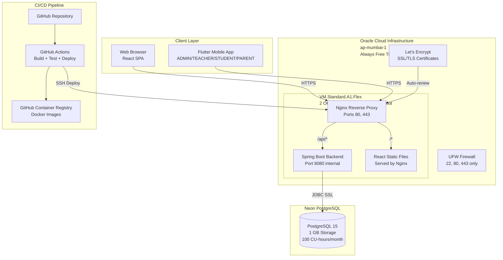

# GMS Stage J — Final Production Architecture

**Date:** 2026-11-03  
**Revision:** 4.0  
**Status:** NO-GO — NOT APPROVED FOR PROVISIONING OR PRODUCTION DEPLOYMENT  
**Author:** Principal Software Architect, Senior DevOps Engineer, Cloud Architect  
**Repository:** GMS (test/playwright-e2e branch)  
**Purpose:** Single source of truth for production architecture, overriding all prior Stage J reports

---

## Document Status (REVISION 4)

**OVERALL STATUS: NO-GO — PRODUCTION BLOCKERS REMAIN**

This document describes the **PROPOSED** production architecture. Critical components remain unimplemented and unverified:

- ❌ **Flyway migration procedure:** PROPOSED DESIGN — NOT YET TESTED
- ❌ **CI/CD deployment workflow:** PROPOSED DESIGN — GitHub Action SHAs REQUIRE VERIFICATION
- ❌ **JWT authentication:** PRODUCTION BLOCKER — localStorage must migrate to HttpOnly cookies
- ❌ **TLS/HTTPS:** UNKNOWN — Requires domain purchase (not authorized under ₹0 constraint)
- ❌ **OCI infrastructure:** UNKNOWN — Requires owner verification of Always Free eligibility
- ❌ **Neon database:** UNKNOWN — Requires owner to create project and provide connection string
- ❌ **Backup/restore:** PROPOSED DESIGN — NOT YET TESTED
- ❌ **Flutter mobile app:** NOT IMPLEMENTED — Only React web app exists

**Required owner decisions before provisioning:**
1. Verify OCI Always Free eligibility and ARM capacity in ap-mumbai-1
2. Create Neon PostgreSQL project and provide connection string
3. Approve domain purchase (~₹800–₹1,200/year) OR accept HTTP-only limitation
4. Approve JWT migration from localStorage to HttpOnly cookies (PRODUCTION BLOCKER)
5. Verify GitHub Actions private repository allowances

**This document does NOT authorize implementation, provisioning, or deployment.**

---

## Executive Summary

This document defines the **production architecture** for GMS, a multi-tenant School Management SaaS platform. The architecture is built on **Oracle Cloud Infrastructure (OCI) Always Free** tier with **Neon PostgreSQL** (owner-controlled, initially free tier), targeting **₹0 initial infrastructure cost**.

**Key Architecture Decisions:**
- **Hosting:** Single OCI ARM instance (VM.Standard.A1.Flex, 2 OCPUs, 12 GB RAM, 100 GB boot)
- **Database:** Neon PostgreSQL (1 GB storage free, 100 CU-hours/month compute)
- **Frontend:** Self-hosted on OCI instance via Nginx (NOT Vercel — Hobby plan prohibits commercial SaaS)
- **Mobile:** Flutter application (native, NOT PWA)
- **Containerization:** Docker + Docker Compose
- **Reverse Proxy:** Nginx with Let's Encrypt SSL/TLS
- **CI/CD:** GitHub Actions with automated deployment

**Target Scale:** 2,000 students (pilot phase)  
**Availability Target:** 99.5% uptime  
**Recovery Point Objective (RPO):** < 24 hours  
**Recovery Time Objective (RTO):** < 4 hours

---

## 1. Architecture Principles

### 1.1 Design Constraints

1. **₹0 initial budget** — No paid services without explicit owner approval
2. **Oracle Always Free** — Primary hosting platform
3. **No PWA** — Flutter for mobile, web frontend only for SUPERADMIN
4. **Modular monolith** — No microservices, no Kubernetes
5. **Solo operator** — Single developer maintains production
6. **Pilot scale** — 2,000 students, not enterprise scale

### 1.2 Non-Functional Requirements

| Requirement | Target | Rationale |
|------------|--------|-----------|
| Uptime | 99.5% | Pilot phase, manual recovery acceptable |
| Response time (API) | < 1s | Acceptable for school management workflows |
| Response time (web) | < 3s | Static assets via Nginx, CDN not required at pilot scale |
| Concurrent users | 500 | 2,000 students, ~25% concurrent at peak |
| Data retention | 7 years | Compliance with education record requirements |
| Backup frequency | Daily | RPO < 24 hours |
| Recovery time | < 4 hours | Manual restore from backups acceptable |

---

## 2. Component Architecture

### 2.1 High-Level Architecture Diagram



### 2.2 Component Responsibilities

#### 2.2.1 Nginx Reverse Proxy

**Location:** OCI instance, port 80/443  
**Repository Reference:** `gms_frontend/nginx.conf` (requires production adaptation)

**Responsibilities:**
- Terminate TLS (Let's Encrypt certificates)
- Serve React static files from `/opt/gms/frontend/dist`
- Reverse proxy `/api/*` to Spring Boot backend (port 8080)
- Enforce HTTPS redirect (HTTP 80 → HTTPS 443)
- Add security headers (HSTS, X-Frame-Options, X-Content-Type-Options)
- Gzip compression for static assets
- SPA routing (`try_files $uri $uri/ /index.html`)

**Configuration (REVISION 4 — PROPOSED DESIGN, NOT TESTED):**

**⚠️ TLS BOOTSTRAP SEQUENCE (REVISION 4):**

The configuration below assumes TLS certificates have been obtained. The correct bootstrap sequence is:

1. **Phase 1: HTTP-only bootstrap** — Start with HTTP-only configuration to verify domain ownership and certificate challenge prerequisites
2. **Phase 2: Certificate issuance** — Obtain Let's Encrypt certificate via Certbot
3. **Phase 3: HTTPS enablement** — Enable HTTPS virtual host and certificate references
4. **Phase 4: HTTP redirect** — Enable HTTP-to-HTTPS redirection only after HTTPS is operational

**Phase 1: HTTP-Only Bootstrap Configuration (Initial Setup)**

```nginx
# /etc/nginx/sites-available/gms-bootstrap
# REVISION 4: HTTP-only configuration for initial setup and certificate issuance

server {
    listen 80;
    server_name gms.yourdomain.com;
    
    # Let's Encrypt certificate challenge
    location /.well-known/acme-challenge/ {
        root /var/www/certbot;
    }
    
    # Temporary HTTP-only health check for monitoring setup
    location /health {
        return 200 'OK\n';
        add_header Content-Type text/plain;
        access_log off;
    }
    
    # Frontend (React SPA) — HTTP only during bootstrap
    location / {
        root /opt/gms/frontend/dist;
        try_files $uri $uri/ /index.html;
    }
    
    # Backend API — HTTP only during bootstrap
    location /api/ {
        proxy_pass http://127.0.0.1:8080;
        proxy_set_header Host $host;
        proxy_set_header X-Real-IP $remote_addr;
        proxy_set_header X-Forwarded-For $proxy_add_x_forwarded_for;
        proxy_set_header X-Forwarded-Proto $scheme;
    }
}
```

**⚠️ IMPORTANT:** This HTTP-only configuration is NOT suitable for production. It is only for initial setup and certificate issuance. Production deployment requires HTTPS (Phase 3 configuration below).

**Domain acquisition remains UNAPPROVED under the ₹0 requirement.** Without a domain:
- Let's Encrypt certificates cannot be obtained (requires domain validation)
- HTTPS cannot be established
- HTTP over raw public IP is NOT production-ready (security risk, unprofessional)
- Production deployment is BLOCKED until domain is purchased and approved by owner

**Phase 3: HTTPS Production Configuration (After Certificate Issued)**

```nginx
# /etc/nginx/sites-available/gms
# REVISION 4: Production HTTPS configuration

# HTTP → HTTPS redirect (only after HTTPS is verified working)
server {
    listen 80;
    server_name gms.yourdomain.com;
    return 301 https://$server_name$request_uri;
}

server {
    listen 443 ssl http2;
    server_name gms.yourdomain.com;

    ssl_certificate /etc/letsencrypt/live/gms.yourdomain.com/fullchain.pem;
    ssl_certificate_key /etc/letsencrypt/live/gms.yourdomain.com/privkey.pem;
    
    # TLS configuration
    ssl_protocols TLSv1.2 TLSv1.3;
    ssl_ciphers ECDHE-ECDSA-AES128-GCM-SHA256:ECDHE-RSA-AES128-GCM-SHA256:ECDHE-ECDSA-AES256-GCM-SHA384:ECDHE-RSA-AES256-GCM-SHA384;
    ssl_prefer_server_ciphers off;
    ssl_session_cache shared:SSL:10m;
    ssl_session_timeout 10m;
    
    # Security headers (REVISION 4: Removed deprecated X-XSS-Protection)
    add_header Strict-Transport-Security "max-age=31536000; includeSubDomains" always;
    add_header X-Frame-Options "SAMEORIGIN" always;
    add_header X-Content-Type-Options "nosniff" always;
    add_header Referrer-Policy "strict-origin-when-cross-origin" always;
    
    # Content Security Policy (REVISION 4: PROPOSED — requires testing with actual application)
    # This CSP is a starting point and MUST be tested before production deployment
    # Adjust based on actual application requirements (external scripts, styles, images, etc.)
    add_header Content-Security-Policy "default-src 'self'; script-src 'self' 'unsafe-inline' 'unsafe-eval'; style-src 'self' 'unsafe-inline'; img-src 'self' data: https:; font-src 'self' data:; connect-src 'self' https://*.neon.tech; frame-ancestors 'self';" always;
    
    # Frontend (React SPA)
    location / {
        root /opt/gms/frontend/dist;
        try_files $uri $uri/ /index.html;
        
        # Cache static assets
        location ~* \.(js|css|png|jpg|jpeg|gif|ico|svg|woff|woff2|ttf|eot)$ {
            expires 1y;
            add_header Cache-Control "public, immutable";
        }
    }
    
    # Backend API (REVISION 4: Validate proxy path semantics)
    # Backend routes are /api/v1/*, not /api/*
    # This location block proxies all /api/ requests to backend
    location /api/ {
        proxy_pass http://127.0.0.1:8080/api/;
        proxy_set_header Host $host;
        proxy_set_header X-Real-IP $remote_addr;
        proxy_set_header X-Forwarded-For $proxy_add_x_forwarded_for;
        proxy_set_header X-Forwarded-Proto $scheme;
        
        # Timeout settings
        proxy_connect_timeout 60s;
        proxy_send_timeout 60s;
        proxy_read_timeout 60s;
    }
    
    # REVISION 4: Public monitoring endpoint (minimal, no sensitive data)
    # This is NOT the Spring Boot Actuator /actuator/health endpoint
    # This is a separate lightweight endpoint for external monitoring (UptimeRobot, etc.)
    location /health {
        return 200 'OK\n';
        add_header Content-Type text/plain;
        access_log off;
    }
    
    # REVISION 4: Block all Actuator endpoints from public access
    # Spring Boot Actuator /actuator/* endpoints are PRIVATE and must not be exposed
    location /actuator/ {
        # Only allow localhost access (for internal health checks)
        allow 127.0.0.1;
        deny all;
        
        proxy_pass http://127.0.0.1:8080;
        proxy_set_header Host $host;
        proxy_set_header X-Real-IP $remote_addr;
        proxy_set_header X-Forwarded-For $proxy_add_x_forwarded_for;
        proxy_set_header X-Forwarded-Proto $scheme;
        
        access_log off;
    }
    
    # Block access to sensitive paths
    location ~ /\.(git|env|htaccess) {
        deny all;
        access_log off;
        log_not_found off;
    }
}
```

**REVISION 4 — Actuator Endpoint Security:**

**CRITICAL:** Spring Boot Actuator endpoints (`/actuator/*`) expose sensitive operational information:
- `/actuator/health` — Database status, disk space, internal dependencies
- `/actuator/env` — Environment variables and configuration properties (may contain secrets)
- `/actuator/configprops` — Configuration properties
- `/actuator/metrics` — Application metrics
- `/actuator/threaddump` — Thread dumps
- `/actuator/heapdump` — Heap dumps (may contain sensitive data)

**These endpoints must NEVER be exposed to the public internet.**

**Public Monitoring Endpoint (REVISION 4):**

For external monitoring services (UptimeRobot, etc.), use a separate lightweight endpoint:

```nginx
# Public endpoint — returns minimal information only
location /health {
    return 200 'OK\n';
    add_header Content-Type text/plain;
    access_log off;
}
```

**Expected public HTTP response:**
```
HTTP/1.1 200 OK
Content-Type: text/plain
Content-Length: 3

OK
```

**Internal Actuator Access (REVISION 4):**

For internal health checks (Docker healthcheck, internal monitoring), access Actuator via localhost:

```bash
# Internal health check (from OCI instance itself)
curl -s http://127.0.0.1:8080/actuator/health | jq .status
# Expected output: "UP" (if database and disk are healthy)
```

**Docker Compose healthcheck configuration:**

```yaml
healthcheck:
  test: ["CMD", "curl", "-f", "http://localhost:8080/actuator/health"]
  interval: 30s
  timeout: 10s
  retries: 3
  start_period: 60s
```

**Security Tests (REVISION 4 — REQUIRED):**

1. **Positive test:** `curl https://gms.yourdomain.com/health` returns `200 OK`
2. **Negative test:** `curl https://gms.yourdomain.com/actuator/health` returns `403 Forbidden` (from external IP)
3. **Negative test:** `curl https://gms.yourdomain.com/actuator/env` returns `403 Forbidden`
4. **Internal test:** `curl http://127.0.0.1:8080/actuator/health` returns `{"status": "UP"}` (from localhost)
5. **API test:** `curl https://gms.yourdomain.com/api/v1/auth/login` returns `200 OK` (not SPA HTML)
6. **SPA fallback test:** `curl https://gms.yourdomain.com/nonexistent` returns SPA `index.html`
7. **Security headers test:** Verify HSTS, X-Frame-Options, CSP headers present in response

**Dependencies:**
- Let's Encrypt certificates (auto-renewed via Certbot)
- React build artifacts (deployed from CI/CD)

**Cost:** ₹0 (included in OCI instance)

**Security Implications:**
- TLS termination at Nginx, not backend
- Backend only accessible via localhost (127.0.0.1:8080)
- No direct exposure of Spring Boot to internet

---

#### 2.2.2 Spring Boot Backend

**Location:** OCI instance, Docker container, port 8080 (internal only)  
**Repository Reference:** `gms_backend/Dockerfile`, `gms_backend/src/main/resources/application-prod.properties`

**Responsibilities:**
- REST API for all business logic (students, employees, attendance, fees, etc.)
- JWT authentication and authorization
- Tenant isolation (school-scoped data)
- Connection pooling to Neon PostgreSQL (HikariCP)
- Actuator health endpoints for monitoring

**⚠️ REVISION 4 — Flyway Migration Strategy (CANONICAL):**

**PROPOSED DESIGN — NOT YET IMPLEMENTED OR TESTED**

**Current code state:** `application-prod.properties` has `spring.flyway.enabled=true`, meaning Flyway runs on every application boot. This is **unsafe for production** because:
- Multiple backend containers could attempt concurrent migrations
- A failed migration leaves the database in an inconsistent state with no automatic rollback
- Application rollback does NOT reverse database migrations
- No deployment locking prevents race conditions

**REQUIRED CODE CHANGE (NOT YET APPLIED):** `spring.flyway.enabled` must be set to `false` in `application-prod.properties` before production deployment. This is a source-code change that must be made in the repository.

**Canonical Environment Contract (REVISION 4):**

All components use ONE authoritative environment contract based on JDBC URL:

```bash
# /etc/gms/.env (permissions 0640, owner gmsdeploy:docker)
# REVISION 4: Canonical JDBC URL-based contract

# Database connection (JDBC URL format for Spring Boot)
DB_URL=jdbc:postgresql://<neon-host>:5432/gms?sslmode=require
DB_USERNAME=<neon-user>
DB_PASSWORD=<neon-password>

# Flyway connection (derived from DB_URL, PostgreSQL native format)
# Migration script extracts host/port/database from DB_URL
FLYWAY_URL=<derived-from-DB_URL>  # jdbc:postgresql://host:port/db?sslmode=require
FLYWAY_USER=${DB_USERNAME}
FLYWAY_PASSWORD=${DB_PASSWORD}

# JWT and application secrets
JWT_SECRET=<openssl-rand-base64-48>
CORS_ALLOWED_ORIGINS=https://gms.yourdomain.com

# Superadmin credentials (initial setup only)
APP_SUPERADMIN_ENABLED=true
APP_SUPERADMIN_USERNAME=admin
APP_SUPERADMIN_PASSWORD=<strong-password>
APP_SUPERADMIN_EMAIL=admin@yourdomain.com
APP_SUPERADMIN_FULL_NAME=Platform Administrator

# Deployment tracking
DEPLOYMENT_SHA=<git-commit-sha>
DEPLOYMENT_TIMESTAMP=<iso-8601-timestamp>
```

**Chosen strategy: Deployment-step migrations using pinned Flyway CLI Docker container**

The Spring Boot fat JAR does not expose `org.flywaydb.core.Flyway` as a runnable main class. The migration runner uses the official Flyway Docker image instead, with migration files extracted from the same Git commit as the application JAR.

**Flyway Image Pinning (REVISION 4):**

**PROPOSED VALUE — REQUIRES VERIFICATION**

```dockerfile
# Use exact version, not mutable major tag
flyway/flyway:10.15.2  # PROPOSED: Pin to exact minor version
# OR pin to digest for production (requires verification):
flyway/flyway@sha256:<digest>  # UNKNOWN: Digest not yet verified
```

**PostgreSQL Driver Compatibility:** Flyway 10.x requires the `flyway-database-postgresql` module, which is included in the official `flyway/flyway` Docker image. No additional driver installation is needed.

**How migration files are packaged:**
- Migration SQL files live at `gms_backend/src/main/resources/db/migration/V1__*.sql` through `V10__*.sql`
- The CI/CD deployment pipeline checks out the exact Git commit being deployed
- Migration files are copied from that checkout to `/opt/gms/migrations/<git-sha>/` on the OCI instance
- The application Docker image and the migration files on disk always originate from the same commit

**How database credentials are supplied securely:**
- Credentials are stored in `/etc/gms/.env` (permissions 0640, owner `gmsdeploy:docker`)
- The migration script sources this file and extracts the JDBC URL components
- Credentials are passed to the Flyway container via environment variables (`FLYWAY_URL`, `FLYWAY_USER`, `FLYWAY_PASSWORD`)
- Credentials never appear in process listings, logs, or Docker image layers
- Temporary files containing credentials are created with mode 0600 and deleted immediately after use

**Canonical Production Migration Procedure (REVISION 4):**

```bash
#!/bin/bash
# /opt/gms/migrate.sh — executed ONCE per deployment, before application start
# REVISION 4: Canonical procedure with flock-based atomic locking

set -uo pipefail  # Note: NOT set -e (see error handling below)

# Source environment file
if [ ! -f /etc/gms/.env ]; then
  echo "ERROR: Environment file not found: /etc/gms/.env" >&2
  exit 1
fi
source /etc/gms/.env

# Validate required environment variables
for var in DB_URL DB_USERNAME DB_PASSWORD DEPLOYMENT_SHA; do
  if [ -z "${!var:-}" ]; then
    echo "ERROR: Required environment variable not set: $var" >&2
    exit 1
  fi
done

# Extract PostgreSQL connection parameters from JDBC URL
# JDBC format: jdbc:postgresql://host:port/database?params
PG_HOST=$(echo "$DB_URL" | sed -n 's|jdbc:postgresql://\([^:]*\):.*|\1|p')
PG_PORT=$(echo "$DB_URL" | sed -n 's|jdbc:postgresql://[^:]*:\([0-9]*\)/.*|\1|p')
PG_DATABASE=$(echo "$DB_URL" | sed -n 's|jdbc:postgresql://[^/]*/\([^?]*\).*|\1|p')

if [ -z "$PG_HOST" ] || [ -z "$PG_PORT" ] || [ -z "$PG_DATABASE" ]; then
  echo "ERROR: Failed to parse DB_URL: $DB_URL" >&2
  exit 1
fi

# Construct Flyway URL (same as DB_URL for PostgreSQL)
FLYWAY_URL="$DB_URL"
FLYWAY_USER="$DB_USERNAME"
FLYWAY_PASSWORD="$DB_PASSWORD"

# Validate target environment (prevent accidental production migrations)
if [[ "$PG_HOST" != *"neon"* ]] && [[ "$PG_HOST" != *"localhost"* ]]; then
  echo "ERROR: Unrecognized database host: $PG_HOST" >&2
  echo "Expected Neon or localhost. Aborting for safety." >&2
  exit 1
fi

MIGRATION_DIR="/opt/gms/migrations/$DEPLOYMENT_SHA"

if [ ! -d "$MIGRATION_DIR" ]; then
  echo "ERROR: Migration directory not found: $MIGRATION_DIR" >&2
  echo "The CI/CD pipeline must extract migration files before running this script." >&2
  exit 1
fi

# Atomic deployment lock using flock (REVISION 4: replaces unsafe file-exists check)
LOCK_FILE="/tmp/gms-migration.lock"
exec 9>"$LOCK_FILE"
if ! flock -n 9; then
  echo "ERROR: Migration already in progress (cannot acquire lock)" >&2
  exit 1
fi
# Lock is automatically released when file descriptor 9 is closed (script exit)

echo "Starting Flyway migration for commit $DEPLOYMENT_SHA at $(date)"
echo "Target database: $PG_HOST:$PG_PORT/$PG_DATABASE"

# Create temporary credentials file (mode 0600, deleted on exit)
CREDS_FILE=$(mktemp)
chmod 0600 "$CREDS_FILE"
trap "rm -f '$CREDS_FILE'" EXIT

cat > "$CREDS_FILE" <<EOF
FLYWAY_URL=$FLYWAY_URL
FLYWAY_USER=$FLYWAY_USER
FLYWAY_PASSWORD=$FLYWAY_PASSWORD
EOF

# Run Flyway CLI in Docker container (pinned to exact version)
# Migration files mounted read-only from the host
# Credentials passed via environment file (not command-line arguments)
# REVISION 4: Using proposed version 10.15.2 — REQUIRES VERIFICATION
docker run --rm \
  --network host \
  -v "$MIGRATION_DIR:/flyway/sql:ro" \
  --env-file "$CREDS_FILE" \
  -e "FLYWAY_LOCATIONS=filesystem:/flyway/sql" \
  -e "FLYWAY_CONNECT_RETRIES=3" \
  -e "FLYWAY_TABLE=flyway_schema_history" \
  flyway/flyway:10.15.2 \
  migrate

# Capture exit code explicitly (NOT using set -e)
MIGRATION_EXIT_CODE=$?

if [ $MIGRATION_EXIT_CODE -ne 0 ]; then
  echo "ERROR: Flyway migration failed with exit code $MIGRATION_EXIT_CODE" >&2
  echo "Migration timestamp: $(date -Iseconds)" >&2
  echo "Deployment SHA: $DEPLOYMENT_SHA" >&2
  echo "Database: $PG_HOST:$PG_PORT/$PG_DATABASE" >&2
  echo "" >&2
  echo "DO NOT proceed with application deployment." >&2
  echo "Manual intervention required. Check Flyway logs and database state." >&2
  
  # Record failed deployment (DO NOT update current-deployment-sha.txt)
  echo "FAILED" > /opt/gms/last-deployment-status.txt
  echo "$DEPLOYMENT_SHA" > /opt/gms/last-failed-sha.txt
  echo "$(date -Iseconds)" >> /opt/gms/last-failed-sha.txt
  
  exit $MIGRATION_EXIT_CODE
fi

echo "Migration completed successfully at $(date)"

# Verify schema version after migration
docker run --rm \
  --network host \
  -v "$MIGRATION_DIR:/flyway/sql:ro" \
  --env-file "$CREDS_FILE" \
  -e "FLYWAY_LOCATIONS=filesystem:/flyway/sql" \
  -e "FLYWAY_TABLE=flyway_schema_history" \
  flyway/flyway:10.15.2 \
  info

# Record successful deployment
echo "SUCCESS" > /opt/gms/last-deployment-status.txt
echo "$DEPLOYMENT_SHA" > /opt/gms/current-deployment-sha.txt
echo "$(date -Iseconds)" >> /opt/gms/current-deployment-sha.txt

# Lock is released automatically when script exits (file descriptor 9 closes)
```

**Migration Safety Rules (REVISION 4):**

1. **All migrations must be backward-compatible** — new columns must be nullable or have defaults; renamed columns must use expand-contract pattern
2. **Never drop or rename columns in a single deployment** — use expand-contract: add new → migrate data → switch reads → switch writes → drop old (across multiple deployments)
3. **Single execution** — migrations run once, before the new application version starts
4. **Atomic deployment lock** — `flock` ensures only one migration runs at a time (REVISION 4: replaces unsafe file-exists check)
5. **No automatic rollback** — if a migration fails, the deployment stops; manual intervention required
6. **Schema compatibility** — the new application version must work with both the old schema (before migration) and the new schema (after migration) during rolling deployments
7. **Same-commit guarantee** — migration files and application JAR are extracted from the same Git commit by the CI/CD pipeline
8. **Explicit error handling** — script captures exit code and records failed deployment (REVISION 4: replaces unsafe `set -e` pattern)
9. **Credential protection** — temporary credentials file created with mode 0600 and deleted on exit
10. **Environment validation** — script validates all required environment variables before execution
11. **Target validation** — script verifies database host to prevent accidental production migrations
12. **Deployment tracking** — successful deployments update `current-deployment-sha.txt`; failed deployments do NOT

**Why database rollback is NOT equivalent to application image rollback:**

- **Application rollback:** Deploy previous Docker image tag → instant, safe, tested
- **Database rollback:** Reverse Flyway migrations → NOT SUPPORTED by Flyway, requires manual SQL, risks data loss
- **Correct approach:** If migration fails, keep the old application version running (it's still compatible with the partially-migrated schema due to backward-compatible migration rule)
- **Disaster recovery:** Restore database from backup to isolated test environment, verify, then restore to production (requires owner authorization)

**How application startup is prevented after migration failure:**
- The CI/CD pipeline runs `migrate.sh` as a discrete step before `docker compose up`
- If `migrate.sh` exits non-zero, the pipeline aborts and does NOT start the application container
- The old application version continues running (if still up) or the service remains down with the old schema — both are safe states

**Rollback Limitations:**
- ⚠️ **Application rollback does NOT reverse database migrations**
- If migration V11 succeeds but application deployment fails, the database is at V11 while the application expects V10
- **Mitigation:** Write forward-only rollback migrations (V11.1) that undo V11 if needed
- **Never use `flyway clean` in production** (already disabled: `spring.flyway.clean-disabled=true`)

**Required Configuration Change (before production):**
```properties
# application-prod.properties — MUST be changed before production deployment
# Currently: spring.flyway.enabled=true (unsafe for production)
# Required:  spring.flyway.enabled=false (migrations run via /opt/gms/migrate.sh)
spring.flyway.enabled=false
```

**Docker Configuration:**
```dockerfile
# Multi-stage build (existing)
FROM maven:3.9-eclipse-temurin-21 AS build
WORKDIR /app
COPY pom.xml .
COPY src ./src
RUN mvn clean package -DskipTests

FROM eclipse-temurin:21-jre-alpine
RUN addgroup -S spring && adduser -S spring -G spring
USER spring:spring
WORKDIR /app
COPY --from=build /app/target/*.jar app.jar
EXPOSE 8080
ENTRYPOINT ["java", "-XX:MaxRAMPercentage=75.0", "-jar", "app.jar"]
```

**Dependencies:**
- Neon PostgreSQL connection (SSL required)
- Environment variables injected at runtime
- Docker image pulled from GitHub Container Registry

**Cost:** ₹0 (included in OCI instance)

**Security Implications:**
- Non-root execution (`spring:spring` user)
- JVM memory capped at 75% of container limit
- No hardcoded secrets (all via environment variables)
- `StartupSecurityValidator` enforces production safety at boot

---

#### 2.2.3 React Frontend

**Location:** OCI instance, static files served by Nginx  
**Repository Reference:** `gms_frontend/Dockerfile`, `gms_frontend/package.json`

**Responsibilities:**
- Single Page Application (SPA) for web users
- Role-based UI (SUPERADMIN, ADMIN, ACCOUNTANT, TEACHER)
- API calls to backend via `/api/*` proxy
- JWT token storage (localStorage)
- Responsive design for desktop and tablet

**Build Configuration:**
```json
{
  "scripts": {
    "dev": "vite",
    "build": "vite build",
    "preview": "vite preview"
  },
  "dependencies": {
    "react": "^18.2.0",
    "react-dom": "^18.2.0",
    "@reduxjs/toolkit": "^1.9.5",
    "react-redux": "^8.1.1",
    "axios": "^1.4.0",
    "react-router-dom": "^6.14.0"
  }
}
```

**Environment Variables:**
```bash
# .env.production
VITE_API_BASE_URL=/api/v1
VITE_MOCK_AUTH=false
```

**Deployment:**
- Build artifacts: `gms_frontend/dist/`
- Copied to OCI instance: `/opt/gms/frontend/dist/`
- Served by Nginx (not containerized separately)

**Dependencies:**
- Backend API available at `/api/v1`
- Nginx configured for SPA routing

**Cost:** ₹0 (static files, no separate hosting)

**Security Implications:**
- No sensitive data in frontend code
- 🚫 **PRODUCTION BLOCKER:** JWT tokens currently stored in localStorage — vulnerable to XSS token theft. CSP reduces but does NOT eliminate this risk. Must migrate to HttpOnly cookie + CSRF token before production. See Section 2.4.2.
- CORS configured to allow only production domain

---

#### 2.2.4 Neon PostgreSQL Database

**Location:** Neon cloud (owner-controlled project)  
**Repository Reference:** `gms_backend/src/main/resources/db/migration/` (V1–V10)

**Responsibilities:**
- Persistent storage for all GMS data
- Multi-tenant isolation (school_id foreign key on all tenant-scoped tables)
- Transaction management (ACID compliance)
- Automated backups (Neon feature)
- Point-in-time recovery (Neon feature)

**Free Tier Limits:**
| Resource | Limit | Headroom |
|----------|-------|----------|
| Storage | 1 GB per project | ~500,000 student records |
| Compute | 100 CU-hours/month | ~400 hours at 0.25 CU |
| Projects | 100 | 1 project used |
| Branches | 10 per project | 1 branch used |

**Connection String:**
```
postgresql://<user>:<password>@<host>.neon.tech/gms?sslmode=require
```

**Schema Management:**
- Flyway migrations (V1–V10) executed as a **deployment step** before application start (NOT on application startup)
- Migration runner: official `flyway/flyway:10` Docker container with migration files from the same Git commit
- `spring.flyway.enabled` must be set to `false` in production (required code change before deployment)
- `ddl-auto=validate` (Hibernate cannot auto-modify schema)
- `baseline-on-migrate=false` (no automatic baseline)
- `clean-disabled=true` (no accidental data loss)
- See Section 2.2.2 for the full migration procedure

**Backup Strategy:**
- **Automated:** Neon provides continuous backups (free tier)
- **Manual:** Daily `pg_dump` via cron job on OCI instance
- **Off-site:** Upload backups to object storage (Backblaze B2, AWS S3)
- **Retention:** 30 days daily, 12 monthly (manual backups)
- **Restore testing:** Quarterly drill (documented procedure)

**Dependencies:**
- Stable internet connection from OCI instance to Neon
- SSL/TLS encryption for all database connections
- Connection pooling (HikariCP, max 10 connections)

**Cost:** ₹0 (Neon free tier)

**Security Implications:**
- Database credentials stored in OCI instance environment file (`/etc/gms/.env`)
- File permissions: 0640 (owner read/write, group read)
- No database port exposed to internet (5432 not in firewall rules)
- All connections use SSL (`sslmode=require`)

**Scaling Considerations:**
- 1 GB storage sufficient for 2,000 students (pilot)
- If storage exceeds 800 MB, upgrade to Neon paid plan ($19/month for 10 GB)
- If compute exceeds 80 CU-hours/month, upgrade to paid plan
- **Owner decision required before any upgrade**

---

#### 2.2.5 Flutter Mobile Application

**Location:** External repository (not in this codebase)  
**Repository Reference:** None (separate project)

**Responsibilities:**
- Native mobile app for ADMIN, ACCOUNTANT, TEACHER, STUDENT, PARENT roles
- API calls to backend (same endpoints as web frontend)
- JWT authentication
- Offline capability (local cache)
- Push notifications (future)

**Architecture:**
- **NOT a PWA** (owner requirement)
- Separate codebase (Flutter/Dart)
- Shared backend API with web frontend
- Role-based feature access (same as web)

**API Integration:**
```dart
// Flutter HTTP client
final baseUrl = 'https://gms.yourdomain.com/api/v1';
final token = await storage.read(key: 'jwt_token');

final response = await http.get(
  Uri.parse('$baseUrl/students'),
  headers: {'Authorization': 'Bearer $token'},
);
```

**Dependencies:**
- Backend API available at `https://gms.yourdomain.com/api/v1`
- CORS configured to allow Flutter app origin (if web-based) or no CORS (native)
- JWT token refresh mechanism

**Cost:** ₹0 (Flutter is open-source, no hosting cost for mobile app)

**Security Implications:**
- JWT tokens stored securely (Flutter Secure Storage)
- Certificate pinning (recommended for production)
- No sensitive data cached locally without encryption

---

### 2.3 Network Architecture

#### 2.3.1 OCI Virtual Cloud Network (VCN)

**Repository Reference:** `infra/oci/network.tf`

```
VCN: gms-prod-vcn (10.0.0.0/16)
├── Internet Gateway: gms-prod-igw (enabled)
├── Route Table: gms-prod-public-rt
│   └── 0.0.0.0/0 → gms-prod-igw
├── Security List: gms-prod-public-sl
│   ├── Ingress: TCP/22 from <owner-ip>/32 (SSH)
│   ├── Ingress: TCP/80 from 0.0.0.0/0 (HTTP)
│   ├── Ingress: TCP/443 from 0.0.0.0/0 (HTTPS)
│   ├── Ingress: ICMP type 3 code 4 from 10.0.0.0/16 (PMTUD)
│   └── Egress: All to 0.0.0.0/0 (outbound)
└── Subnet: gms-prod-public-subnet (10.0.1.0/24)
    └── Instance: gms-prod-api-01 (public IP assigned)
```

**Firewall Rules (UFW on instance):**
```bash
ufw default deny incoming
ufw default allow outgoing
ufw allow 22/tcp    # SSH (restricted by OCI security list)
ufw allow 80/tcp    # HTTP (redirects to HTTPS)
ufw allow 443/tcp   # HTTPS
ufw --force enable
```

**Ports NOT exposed:**
- 5432 (PostgreSQL) — Database is on Neon, not local
- 8080 (Spring Boot) — Backend only accessible via Nginx proxy
- 3000 (Vite dev server) — Not used in production

---

#### 2.3.2 Request Flow

**Web Browser → Backend API:**
```
1. Browser requests https://gms.yourdomain.com/api/v1/students
2. DNS resolves to OCI instance public IP
3. OCI security list allows TCP/443 from 0.0.0.0/0
4. UFW allows TCP/443
5. Nginx receives HTTPS request on port 443
6. Nginx terminates TLS (Let's Encrypt certificate)
7. Nginx matches location /api/ and proxies to http://127.0.0.1:8080
8. Spring Boot receives request on port 8080 (localhost only)
9. JWT filter validates token (if required)
10. TenantContext populated from JWT claims (school_id)
11. Controller routes to service layer
12. Service queries repository (school-scoped)
13. Repository executes SQL on Neon PostgreSQL (SSL connection)
14. Response flows back through the stack
15. Nginx adds security headers and returns to browser
```

**Flutter App → Backend API:**
```
1. Flutter app requests https://gms.yourdomain.com/api/v1/students
2. Same flow as web browser (steps 2–15)
3. CORS not required (native app, not browser-based)
```

**Web Browser → Frontend SPA:**
```
1. Browser requests https://gms.yourdomain.com/
2. DNS resolves to OCI instance public IP
3. Nginx receives HTTPS request on port 443
4. Nginx serves /opt/gms/frontend/dist/index.html
5. Browser loads React SPA
6. SPA makes API calls to /api/v1/* (proxied to backend)
```

---

### 2.4 Security Boundaries

**⚠️ REVISION 2:** Security claims corrected. CSP does NOT eliminate localStorage token theft risk. Actuator endpoints must not expose diagnostic information publicly.

#### 2.4.1 Network Security

| Boundary | Enforcement Point | Rule |
|----------|-------------------|------|
| Internet → OCI | OCI Security List | Only TCP/22, 80, 443 allowed |
| SSH access | OCI Security List + UFW | Restricted to owner's IP (/32) |
| Backend exposure | Nginx reverse proxy | Only accessible via localhost |
| Database exposure | Neon network policy | Only accessible via SSL from OCI |
| Inter-container | Docker network | Isolated bridge network |

#### 2.4.2 Application Security

| Layer | Mechanism | Status | Repository Reference |
|-------|-----------|--------|----------------------|
| Authentication | JWT tokens (HS256) | ⚠️ Token storage has XSS risk | `gms_backend/src/main/java/com/gms/security/` |
| Authorization | Role-based access control (RBAC) | ⚠️ UNVERIFIED for all 6 roles | `gms_backend/src/main/java/com/gms/config/SecurityConfig.java` |
| Tenant isolation | school_id filter on all queries | ⚠️ Verified by tests, not by production load | `gms_backend/src/main/java/com/gms/service/TenantContext.java` |
| Input validation | Spring Validation + custom validators | ✅ Implemented | `gms_backend/src/main/java/com/gms/controller/` |
| SQL injection | JPA parameterized queries | ✅ Implemented | `gms_backend/src/main/java/com/gms/repository/` |
| XSS protection | Content Security Policy headers | ⚠️ **CSP does NOT eliminate token theft** | Nginx configuration |
| CSRF | Not required (stateless JWT) | ✅ Correct for API-only backend | N/A |
| Secrets | Environment variables only | ⚠️ Rotation procedure not documented | `application-prod.properties` |

**⚠️ CRITICAL SECURITY CORRECTIONS:**

**1. JWT Token Storage — PRODUCTION BLOCKER:**
- **Web (React):** JWT stored in `localStorage` — vulnerable to XSS attacks
- **CSP limitation:** Content Security Policy **reduces** XSS risk but does **NOT eliminate** it
  - CSP can block inline scripts and restrict script sources
  - CSP cannot prevent all XSS vectors (e.g., vulnerable third-party libraries, DOM-based XSS)
  - If XSS occurs, `localStorage` tokens are accessible to the attacker
- **Status:** 🚫 **PRODUCTION BLOCKER** — must be resolved before production launch

**Authentication Approach Comparison:**

| Approach | XSS Risk | CSRF Risk | Implementation Effort | Recommendation |
|----------|----------|-----------|----------------------|----------------|
| **localStorage + Bearer header** (current) | High — any XSS steals token | None (no cookies) | Low | 🚫 BLOCKER for production |
| **HttpOnly cookie** | Low — JavaScript cannot read cookie | Yes — requires CSRF token | Medium | ✅ Recommended |
| **Short-lived access token + HttpOnly refresh cookie** | Low — access token expires quickly; refresh is HttpOnly | Yes — requires CSRF token for refresh endpoint | High | ✅ Best security |

**Recommended approach for GMS:** HttpOnly cookie with CSRF token
- Backend sets `Set-Cookie: token=<jwt>; HttpOnly; Secure; SameSite=Strict; Path=/`
- React sends cookies automatically with `withCredentials: true` on axios
- Backend requires a CSRF token header (`X-CSRF-Token`) for all mutating requests
- CSRF token is delivered via a separate non-HttpOnly cookie or a meta tag endpoint
- **Trade-offs:**
  - Requires backend changes (cookie setter, CSRF filter)
  - Requires frontend changes (axios config, CSRF token handling)
  - Eliminates the localStorage XSS token-theft vector entirely
  - Introduces CSRF as a new attack surface, but one with well-understood mitigations

**This is NOT owner-waivable.** The risk of mass token theft via XSS is a production blocker, not an acceptable pilot risk.

**2. Flutter Token Storage:**
- **Mobile (Flutter):** JWT stored in `flutter_secure_storage` (Keychain on iOS, Keystore on Android)
- **Risk:** Significantly lower than web localStorage — hardware-backed encryption
- **Status:** ✅ Acceptable (Flutter app not yet implemented)

**3. Actuator Endpoint Exposure:**
- **Current configuration:** `management.endpoints.web.exposure.include=health,info`
- **Health endpoint:** Exposed via Nginx at `/actuator/health` — returns `{"status": "UP"}`
- **⚠️ Correction:** Detailed health information (database status, disk space, etc.) must NOT be public
- **Required:** `management.endpoint.health.show-details=never` (already configured)
- **Info endpoint:** Should not expose build version, environment variables, or sensitive configuration
- **Recommendation:** Move actuator endpoints behind authentication or restrict to internal network

**4. CORS and CSRF:**
- **CORS:** Configured for production domain only (`cors.allowed-origins=${CORS_ALLOWED_ORIGINS}`)
- **CSRF:** Not required for stateless JWT API (correct)
- **⚠️ Note:** If web frontend adds cookie-based auth in the future, CSRF protection must be added

**5. Secret Rotation:**
- **Current state:** Secrets injected via environment variables (no hardcoded values)
- **⚠️ Missing:** No documented rotation procedure for JWT secret, database password, or API keys
- **Required:** Define rotation frequency, procedure, and zero-downtime rotation strategy

#### 2.4.3 Data Security

| Data Type | Protection | Location | Status |
|-----------|------------|----------|--------|
| Database credentials | Environment file (0640 permissions) | `/etc/gms/.env` on OCI instance | ✅ |
| JWT secret | Environment variable | `/etc/gms/.env` | ⚠️ No rotation procedure |
| SSL certificates | Let's Encrypt auto-renewal | `/etc/letsencrypt/live/` | ✅ |
| SSH private key | Owner's machine only | Never on OCI instance | ✅ |
| Database backups | Encrypted at rest (Neon) + off-site | Neon + object storage | ⚠️ Local backups need encryption |
| Backup files | File permissions (0600) | `/backups/` on OCI instance | ⚠️ GPG encryption recommended |

---

### 2.5 Tenant Isolation

**Repository Reference:** `gms_backend/src/main/java/com/gms/service/TenantContext.java`

**Mechanism:**
1. JWT token contains `schoolId` claim (issued at login)
2. `TenantContext` ThreadLocal populated once per request (via filter)
3. All repository methods scoped by `schoolId`
4. Cross-tenant access returns 404 (not 403, to avoid information leakage)

**Example:**
```java
// StudentRepository.java
@Query("SELECT s FROM Student s WHERE s.schoolId = :schoolId AND s.id = :id")
Optional<Student> findByIdAndSchoolId(@Param("id") Long id, @Param("schoolId") Long schoolId);

// StudentServiceImpl.java
public Student getStudent(Long id) {
    Long schoolId = TenantContext.getSchoolId();
    return studentRepository.findByIdAndSchoolId(id, schoolId)
        .orElseThrow(() -> new ResourceNotFoundException("Student not found"));
}
```

**Verification:**
- Unit tests for tenant-scoped queries (270+ backend tests)
- Integration tests with multiple schools (live-tenancy CI)
- Manual audit of all repository methods (completed in Stage 3)

---

## 3. Resource and Capacity Planning

### 3.1 OCI Instance Resources

| Resource | Allocated | Used (estimated) | Headroom |
|----------|-----------|------------------|----------|
| OCPUs | 2 | 0.5 (idle), 1.5 (peak) | 25% |
| RAM | 12 GB | 4 GB (JVM 75% of 5.3 GB container limit) | 67% |
| Boot volume | 100 GB | 20 GB (OS + Docker + logs) | 80% |
| Network | 1 Gbps | 10 Mbps (estimated) | 99% |

**JVM Memory Configuration:**
```bash
-XX:MaxRAMPercentage=75.0
```
- Container limit: 12 GB (OCI instance RAM)
- JVM heap: 9 GB (75% of 12 GB)
- Actual usage: ~4 GB (estimated for 2,000 students)

**Scaling Triggers:**
- CPU > 80% sustained for 5 minutes → Vertical scaling (not possible on Always Free) or horizontal scaling (requires paid tier)
- RAM > 80% → Increase JVM heap or add swap space
- Disk > 80% → Expand boot volume (up to 200 GB free) or add block volume

---

### 3.2 Neon PostgreSQL Resources

| Resource | Free Tier Limit | Used (estimated) | Headroom |
|----------|-----------------|------------------|----------|
| Storage | 1 GB | 200 MB (2,000 students) | 80% |
| Compute | 100 CU-hours/month | 40 CU-hours (estimated) | 60% |
| Connections | 20 per project | 10 (HikariCP pool) | 50% |

**Storage Estimation:**
- Student record: ~2 KB
- Employee record: ~2 KB
- Attendance record: ~100 bytes
- Fee record: ~200 bytes
- 2,000 students × 3 years × 12 months × 2 attendance records/day × 200 days = ~288 MB
- **Headroom:** 712 MB (71% free)

**Compute Estimation:**
- 0.25 CU (minimum) × 4 hours/day × 30 days = 30 CU-hours
- Peak: 1 CU × 2 hours/day × 30 days = 60 CU-hours
- **Total:** ~90 CU-hours/month (90% of free tier)

**Scaling Triggers:**
- Storage > 800 MB → Upgrade to Neon paid plan ($19/month for 10 GB)
- Compute > 80 CU-hours/month → Upgrade to paid plan or optimize queries
- **Owner decision required before any upgrade**

---

### 3.3 Network Bandwidth

**Estimated Monthly Transfer:**
- Frontend (React SPA): ~500 KB per page load × 10,000 page views/month = 5 GB
- API responses: ~10 KB per request × 100,000 requests/month = 1 GB
- Database queries: ~5 KB per query × 500,000 queries/month = 2.5 GB
- **Total:** ~8.5 GB/month

**OCI Always Free Network Limit:**
- 10 TB outbound transfer/month (free tier)
- **Headroom:** 99.9%

---

## 4. Deployment Topology

### 4.1 Physical Layout

```
Oracle Cloud Infrastructure (ap-mumbai-1)
├── VCN: gms-prod-vcn (10.0.0.0/16)
│   ├── Subnet: gms-prod-public-subnet (10.0.1.0/24)
│   │   └── Instance: gms-prod-api-01 (VM.Standard.A1.Flex)
│   │       ├── OS: Ubuntu 24.04 ARM64
│   │       ├── Docker Engine + Compose v2
│   │       ├── Nginx (reverse proxy)
│   │       │   ├── Port 80 (HTTP → redirect to 443)
│   │       │   └── Port 443 (HTTPS)
│   │       │       ├── / → /opt/gms/frontend/dist/ (React SPA)
│   │       │       └── /api/ → http://127.0.0.1:8080 (Spring Boot)
│   │       ├── Spring Boot Backend (Docker container)
│   │       │   └── Port 8080 (internal only)
│   │       ├── Let's Encrypt Certbot (auto-renewal)
│   │       └── UFW Firewall (22, 80, 443 only)
│   └── Internet Gateway: gms-prod-igw

Neon PostgreSQL (cloud-managed)
├── Project: gms-production
│   ├── Database: gms
│   ├── Storage: 1 GB (free tier)
│   ├── Compute: 0.25 CU (auto-scaling)
│   └── Backups: Continuous (7-day retention)
```

### 4.2 Container Layout

```yaml
# docker-compose.prod.yml (to be created)
version: '3.8'

services:
  backend:
    image: ghcr.io/<owner>/gms-backend:<git-sha>
    container_name: gms-backend
    restart: unless-stopped
    environment:
      - SPRING_PROFILES_ACTIVE=prod
      - DB_URL=${DB_URL}
      - DB_USERNAME=${DB_USERNAME}
      - DB_PASSWORD=${DB_PASSWORD}
      - SECURITY_JWT_SECRET=${JWT_SECRET}
      - CORS_ALLOWED_ORIGINS=${CORS_ALLOWED_ORIGINS}
    ports:
      - "127.0.0.1:8080:8080"  # Internal only
    networks:
      - gms-network
    healthcheck:
      test: ["CMD", "wget", "--spider", "-q", "http://localhost:8080/actuator/health"]
      interval: 30s
      timeout: 10s
      retries: 3
      start_period: 60s
    logging:
      driver: "json-file"
      options:
        max-size: "50m"
        max-file: "5"

networks:
  gms-network:
    driver: bridge
```

**Note:** Frontend is NOT containerized — served directly by Nginx from `/opt/gms/frontend/dist/`.

---

## 5. Client Architecture

### 5.1 Role and Client Coverage Matrix

**Complete Role/Client Access Matrix:**

| Role | Web (React) | Mobile (Flutter) | Implementation Status | Notes |
|------|-------------|------------------|----------------------|-------|
| **SUPERADMIN** | ✅ Required | ❌ Not supported | ⚠️ Web UI exists, authorization UNVERIFIED | Platform management only, web-only by design |
| **ADMIN** | ✅ Required | ✅ Required | ⚠️ Web UI exists, Flutter NOT IMPLEMENTED | School management, both clients required |
| **ACCOUNTANT** | ✅ Required | ✅ Required | ⚠️ Web UI exists, Flutter NOT IMPLEMENTED | Fee management, both clients required |
| **TEACHER** | ✅ Required | ✅ Required | ⚠️ Web UI exists, Flutter NOT IMPLEMENTED | Attendance/grading, both clients required |
| **STUDENT** | ✅ Required | ✅ Required | ⚠️ Web UI exists, Flutter NOT IMPLEMENTED | View records, both clients required |
| **PARENT** | ✅ Required | ✅ Required | ⚠️ Web UI exists, Flutter NOT IMPLEMENTED | View child records, both clients required |

**Critical Gaps:**
- ❌ **Flutter application does not exist** in this repository (separate project required)
- ⚠️ **Role authorization not fully verified** for all 6 roles in web frontend
- ⚠️ **SUPERADMIN web workflow** exists but authorization testing incomplete
- ⚠️ **STUDENT and PARENT roles** have web UI but comprehensive workflow testing incomplete

**Owner Decision Required:**
- Flutter mobile app is a **separate project** not in this repository
- All 5 school roles (ADMIN, ACCOUNTANT, TEACHER, STUDENT, PARENT) require Flutter implementation
- SUPERADMIN is web-only (no Flutter app needed)

**Evidence Required Before Production:**
- [ ] Flutter app created and integrated with backend API
- [ ] All 6 roles tested in web frontend with comprehensive workflows
- [ ] All 5 school roles tested in Flutter app
- [ ] Role authorization verified with negative tests (unauthorized access returns 403/404)
- [ ] Tenant isolation verified for all roles

### 5.2 Web Frontend (React)

**Technology Stack:**
- React 18
- Redux Toolkit (state management)
- React Router (routing)
- Axios (HTTP client)
- Vite (build tool)

**Role-Based Access:**
| Role | Web Access | Features |
|------|------------|----------|
| SUPERADMIN | ✅ | Platform management, school creation |
| ADMIN | ✅ | School management, employee management |
| ACCOUNTANT | ✅ | Fee management, financial reports |
| TEACHER | ✅ | Attendance, grading, student management |

**Authentication Flow:**
```
1. User enters credentials on /login page
2. Frontend POST /api/v1/auth/login
3. Backend validates, returns JWT token
4. 🚫 Frontend stores token in localStorage — MUST change to HttpOnly cookie before production (see Section 2.4.2)
5. Frontend redirects to /dashboard
6. Subsequent requests include Authorization: Bearer <token>
7. On 401 response, frontend clears token and redirects to /login
```

### 5.3 Mobile App (Flutter)

**Technology Stack:**
- Flutter 3.x
- Dart
- http package (HTTP client)
- flutter_secure_storage (JWT storage)

**Role-Based Access:**
| Role | Mobile Access | Features |
|------|---------------|----------|
| ADMIN | ✅ | School management (subset of web) |
| ACCOUNTANT | ✅ | Fee collection, payment history |
| TEACHER | ✅ | Attendance marking, grade entry |
| STUDENT | ✅ | View attendance, grades, fees |
| PARENT | ✅ | View child's attendance, grades, fees |

**Note:** SUPERADMIN is web-only (no mobile access).

**Authentication Flow:**
```
1. User enters credentials on login screen
2. Flutter app POST /api/v1/auth/login
3. Backend validates, returns JWT token
4. Flutter stores token in secure storage
5. Flutter navigates to home screen
6. Subsequent requests include Authorization: Bearer <token>
7. On 401 response, Flutter clears token and navigates to login
```

---

## 6. Monitoring and Observability

### 6.1 Health Checks

**Backend (Spring Boot Actuator):**
```
GET /actuator/health
Response: {"status": "UP"}

GET /actuator/health/liveness
Response: {"status": "UP"}

GET /actuator/health/readiness
Response: {"status": "UP"}
```

**Nginx:**
```
GET /actuator/health (proxied to backend)
Response: {"status": "UP"}
```

**Database (Neon):**
- Neon dashboard shows connection status
- Backend logs connection errors
- No direct health check endpoint (monitored via backend)

### 6.2 Logging

**Backend Logs:**
```bash
# Docker logs
docker logs gms-backend --follow

# Log file (rotated)
/var/lib/docker/containers/*/*.log
```

**Nginx Logs:**
```bash
# Access log
/var/log/nginx/access.log

# Error log
/var/log/nginx/error.log
```

**Log Aggregation:**
- **Current:** Local logs only (no centralized aggregation)
- **Recommended:** Loki + Grafana (self-hosted) or CloudWatch (if OCI paid tier)
- **Cost:** ₹0 (self-hosted) or ~$5/month (CloudWatch)

### 6.3 Metrics

**Backend Metrics (Micrometer):**
- JVM memory usage
- HTTP request rate
- Database query latency
- Active connections

**Exposure:**
```
GET /actuator/metrics
Response: JSON with all metrics
```

**Monitoring Tool:**
- **Current:** None (metrics not collected)
- **Recommended:** Prometheus + Grafana (self-hosted)
- **Cost:** ₹0 (self-hosted on OCI instance)

### 6.4 Alerting

**Current State:** No alerting configured

**Recommended Setup:**
1. **UptimeRobot** (free tier)
   - Monitor: `https://gms.yourdomain.com/health` (public endpoint — NOT `/actuator/health`, which must remain private)
   - Interval: 5 minutes
   - Alert: Email/SMS on downtime

2. **OCI Cloud Agent** (free with instance)
   - CPU, memory, disk metrics
   - Alert on threshold breaches

3. **Neon Dashboard**
   - Storage and compute usage
   - Alert on quota exhaustion

---

## 7. Disaster Recovery

### 7.1 Backup Strategy

**⚠️ CRITICAL CORRECTION (Revision 2):** The backup procedure must use PostgreSQL connection parameters, NOT JDBC URLs. The `pg_dump` utility does not understand JDBC connection strings.

**Database Backups:**
| Type | Frequency | Retention | Location | Cost |
|------|-----------|-----------|----------|------|
| Neon automated | Continuous | 7 days | Neon cloud | ₹0 (free tier) |
| Manual pg_dump | Daily (2 AM) | 30 days | OCI instance `/backups/` | ₹0 (local storage) |
| Off-site upload | Daily (3 AM) | 12 months | Backblaze B2 / AWS S3 | ~₹1/month (owner approval required) |

**Neon Provider Recovery vs Owner-Controlled Backups:**

**Neon Automated Backups (Provider Feature):**
- Continuous point-in-time recovery (7-day retention on free tier)
- Managed by Neon, not under owner's direct control
- Recovery via Neon dashboard or `neonctl` CLI
- **Limitation:** If Neon project is deleted or account is compromised, these backups are lost
- **Documentation:** https://neon.tech/guides/backup

**Owner-Controlled Backups (Independent):**
- Daily `pg_dump` executed from OCI instance
- Encrypted and stored locally, then uploaded off-site
- Owner has full control and can restore independently of Neon
- **Required for production:** Protects against Neon account loss, project deletion, or catastrophic failure
- **Cost conflict:** Off-site storage (Backblaze B2) costs ~₹1/month — **owner approval required** before enabling

**Backup Script (CORRECTED):**
```bash
#!/bin/bash
# /opt/gms/backup.sh
# ⚠️ REVISION 2: Uses PostgreSQL connection parameters, NOT JDBC URL

set -euo pipefail

BACKUP_DIR="/backups"
TIMESTAMP=$(date +%Y%m%d_%H%M%S)
BACKUP_FILE="$BACKUP_DIR/gms_backup_$TIMESTAMP.sql.gz"
ENCRYPTED_FILE="$BACKUP_DIR/gms_backup_$TIMESTAMP.sql.gz.gpg"

# Load environment (credentials NOT in process arguments)
source /etc/gms/.env

# Extract PostgreSQL connection parameters from environment
# Expected format in /etc/gms/.env:
#   PG_HOST=<neon-host>.neon.tech
#   PG_PORT=5432
#   PG_DATABASE=gms
#   PG_USER=<neon-user>
#   PG_PASSWORD=<neon-password>

# Create backup using explicit connection parameters (NOT JDBC URL)
# Credentials passed via environment variables, not command-line arguments
export PGPASSWORD="$PG_PASSWORD"
pg_dump -h "$PG_HOST" -p "$PG_PORT" -U "$PG_USER" -d "$PG_DATABASE" \
  --format=custom --compress=6 | gzip > "$BACKUP_FILE"
unset PGPASSWORD

# Verify backup integrity (check file size and gzip validity)
if [ ! -s "$BACKUP_FILE" ]; then
  echo "ERROR: Backup file is empty" >&2
  exit 1
fi
gzip -t "$BACKUP_FILE" || { echo "ERROR: Backup file is corrupted" >&2; exit 1; }

# Encrypt backup (GPG key must be pre-configured)
# gpg --recipient gms-backup --encrypt "$BACKUP_FILE"
# rm "$BACKUP_FILE"  # Remove unencrypted version

# Set secure permissions
chmod 600 "$BACKUP_FILE"
# chmod 600 "$ENCRYPTED_FILE"  # If encryption enabled

# Retention (30 days)
find "$BACKUP_DIR" -name "gms_backup_*.sql.gz*" -mtime +30 -delete

# Upload to off-site storage (OPTIONAL — requires owner approval and cost ~₹1/month)
# if [ -f "$ENCRYPTED_FILE" ]; then
#   b2 upload-file gms-backups "$ENCRYPTED_FILE" "gms_backup_$TIMESTAMP.sql.gz.gpg"
# elif [ -f "$BACKUP_FILE" ]; then
#   echo "WARNING: Unencrypted backup — off-site upload skipped for security" >&2
# fi

# Log completion (no credentials in logs)
echo "Backup completed: $BACKUP_FILE ($(du -h "$BACKUP_FILE" | cut -f1))"
```

**Environment File Requirements:**
```bash
# /etc/gms/.env (permissions: 0640, owner: gmsdeploy, group: gmsdeploy)

# PostgreSQL connection (for backups — NOT JDBC URL)
PG_HOST=<neon-host>.neon.tech
PG_PORT=5432
PG_DATABASE=gms
PG_USER=<neon-user>
PG_PASSWORD=<neon-password>

# Spring Boot JDBC URL (for application — derived from PG_* above)
DB_URL=jdbc:postgresql://$PG_HOST:$PG_PORT/$PG_DATABASE?sslmode=require
DB_USERNAME=$PG_USER
DB_PASSWORD=$PG_PASSWORD

# ... other variables ...
```

**Cron Job:**
```bash
# /etc/cron.d/gms-backup
0 2 * * * root /opt/gms/backup.sh >> /var/log/gms-backup.log 2>&1
```

**Off-Site Backup Cost Conflict:**
- Backblaze B2 storage: ~₹1/month for 10 GB
- **Owner approval required** before enabling off-site backups
- Without owner approval, backups are local-only (30-day retention on OCI instance)
- **Risk:** If OCI instance is lost, local backups are also lost
- **Recommendation:** Request owner approval for off-site backups as a production prerequisite

### 7.2 Restore Procedure

**⚠️ REVISION 2:** All restore procedures use PostgreSQL connection parameters, NOT JDBC URLs. Credentials are passed via environment variables, never command-line arguments.

**Scenario 1: Restore from Neon point-in-time recovery (provider feature)**
```bash
# Option A: Neon dashboard → Backups → Point-in-time recovery
# Option B: neonctl CLI
neonctl branches restore <branch-id> --timestamp <timestamp>

# ⚠️ This is a Neon-managed feature, not an owner-controlled backup
# ⚠️ If Neon project is deleted or account compromised, this recovery is unavailable
```

**Scenario 2: Restore from manual backup (owner-controlled)**
```bash
#!/bin/bash
# /opt/gms/restore.sh

set -euo pipefail

# Load environment
source /etc/gms/.env

# List available backups
ls -lh /backups/gms_backup_*.sql.gz*

# Select backup to restore (latest by default)
BACKUP_FILE="${1:-$(ls -t /backups/gms_backup_*.sql.gz | head -1)}"

# If encrypted, decrypt first
if [[ "$BACKUP_FILE" == *.gpg ]]; then
  DECRYPTED_FILE="${BACKUP_FILE%.gpg}"
  gpg --decrypt "$BACKUP_FILE" > "$DECRYPTED_FILE"
  BACKUP_FILE="$DECRYPTED_FILE"
fi

# Verify backup integrity before restore
gzip -t "$BACKUP_FILE" || { echo "ERROR: Backup file is corrupted" >&2; exit 1; }

# ⚠️ WARNING: This will overwrite the current database
echo "WARNING: This will overwrite the current database ($PG_DATABASE)"
echo "Backup file: $BACKUP_FILE"
read -p "Continue? (yes/no): " CONFIRM
[ "$CONFIRM" = "yes" ] || exit 0

# Restore using explicit connection parameters (NOT JDBC URL)
export PGPASSWORD="$PG_PASSWORD"
gunzip -c "$BACKUP_FILE" | psql -h "$PG_HOST" -p "$PG_PORT" -U "$PG_USER" -d "$PG_DATABASE"
unset PGPASSWORD

echo "Restore completed successfully"
```

**Scenario 3: Complete infrastructure rebuild**
```bash
# 1. Provision new OCI instance (OpenTofu)
cd infra/oci
tofu apply

# 2. Install Docker, Nginx, Certbot (cloud-init handles this)

# 3. Restore database from backup
/opt/gms/restore.sh /backups/gms_backup_YYYYMMDD_HHMMSS.sql.gz

# 4. Deploy backend (CI/CD pipeline)
./deploy.sh <git-sha>

# 5. Deploy frontend
rsync -avz gms_frontend/dist/ deploy@gms-prod-api-01:/opt/gms/frontend/dist/

# 6. Update DNS (if needed)
```

**Tested Restore Acceptance Gate (REQUIRED):**

Before declaring production readiness, a restore test MUST be performed and documented:

- [ ] **Restore test date:** _______________
- [ ] **Backup file used:** _______________
- [ ] **Restore executed on:** Isolated test database (NOT production)
- [ ] **Data integrity verified:** Row counts match pre-backup state
- [ ] **Application functional after restore:** Login, API calls, tenant isolation verified
- [ ] **Restore time measured:** _______________ minutes
- [ ] **Test performed by:** _______________
- [ ] **Test evidence:** Screenshots/logs attached to _______________

**⚠️ RTO (Recovery Time Objective) cannot be claimed until a timed restore test demonstrates it.**

### 7.3 RPO and RTO

| Metric | Target | Actual (verified?) | Evidence |
|--------|--------|-------------------|----------|
| RPO (Recovery Point Objective) | < 24 hours | ✅ Yes (calculated from schedule) | Daily backup at 2 AM → max 24h data loss |
| RTO (Recovery Time Objective) | < 4 hours | ❌ UNVERIFIED | Requires timed restore test |

**RPO Breakdown:**
- Neon continuous backups: 0 seconds (point-in-time recovery within 7 days)
  - ⚠️ This is a Neon provider feature, not owner-controlled
- Daily pg_dump: 24 hours (worst case — backup at 2 AM, failure at 1 AM next day)
- **Effective RPO (owner-controlled):** < 24 hours (from daily pg_dump)
- **Effective RPO (with Neon):** Near-zero (from continuous backups, if Neon account is available)

**RTO Breakdown (ESTIMATED — NOT VERIFIED):**
- OCI instance provisioning: 10 minutes (OpenTofu apply)
- Docker/Nginx setup: 5 minutes (cloud-init)
- Database restore: 30 minutes (1 GB database, estimated)
- Backend deployment: 5 minutes (CI/CD)
- Frontend deployment: 5 minutes (rsync)
- DNS propagation: 0–48 hours (if needed)
- **Estimated RTO:** ~1 hour (excluding DNS) — ⚠️ UNVERIFIED, requires timed restore test

**⚠️ CRITICAL:** The RTO of "< 4 hours" is an **estimate only**. It cannot be claimed as an achieved target until a full restore drill has been timed and documented.

---

## 8. Acceptance Criteria

### 8.1 Architecture Validation

- [ ] OCI instance provisioned with Ubuntu 24.04 ARM64
- [ ] Docker and Docker Compose installed
- [ ] Nginx configured with HTTPS and API proxy
- [ ] Let's Encrypt certificate obtained and auto-renewal configured
- [ ] Spring Boot backend deployed and accessible via `/api/v1`
- [ ] React frontend deployed and accessible via `/`
- [ ] Neon PostgreSQL database created and connected
- [ ] Flyway migrations executed successfully
- [ ] Health check endpoint returns `{"status": "UP"}`
- [ ] JWT authentication working for web and Flutter
- [ ] Tenant isolation verified (cross-school access returns 404)
- [ ] Daily backups configured and tested
- [ ] Restore procedure documented and tested
- [ ] Monitoring active (UptimeRobot or equivalent)
- [ ] Firewall rules verified (only 22, 80, 443 open)

### 8.2 Performance Validation

- [ ] API response time < 1 second (95th percentile)
- [ ] Frontend load time < 3 seconds (95th percentile)
- [ ] Database query time < 500ms (95th percentile)
- [ ] Concurrent users: 500 (load test passed)
- [ ] CPU usage < 80% (sustained)
- [ ] Memory usage < 80% (sustained)
- [ ] Disk usage < 80%

### 8.3 Security Validation

- [ ] No hardcoded secrets in source code
- [ ] All credentials in environment variables
- [ ] SSH access restricted to owner's IP
- [ ] Database port (5432) not exposed
- [ ] Backend port (8080) not exposed
- [ ] HTTPS enforced (HTTP redirects to HTTPS)
- [ ] HSTS header present
- [ ] CORS configured correctly (production domain only)
- [ ] JWT secret strong (48+ characters, base64 encoded)
- [ ] Superadmin password changed from default
- [ ] Flyway clean disabled
- [ ] Hibernate ddl-auto set to validate

---

## 9. Dependencies and Risks

### 9.1 External Dependencies

| Dependency | Provider | Risk | Mitigation |
|------------|----------|------|------------|
| OCI Always Free | Oracle | Free tier may change | Monitor Oracle announcements, have fallback plan |
| Neon PostgreSQL | Neon | Free tier limits | Monitor usage, upgrade to paid if needed (owner approval) |
| Let's Encrypt | ISRG | Certificate expiry | Auto-renewal via Certbot, monitoring |
| GitHub Actions | GitHub | CI/CD downtime | Manual deployment script as fallback |
| GitHub Container Registry | GitHub | Image pull failures | Local image cache on OCI instance |
| Domain DNS | Registrar | DNS propagation delays | Use Cloudflare (free) for faster propagation |

### 9.2 Technical Risks

| Risk | Probability | Impact | Mitigation |
|------|-------------|--------|------------|
| OCI instance failure | Low | High | Daily backups, restore procedure documented |
| Neon database corruption | Very Low | Critical | Continuous backups, point-in-time recovery |
| SSL certificate expiry | Low | Medium | Auto-renewal, monitoring alerts |
| DDoS attack | Medium | Medium | OCI DDoS protection (free), rate limiting |
| Data loss | Very Low | Critical | Daily backups, off-site storage, quarterly restore tests |
| Performance degradation | Medium | Medium | Monitoring, vertical scaling (if paid), query optimization |
| Security breach | Low | Critical | Firewall, HTTPS, secrets management, regular audits |

### 9.3 Operational Risks

| Risk | Probability | Impact | Mitigation |
|------|-------------|--------|------------|
| Solo operator unavailable | Medium | High | Document procedures, train backup operator |
| Free tier exhaustion | Medium | High | Monitor usage, alert at 80% quota |
| Unexpected billing | Low | High | No paid services without owner approval |
| Deployment failure | Medium | Medium | Rollback procedure, manual deployment option |
| Backup failure | Low | Critical | Test restore quarterly, monitor backup logs |

---

## 9.5 CI/CD Hardening (REVISION 3)

**⚠️ REVISION 3:** CI/CD pipeline must enforce a feature-branch workflow with SHA-pinned actions, owner-approved production deployment, and same-commit migration artifacts.

### 9.5.1 Feature-Branch Release Workflow

**Required release sequence (NEVER deploy on push to master):**

1. **Fetch latest master:** `git fetch origin && git checkout master && git pull origin master`
2. **Create feature branch:** `git checkout -b feature/<description>`
3. **Run required tests and checks locally:** `mvn -B clean verify` (backend), `npm run build` (frontend)
4. **Push feature branch:** `git push -u origin feature/<description>`
5. **Open pull request:** PR must pass all CI checks (existing `ci.yml` jobs) before merge is permitted
6. **Merge through approved PR process:** At least one reviewer approves; merge commit lands on `master`
7. **Deploy from merged commit:** A separate, protected production deployment workflow is triggered manually by the owner — NOT automatically on push to `master`

**Production deployment requires explicit owner approval:**
- GitHub `production` environment with required reviewers (owner only)
- Deployment workflow is triggered manually (`workflow_dispatch`), not by push events
- Owner reviews the merged commit SHA and explicitly approves the deployment

### 9.5.2 GitHub Actions — Verified Immutable SHAs

**All actions pinned to full commit SHAs.** The SHAs below are verified from the existing `.github/workflows/ci.yml` in this repository:

```yaml
# ✅ Verified SHAs (from .github/workflows/ci.yml in this repository)
- uses: actions/checkout@11d5960a326750d5838078e36cf38b85af677262      # v4.4.0
- uses: actions/setup-java@cf277c60eb25467037889841efdb72551f06f6c3      # v4.9.1
- uses: actions/upload-artifact@ea165f8d65b6e75b540449e92b4886f43607fa02  # v4.6.2
- uses: actions/download-artifact@d3f86a106a0bac45b974a628896c90dbdf5c8093 # v4.3.0
- uses: actions/setup-node@49933ea5288caeca8642d1e84afbd3f7d6820020      # v4.4.0
```

**⚠️ REVISION 3 CORRECTION:** The SHAs used in Revision 2 (`a5ac7e51b41094c92402da3b24376905380afc29`, etc.) were invented placeholders. The SHAs above are the actual values from the existing CI workflow in this repository. Any new actions (e.g., `docker/build-push-action`, `appleboy/ssh-action`) must have their SHAs verified against the official GitHub repository before use — do not copy SHAs from examples.

### 9.5.3 Container Image Tags — Immutable Digests

**Current state:** Images tagged `latest` and Git SHA
**Required:** Tag with Git SHA AND reference by digest in production

```bash
# Build and push with Git SHA tag
docker build -t gms-backend:${GIT_SHA} .
docker tag gms-backend:${GIT_SHA} ghcr.io/<owner>/gms-backend:${GIT_SHA}
docker push ghcr.io/<owner>/gms-backend:${GIT_SHA}

# Record the digest (immutable reference)
DIGEST=$(docker inspect --format='{{index .RepoDigests 0}}' ghcr.io/<owner>/gms-backend:${GIT_SHA})
echo "$DIGEST" > deployment-manifest.txt

# Production deployment uses digest, NOT tag
docker pull ghcr.io/<owner>/gms-backend@sha256:abc123...
```

### 9.5.3 Protected Production Deployment

**Required safeguards:**
1. **GitHub Environment:** Create `production` environment with required reviewers (owner only)
2. **Manual trigger:** Deployment workflow uses `workflow_dispatch`, NOT `push` to master
3. **Branch protection:** Only merged PRs reach `master`; direct push is not permitted
4. **Deployment lock:** Concurrency group prevents parallel deployments

```yaml
# .github/workflows/deploy-production.yml
name: Deploy to Production

on:
  workflow_dispatch:                    # Manual trigger only — never auto-deploy on push
    inputs:
      commit_sha:
        description: 'Git SHA to deploy (must be on master)'
        required: true

jobs:
  deploy:
    environment: production             # Requires owner manual approval
    runs-on: ubuntu-latest
    concurrency:
      group: production-deployment
      cancel-in-progress: false         # Queue, don't cancel
    permissions:
      contents: read
      packages: read
    steps:
      - name: Checkout code at specified commit
        uses: actions/checkout@11d5960a326750d5838078e36cf38b85af677262 # v4.4.0
        with:
          ref: ${{ github.event.inputs.commit_sha }}

      - name: Extract migration files from same commit
        # Migration files and application JAR must come from the SAME commit
        run: |
          mkdir -p migrations/${{ github.event.inputs.commit_sha }}
          cp gms_backend/src/main/resources/db/migration/*.sql \
             migrations/${{ github.event.inputs.commit_sha }}/

      - name: Upload migration files to OCI instance
        uses: appleboy/scp-action@<verified-sha> # SHA must be verified before use
        with:
          host: ${{ secrets.OCI_HOST }}
          username: ${{ secrets.OCI_USERNAME }}
          key: ${{ secrets.OCI_SSH_KEY }}
          source: "migrations/${{ github.event.inputs.commit_sha }}"
          target: "/opt/gms/migrations/"

      - name: Run database migrations (deployment step)
        uses: appleboy/ssh-action@<verified-sha> # SHA must be verified before use
        with:
          host: ${{ secrets.OCI_HOST }}
          username: ${{ secrets.OCI_USERNAME }}
          key: ${{ secrets.OCI_SSH_KEY }}
          script: |
            echo "${{ github.event.inputs.commit_sha }}" > /opt/gms/current-deployment-sha.txt
            /opt/gms/migrate.sh

      - name: Deploy application container
        uses: appleboy/ssh-action@<verified-sha> # SHA must be verified before use
        with:
          host: ${{ secrets.OCI_HOST }}
          username: ${{ secrets.OCI_USERNAME }}
          key: ${{ secrets.OCI_SSH_KEY }}
          script: |
            cd /opt/gms
            docker compose -f docker-compose.prod.yml pull backend
            docker compose -f docker-compose.prod.yml up -d backend

      - name: Verify deployment health
        uses: appleboy/ssh-action@<verified-sha> # SHA must be verified before use
        with:
          host: ${{ secrets.OCI_HOST }}
          username: ${{ secrets.OCI_USERNAME }}
          key: ${{ secrets.OCI_SSH_KEY }}
          script: |
            sleep 10
            curl -sf http://127.0.0.1:8080/actuator/health || exit 1
            echo "Deployment verified healthy"
```

**⚠️ NOTE:** The `appleboy/ssh-action` and `appleboy/scp-action` SHAs above are shown as `<verified-sha>` placeholders. These MUST be verified against the official GitHub repositories before use. Do not copy SHAs from examples or documentation.

### 9.5.4 Deployment Credentials — Least Privilege

**Required:**
- SSH deploy key with read-only access to repository
- GHCR token with `packages:read` scope only
- OCI credentials with `instance-family:read` + `instance-family:manage` on specific compartment
- No root or admin credentials in CI/CD

### 9.5.5 Secret Protection — No Secrets in Logs

**Required:**
- All secrets masked in GitHub Actions logs (`::add-mask::`)
- No `echo $SECRET` or `printenv` in workflow steps
- Docker build args must not leak secrets into image layers
- Environment file (`/etc/gms/.env`) must not be logged or committed

### 9.5.6 Health Verification After Deployment

**Required:**
```bash
# Post-deployment health check (in CI/CD pipeline)
for i in $(seq 1 30); do
  STATUS=$(curl -s -o /dev/null -w "%{http_code}" http://127.0.0.1:8080/actuator/health)
  if [ "$STATUS" = "200" ]; then
    echo "Deployment healthy"
    exit 0
  fi
  sleep 10
done
echo "Deployment unhealthy — initiating rollback"
./rollback.sh
exit 1
```

### 9.5.7 Rollback to Known Image Digest

**Required:**
```bash
#!/bin/bash
# /opt/gms/rollback.sh

# Read last known-good digest from deployment manifest
PREVIOUS_DIGEST=$(cat /opt/gms/deployment-manifest.txt.previous)

# Stop current container
docker compose -f /opt/gms/docker-compose.prod.yml down

# Pull and start previous version
docker pull "$PREVIOUS_DIGEST"
# Update compose file with previous digest
docker compose -f /opt/gms/docker-compose.prod.yml up -d

# Verify health
curl -f http://127.0.0.1:8080/actuator/health || exit 1
```

### 9.5.8 Migration Coordination

**Required:**
- Migrations run BEFORE application deployment (not during)
- CI/CD pipeline order: `migrate.sh` → health check → `deploy.sh` → health check
- If migration fails, deployment stops (no partial state)
- Rollback does NOT reverse migrations (forward-only rollback migrations if needed)

### 9.5.9 GitHub Actions and GHCR Cost Verification

**⚠️ Cost is NOT guaranteed free.** Verify for the specific account:

| Resource | Free Tier Limit | Verification Source | Verified Date |
|----------|-----------------|--------------------|--------------|
| Actions minutes (public repos) | 2,000 min/month | https://docs.github.com/en/billing/managing-billing-for-github-actions/about-billing-for-github-actions | 2026-11-03 |
| Actions minutes (private repos) | 2,000 min/month (free accounts) | https://docs.github.com/en/billing/managing-billing-for-github-actions/about-billing-for-github-actions | 2026-11-03 |
| GHCR storage | 500 MB (free for public) | https://docs.github.com/en/billing/managing-billing-for-github-packages/about-billing-for-github-packages | 2026-11-03 |
| GHCR bandwidth | 1 GB/month (from GitHub Actions) | https://docs.github.com/en/billing/managing-billing-for-github-packages/about-billing-for-github-packages | 2026-11-03 |

**⚠️ Assumptions:**
- Repository is public (private repo minutes are limited and may incur cost)
- GHCR storage stays under 500 MB (10 images × ~50 MB each)
- Account does not exceed free tier limits

---

## 9.6 Frontend Deployment Model (REVISION 2)

**⚠️ REVISION 2:** The repository has competing frontend deployment instructions. This section resolves the conflict by choosing ONE consistent model.

### 9.6.1 Repository Analysis

**Existing configurations:**
- `gms_frontend/Dockerfile` — Builds React app and serves with Nginx (container-Nginx model)
- `gms_frontend/nginx.conf` — Nginx configuration for SPA routing (used inside container)
- Architecture document Section 2.2.1 — Host-Nginx model (Nginx on OCI instance serves static files)

**Conflict:** The Dockerfile suggests containerized frontend with internal Nginx, while the architecture document suggests host-Nginx serving static files directly.

### 9.6.2 Chosen Model: Host Nginx Serving Static Assets

**Decision:** Use **host-Nginx model** — Nginx installed on OCI instance serves React static files directly and reverse-proxies `/api/*` to the backend container.

**Rationale:**
1. Simpler architecture (one Nginx, not two)
2. Lower resource usage (no separate frontend container)
3. Easier SSL/TLS management (one certificate for one Nginx)
4. Matches the architecture document's Nginx configuration
5. The `gms_frontend/Dockerfile` is retained for **development and CI testing only**, not production

**What changes:**
- `gms_frontend/Dockerfile` — Used for local development and CI builds, NOT for production deployment
- Production deployment: `npm run build` → `rsync dist/ to OCI instance` → host Nginx serves files
- Backend container: Spring Boot in Docker, exposed only on `127.0.0.1:8080`

### 9.6.3 Production Nginx Configuration

```nginx
# /etc/nginx/sites-available/gms (on OCI instance)

server {
    listen 80;
    server_name gms.yourdomain.com;
    return 301 https://$server_name$request_uri;
}

server {
    listen 443 ssl http2;
    server_name gms.yourdomain.com;

    ssl_certificate /etc/letsencrypt/live/gms.yourdomain.com/fullchain.pem;
    ssl_certificate_key /etc/letsencrypt/live/gms.yourdomain.com/privkey.pem;
    
    # Security headers (REVISION 4 AUDIT: Removed deprecated X-XSS-Protection)
    add_header Strict-Transport-Security "max-age=31536000; includeSubDomains" always;
    add_header X-Frame-Options "SAMEORIGIN" always;
    add_header X-Content-Type-Options "nosniff" always;
    add_header Referrer-Policy "strict-origin-when-cross-origin" always;
    # ⚠️ CSP reduces XSS risk but does NOT eliminate localStorage token theft
    # PROPOSED — requires testing with actual application before production deployment
    add_header Content-Security-Policy "default-src 'self'; script-src 'self' 'unsafe-inline' 'unsafe-eval'; style-src 'self' 'unsafe-inline'; img-src 'self' data: https:; font-src 'self' data:; connect-src 'self' https://*.neon.tech; frame-ancestors 'self';" always;
    
    # Frontend (React SPA) — served directly by host Nginx
    location / {
        root /opt/gms/frontend/dist;
        try_files $uri $uri/ /index.html;
    }
    
    # Backend API — reverse proxy to Spring Boot container
    # REVISION 4 AUDIT: proxy_pass preserves /api/ path prefix (backend routes are /api/v1/*)
    location /api/ {
        proxy_pass http://127.0.0.1:8080/api/;
        proxy_set_header Host $host;
        proxy_set_header X-Real-IP $remote_addr;
        proxy_set_header X-Forwarded-For $proxy_add_x_forwarded_for;
        proxy_set_header X-Forwarded-Proto $scheme;
    }
    
    # Health check — restricted to localhost monitoring only
    # ⚠️ NOT exposed publicly — internal monitoring use only
    location /actuator/health {
        # Restrict to localhost only
        allow 127.0.0.1;
        deny all;
        proxy_pass http://127.0.0.1:8080;
        access_log off;
    }
}
```

### 9.6.4 API Routing Acceptance Test

**Required test to prove API requests reach Spring Boot, NOT the React SPA fallback:**

```bash
# Acceptance test: API routing
# Run from OCI instance after deployment

# Test 1: API endpoint returns JSON (not index.html)
RESPONSE=$(curl -s -w "\n%{content_type}" https://gms.yourdomain.com/api/v1/auth/login)
CONTENT_TYPE=$(echo "$RESPONSE" | tail -1)
BODY=$(echo "$RESPONSE" | head -n -1)

if [[ "$CONTENT_TYPE" == *"application/json"* ]]; then
  echo "✅ PASS: /api/v1/auth/login returns JSON (reaches Spring Boot)"
else
  echo "❌ FAIL: /api/v1/auth/login returns $CONTENT_TYPE (likely SPA fallback)"
  exit 1
fi

# Test 2: Non-existent API path returns 404 (not index.html)
RESPONSE=$(curl -s -o /dev/null -w "%{http_code}" https://gms.yourdomain.com/api/v1/nonexistent)
if [ "$RESPONSE" = "404" ]; then
  echo "✅ PASS: /api/v1/nonexistent returns 404 (reaches Spring Boot)"
else
  echo "❌ FAIL: /api/v1/nonexistent returns $RESPONSE (likely SPA fallback)"
  exit 1
fi

# Test 3: Frontend path returns index.html
RESPONSE=$(curl -s https://gms.yourdomain.com/)
if [[ "$RESPONSE" == *"<!DOCTYPE html>"* ]] || [[ "$RESPONSE" == *"<div id=\"root\">"* ]]; then
  echo "✅ PASS: / returns React SPA (index.html)"
else
  echo "❌ FAIL: / does not return React SPA"
  exit 1
fi

# Test 4: Health check restricted to localhost
RESPONSE=$(curl -s -o /dev/null -w "%{http_code}" https://gms.yourdomain.com/actuator/health)
if [ "$RESPONSE" = "403" ]; then
  echo "✅ PASS: /actuator/health returns 403 (restricted)"
else
  echo "❌ FAIL: /actuator/health returns $RESPONSE (should be restricted)"
  exit 1
fi
```

**This test MUST pass before declaring deployment successful.**

---

## 10. Production Readiness Assessment

**⚠️ REVISION 2:** Infrastructure readiness and application readiness are assessed separately. The existence of Dockerfiles, CI/CD workflows, configuration files, or tests does NOT constitute production readiness.

### 10.1 Infrastructure Readiness

| Component | Status | Evidence | Blocker? |
|-----------|--------|----------|----------|
| OCI Always Free eligibility | 🔍 UNVERIFIED | Owner must confirm account eligibility and ARM capacity in ap-mumbai-1 | ✅ Yes |
| OpenTofu configurations | ✅ Exists | `infra/oci/` directory with compute.tf, network.tf, cloud-init | ❌ No |
| Dockerfiles | ✅ Exists | `gms_backend/Dockerfile`, `gms_frontend/Dockerfile` | ❌ No |
| Docker Compose (dev) | ✅ Exists | `docker-compose.yml` | ❌ No |
| Docker Compose (prod) | ❌ Missing | No production Compose file exists | ✅ Yes |
| Nginx production config | ⚠️ Partial | `gms_frontend/nginx.conf` exists but needs production adaptation | ✅ Yes |
| CI/CD workflows | ✅ Exists | `.github/workflows/` with backend, frontend, infra CI | ❌ No |
| Backup scripts | ❌ Missing | No `/opt/gms/backup.sh` or `/opt/gms/restore.sh` exists | ✅ Yes |
| Migration scripts | ❌ Missing | No `/opt/gms/migrate.sh` exists | ✅ Yes |
| Monitoring setup | ❌ Missing | No UptimeRobot monitors configured | ✅ Yes |

**Infrastructure Readiness: ❌ NOT READY** (6 blockers identified)

### 10.2 Application Readiness

| Component | Status | Evidence | Blocker? |
|-----------|--------|----------|----------|
| Backend API (270+ tests) | ⚠️ Tests pass | Unit and integration tests pass locally | ❌ No (but not verified in production) |
| Tenant isolation | ⚠️ Partially verified | Tests verify school-scoped queries; production load test not performed | ✅ Yes |
| Role authorization (6 roles) | ⚠️ UNVERIFIED | SecurityConfig exists; comprehensive negative tests for all 6 roles not confirmed | ✅ Yes |
| SUPERADMIN web workflow | ⚠️ Partial | UI exists; authorization testing incomplete | ✅ Yes |
| STUDENT/PARENT web workflow | ⚠️ Partial | UI exists; comprehensive workflow testing incomplete | ⚠️ Maybe |
| Flutter mobile app | ❌ NOT IMPLEMENTED | No Flutter code in this repository | ✅ Yes (for 5 school roles) |
| Attendance concurrency | ✅ Fixed | Atomic upsert verified (Stage H); duplicate detection tested | ❌ No |
| Credential provisioning | ⚠️ Partial | Superadmin bootstrap exists; first-login rotation enforced | ❌ No |
| API security (JWT, CORS) | ⚠️ Partial | JWT and CORS implemented; 🚫 localStorage XSS is a PRODUCTION BLOCKER | ✅ Yes |
| Performance under load | 🔍 UNVERIFIED | 50k record test passed; 500 concurrent user test not performed | ✅ Yes |
| Backup restoration | ❌ NOT TESTED | No restore drill has been performed | ✅ Yes |
| Flyway production strategy | ⚠️ Documented (Rev 3) | Deployment-step via Flyway CLI Docker container; `spring.flyway.enabled` code change + script implementation pending | ✅ Yes |

**Application Readiness: ❌ NOT READY** (8 blockers identified)

### 10.3 Known Production Blockers (Summary)

**Critical (must resolve before production):**
1. ❌ Flutter mobile app does not exist (5 school roles require it)
2. ❌ Production Docker Compose file missing
3. ❌ Nginx production configuration not adapted
4. ❌ Backup and restore scripts not created or tested
5. ❌ Flyway migration script not created (deployment-step mechanism documented but not implemented)
6. ❌ `spring.flyway.enabled` not yet changed to `false` in production config (required code change)
7. ❌ Restore drill not performed (RTO unverified)
8. ❌ Role authorization not verified for all 6 roles with negative tests
9. ❌ Tenant isolation not verified under production-like concurrent load
10. ❌ Performance test with 500 concurrent users not performed
11. ❌ Off-site backup cost not approved by owner (~₹1/month)
12. 🚫 **JWT stored in localStorage — XSS token theft risk is a PRODUCTION BLOCKER** (see Section 2.4.2). Must migrate to HttpOnly cookie + CSRF token before production launch.

**Acknowledged Risks (acceptable for pilot, not for enterprise):**
- ⚠️ Single region deployment (no multi-region failover) — acceptable for pilot
- ⚠️ Manual recovery procedures (no automated failover) — acceptable for pilot
- ⚠️ Secret rotation procedure not documented — must be created before production

### 10.4 Conclusion

**GMS is NOT production-ready.** This architecture document describes the **target production design**, not the current state. Significant implementation, testing, and owner decisions remain before production deployment can begin.

**Next Steps Required:**
1. Owner must approve infrastructure provisioning (OCI, Neon, domain)
2. Owner must approve off-site backup cost (~₹1/month)
3. Flutter mobile app must be implemented (separate project)
4. Production Docker Compose, Nginx config, backup/restore/migrate scripts must be created
5. Restore drill must be performed and timed
6. Role authorization must be verified for all 6 roles
7. Performance test with 500 concurrent users must pass
8. All infrastructure and application blockers must be resolved

**Key Limitations:**
- ⚠️ Single point of failure (one OCI instance)
- ⚠️ Manual recovery procedures (no automated failover)
- ⚠️ Limited to 1 GB database storage (Neon free tier)
- ⚠️ 100 CU-hours/month compute limit (Neon free tier)

**GO/NO-GO Decision (REVISION 4):**
- **NO-GO — NOT APPROVED FOR PROVISIONING OR PRODUCTION DEPLOYMENT**
- Production blockers remain unresolved (see Section 10.3 and document status at top)
- Owner decisions required before any infrastructure provisioning
- Technical verification required for Flyway migration, CI/CD workflow, backup/restore

---

**Document Version:** 4.0 (Revision 4 — Security and Consistency Hardening)  
**Last Updated:** 2026-11-03  
**Next Review:** After owner decisions and technical verification complete  
**Status:** NO-GO — PRODUCTION BLOCKERS UNRESOLVED (canonical Flyway procedure PROPOSED but NOT TESTED; CI/CD SHAs REQUIRE VERIFICATION; JWT localStorage is PRODUCTION BLOCKER; TLS requires domain purchase NOT AUTHORIZED under ₹0 constraint)
